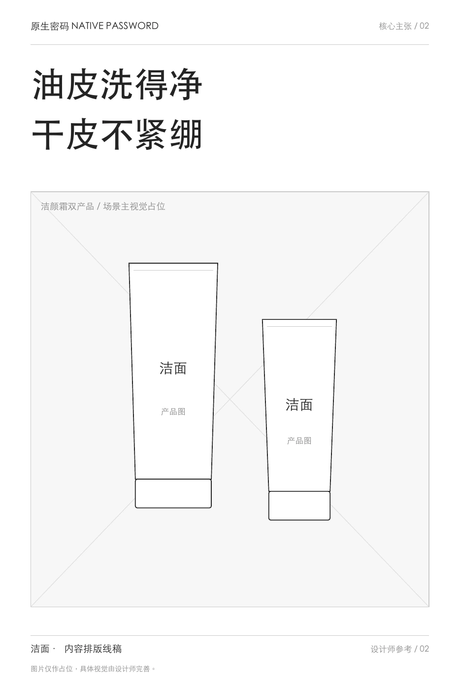
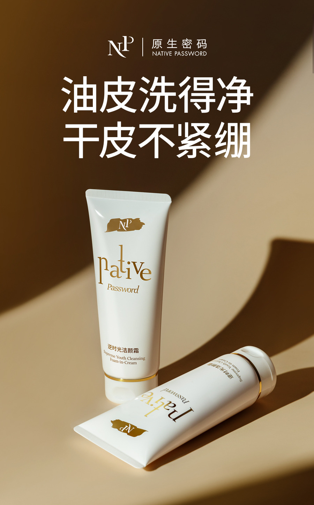
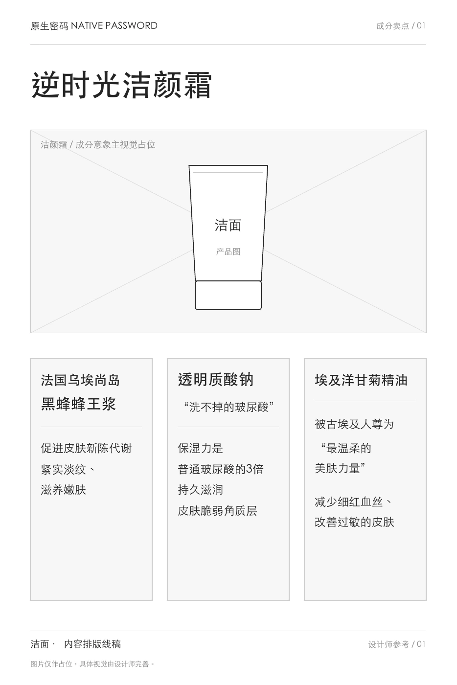
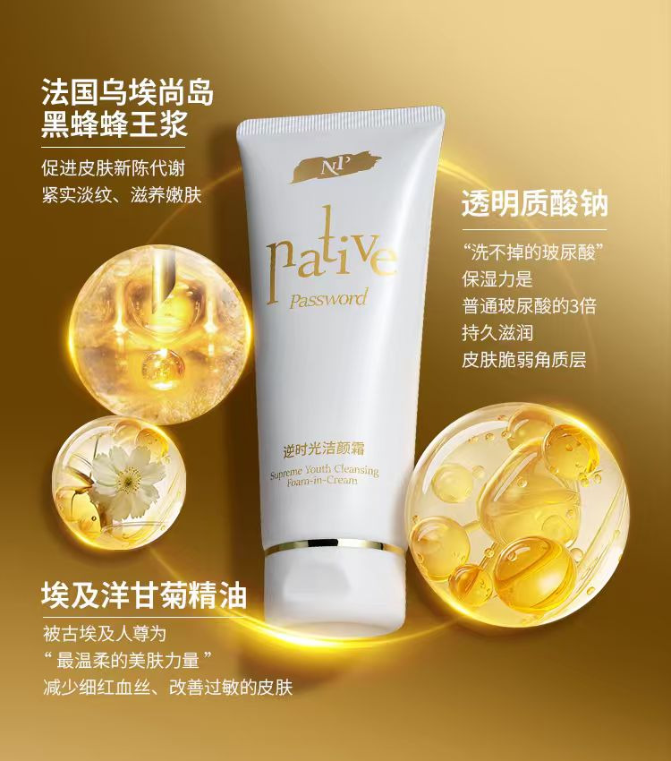
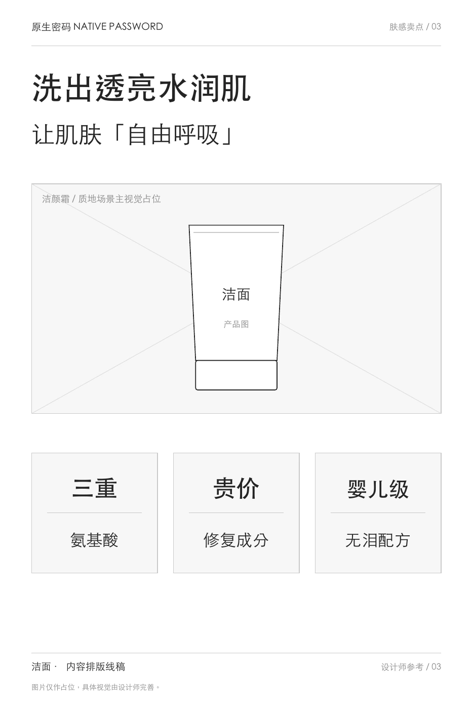
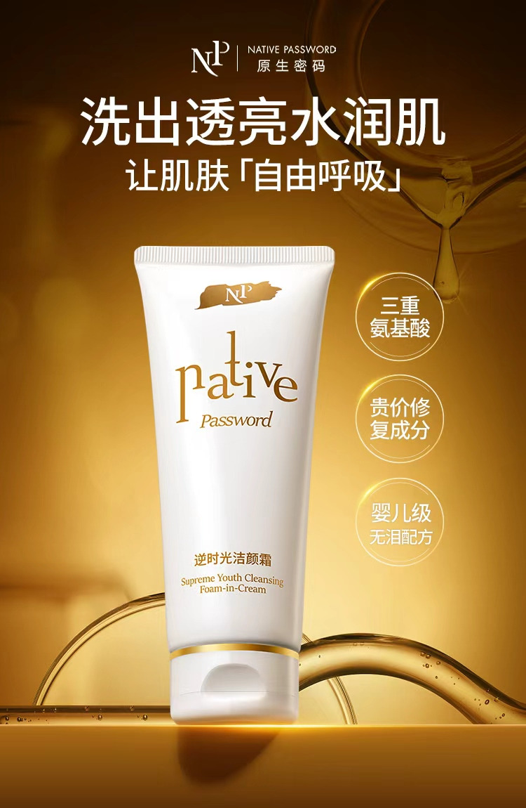

# 原版：逆时光洁颜霜（完整正文还原）

> 固定来源：`c9fc45a4417e7a8cfca30cc6536adcbaa66bcfe0`，原路由：`#/project/clean`。从原版现有渲染结果转录，不是重新撰写的页面稿；原有事实表述保留原样，不等于本轮已重新核实。图片引用原件，视频保留文件入口；折叠内容在此全部展开。Markdown 内章节导航回到对应全文，原版章节跳转与视觉表现见 UI/UX 基线。

[← 全部项目](../works.md)   / CASE 04

产品价值 · 清洁力与肤感

# 逆时光洁颜霜： 把清洁力与肤感讲清楚

围绕清洁力与温和性的双重需求，完成卖点提炼、上新长文、系列海报文案与内容线稿，安排不同卖点的信息层级。

**80万+** 上新 GMV

[项目概览](cleanser.md)  [策划主线](cleanser.md)  [海报线稿](cleanser.md)  [补充作品](cleanser.md)  [项目成果](cleanser.md)

01 / THE BRIEF

## 项目任务与我的职责

这是我早期独立完成内容营销的产品之一。围绕清洁力与温和性的双重需求，把配方、肤感与使用场景转化为上新文章和海报短文案。

 需要解决的问题

消费者既担心洗不净，也担心洗后紧绷。产品需要一句容易记忆的表达，直接回应这两类常见顾虑。

MY CONTRIBUTION

### 产品内容策划／文案

- 独立完成产品卖点提炼与传播表达

- 上新公众号内容策划与文案

- 系列产品海报内容策划与文案输出

- 产品海报内容排版线稿与信息层级规划

本人职责为卖点与整体内容。产品配方、研发及测试来自产品资料，摄影与视觉设计未计入个人已确认职责。

02 / CONTENT THINKING

## 策划主线：先选择重点，再组织表达。

01

### 直接回应两类顾虑

把清洁力与洗后感受放在同一句话里，形成易理解的产品记忆。

> “油皮洗得净，干皮不紧绷”

02

### 让资料变成具体体验

围绕“可以睁眼洗”的历史传播表达建立温和性记忆，再将洗卸合一连接到日常清洁场景。

03

### 为不同篇幅选择信息

长文展开配方、护理与使用信息，海报分别聚焦清洁感和水润感，形成相互对应的内容。

03 / CONTENT STRUCTURE

## 海报线稿｜从内容结构到视觉成品

围绕清洁与洗后感受，我将产品信息组织为主海报、成分分组和肤感表达三种内容。主展示核心主张的文案与结构，另外两组展开查看，保持这个补充案例简洁。

核心主张、成分分组与肤感表达  本人：文案与内容线稿  视觉制作：未计入个人职责

[查看3页简版线稿 PDF ↗](../../../portfolio-content/skincare-wireframes/cleanser/cleanser-content-wireframes.pdf)

01 / 核心主张

### 把两类使用顾虑，压缩成一句产品记忆。

围绕洗不净与洗后紧绷两类顾虑，确定主海报先讲什么，让读者快速理解产品希望回应的问题。

01 / CONTENT STRUCTURE **内容排版线稿**

简版线稿 PDF · 第2页

02 / FINISHED POSTER **海报成品**

文案与内容线稿：孙岩萍

信息结构

用“油皮洗得净，干皮不紧绷”组织对称的两行标题，同时安排清洁与洗后感受两个重点。其余空间留给产品画面，避免继续叠加次要信息。

线稿与成品对照

简版线稿明确标题与双产品主视觉的关系；成品通过字号、陈列和光影强化观看重点。本组展示的是文案取舍与信息主次。

- 取舍：主海报集中表达一个核心理由

- 句式：清洁与洗后感受相互对应

- 层级：主标题与产品画面形成主次

#### 补充查看 2 组：成分分组、肤感表达

> 转录说明：此组在原版默认折叠，以下完整保留。

02 / 成分分组

### 把成分名称与说明，拆成三组对应信息。

为产品资料安排阅读层次，让每组成分信息各有明确的位置和说明。

01 / CONTENT STRUCTURE **内容排版线稿**

简版线稿 PDF · 第1页

02 / FINISHED POSTER **海报成品**

文案与内容线稿：孙岩萍

信息结构

将三组成分分别组织为名称与配套短说明，另为产品和成分意象预留画面位置，让较长资料不挤在同一段中。

线稿与成品对照

简版线稿先把三组文案分开；成品围绕产品安排成分意象和说明，通过位置与分隔线保持对应关系。分析关注内容分组，图内历史表述按原作保留。

- 分组：每个成分名对应一组说明

- 主次：产品与成分信息分别安排

- 对应：文字和画面能逐组辨认

03 / 肤感表达

### 先表达洗后感受，再用短标签补充信息。

将肤感相关主张与配方信息分层，让一张海报既有记忆表达，也保留简短的介绍入口。

01 / CONTENT STRUCTURE **内容排版线稿**

简版线稿 PDF · 第3页

02 / FINISHED POSTER **海报成品**

文案与内容线稿：孙岩萍

信息结构

用两行主标题表达洗后感受，将配方相关信息压缩为三个短标签，与产品和质地画面区分。

线稿与成品对照

简版线稿将标题、产品占位和三个标签分区；成品以主产品、质地意象及侧边圆形标签建立阅读关系。原图中的限定与描述按历史作品保留。

- 入口：标题先表达使用感受

- 补充：三个标签集中排列

- 图文：产品、质地与文字分工

简版线稿用于展示文案与信息层级，成品保留历史作品表达；结构说明依据现有材料整理。图中功效、数字及用户反馈未作本次独立核验，也不作为海报的销售归因数据。展示顺序按内容任务整理。

04 / SELECTED WORK

## 补充作品｜上新长文与清洁表达

公众号通过标题、清洁顾虑、配方解释、养肤体验与使用方式建立完整介绍。系列海报的主要表达已在上方线稿模块中对照展示。

另保留一张围绕清洁感的补充海报，供展开查阅；以下说明依据现有作品作内容归纳。

[查看完整公众号 · 30页 PDF](../../../portfolio-content/cleanser/assets/wechat/cleanser-launch-article.pdf)  [补充查看清洁感海报 · 原图](../../../portfolio-content/cleanser/assets/posters/cleanser-cleansing.jpg)

PROJECT OUTCOME

**80万+** 上新 GMV

将产品资料组织为清晰的传播表达，再按长文与海报的阅读方式选择信息，完成一次新品上市内容交付。

项目上新整体销售结果，统计时长未作额外限定。

图文与视频保留历史作品中的传播表达；本页聚焦内容组织与策划方法。项目 GMV 为整体成果，未作单条内容或个人销售归因。策略说明依据已确认职责及现有作品整理。

[← 返回全部项目](../works.md)  [下一个案例 / 05

**酷狗音乐**](kugou.md)
