# 原版：酷狗音乐（完整正文还原）

> 固定来源：`c9fc45a4417e7a8cfca30cc6536adcbaa66bcfe0`，原路由：`#/project/kugou`。从原版现有渲染结果转录，不是重新撰写的页面稿；原有事实表述保留原样，不等于本轮已重新核实。图片引用原件，视频保留文件入口；折叠内容在此全部展开。Markdown 内章节导航回到对应全文，原版章节跳转与视觉表现见 UI/UX 基线。

[← 全部项目](../works.md)   / CASE 05

团队协作 · 平台与资源统筹

# 酷狗音乐： 从内容策划到多平台协同

独立负责微博内容与活动，管理两名专员并统筹内容审核；协调产品与 APP 运营资源，连接客户端拉新与促活。

**200万+** 客户端引流 · 拉新及促活

[项目概览](kugou.md)  [策划主线](kugou.md)  [主案例](kugou.md)  [小红书](kugou.md)  [抖音](kugou.md)  [微信渠道](kugou.md)  [精选补充](kugou.md)  [项目成果](kugou.md)

01 / THE BRIEF

## 项目任务与我的职责

独立负责微博内容与活动策划执行，统筹抖音、小红书、视频号等平台内容，审核脚本并管理2位专员。根据平台特点组织音乐、品牌活动与产品功能内容，推进站外向客户端拉新促活。

 需要解决的问题

账号已有品牌积累、增粉趋缓，内容需要进一步服务客户端业务目标。关键是找到站外兴趣与站内行为之间可以衔接的入口，并为用户提供参与动力。

MY CONTRIBUTION

### 内容与活动策划／多平台统筹

- 独立策划微博内容与活动并执行

- 提出微博跳转合作思路，沟通资源与产品、APP运营团队

- 发糖机等引流活动的策划与推进

- 统筹其他平台内容与脚本审核，管理2位专员

- 站内电台栏目的整体策划、主题内容及站外推广

专员负责相关内容制作与视频剪辑；技术开发由产品等团队完成。电台协同版权与电台运营团队推进。

02 / CONTENT THINKING

## 策划主线：先选择重点，再组织表达。

01

### 把站外兴趣接到客户端

提出跳转合作思路，通过音乐链接和活动入口，衔接下载或拉起客户端的路径，跨部门推进落地。

02

### 围绕粉丝习惯设计参与

研究签到、打榜、盖楼等行为，以艺人节点和福利设计可复用活动，后续形成月度固定的发糖机。

03

### 用具体场景表达功能

将音效放入热门音乐现场，将电台放进睡前陪伴场景，让用户先理解体验，再接触产品功能。

03 / SELECTED WORK

## 主案例｜微博向客户端引流与发糖机

在合作方案与跨部门推进基础上，用音乐链接、活动入口及搜索口令承接粉丝兴趣。个人贡献在方案、资源沟通和活动策划。

发糖机围绕艺人节点与粉丝福利设计可复用H5，协调产品、设计落地，通过A/B内容测试持续关注参与门槛、福利、主题与转化。代表期次为时代少年团“三时有声”周年企划。

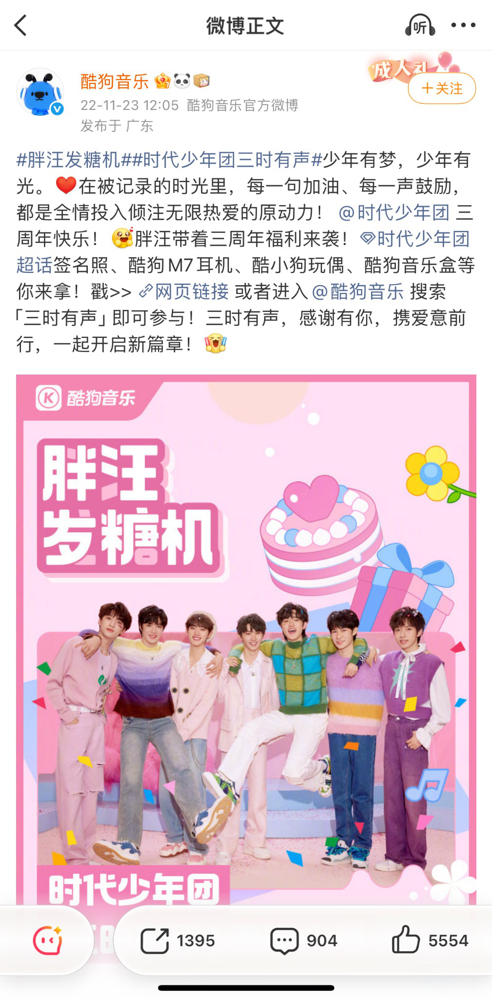

活动微博｜链接与搜索口令双入口

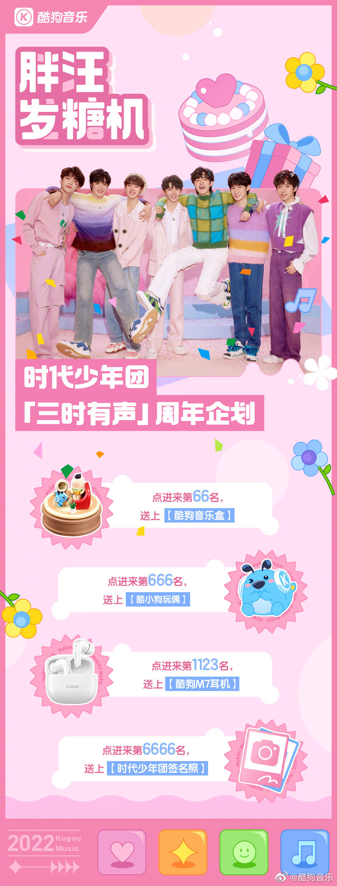

活动长图｜指定参与序号对应奖励

**8万人次** 发糖机累计参与

**2.2万人次** 发糖机拉新及促活

发糖机活动历史阶段成果，非单期时代少年团成绩；不与整体引流数据相加。

04 / SELECTED WORK

## 小红书｜从活动机制到用户表达

鹿晗直播票根活动以“预约直播 → 保存截图 → 带话题发笔记 → 参与抽奖”组织参与。相关话题截图时点累计浏览16.8万次。

歌曲宣发与音效征集则围绕用户场景组织内容，让产品功能进入官号之外的用户表达。日常内容以统筹和审核为主。

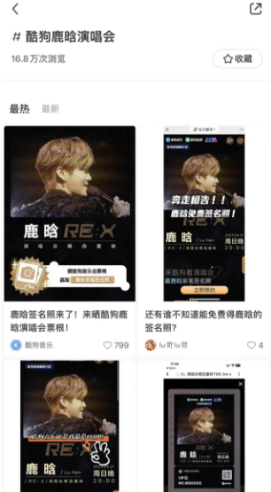

鹿晗活动话题｜16.8万次累计浏览

截图时点，非独立新增曝光或新增预约量

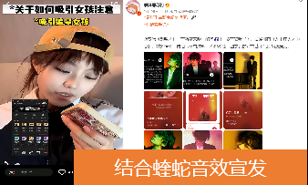

音效征集｜用户内容节选

05 / SELECTED WORK

## 抖音｜用音乐现场表达音效体验

以热门Live和蝰蛇音效结合，让抽象功能进入具体的听觉场景。负责内容统筹、选题与脚本审核，专员制作剪辑。

演唱会音效合集截图显示1763万播放、48集。此处提供历史作品截图，素材中未包含可播放原片。

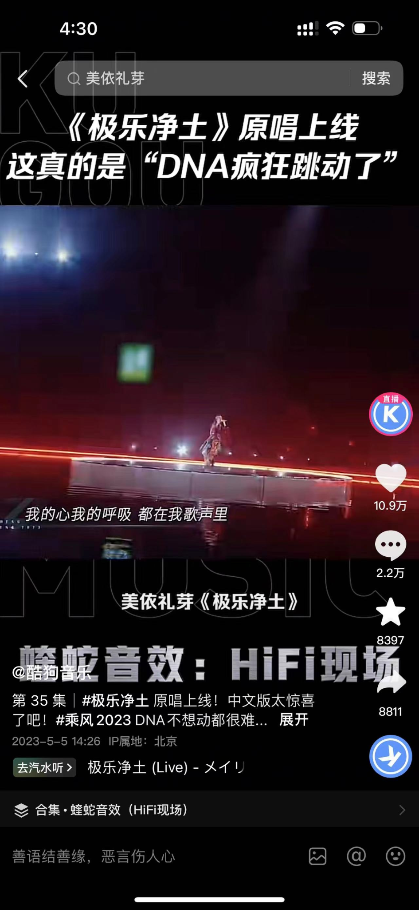

极乐净土｜现场内容与音效结合

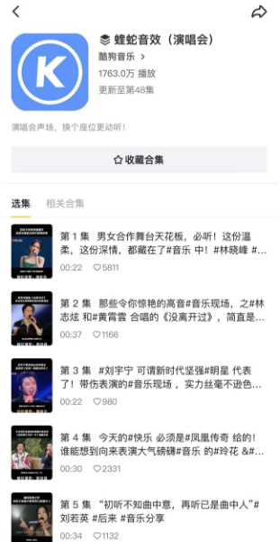

演唱会音效合集｜1763万播放、48集

截图时点的合集数据

06 / SELECTED WORK

## 微信渠道｜定位调整与从0到1

公众号从纯音乐内容转向“音乐内容＋产品功能”，通过人物、新歌或专辑进入，再承接音效介绍、设置与收听引导。代表文章截图显示阅读10万+。

视频号从0到1起步，持续发布新歌与热点现场Live。列表中两条爱心互动10万+，按互动量呈现。

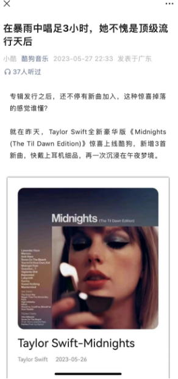

公众号开篇｜用音乐建立兴趣

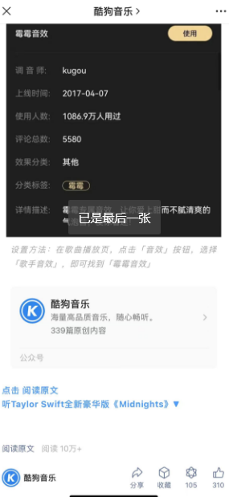

功能与收听引导｜代表文章阅读10万+

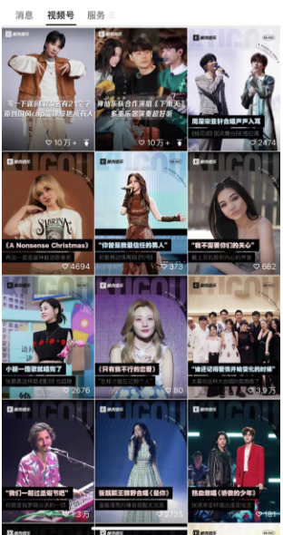

视频号内容列表｜代表内容互动10万+

07 / SELECTED WORK

## 精选补充｜入梦晚安电台

围绕睡前陪伴场景，将艺人介绍、歌词分享、延伸祝愿与晚安收尾组织为3分钟内音频；方案安排每周二、周四22:30更新。

负责整体策划、主题内容与站外推广。版权团队沟通艺人录制，电台运营配合站内推广，通过资源协作推进持续内容上线。

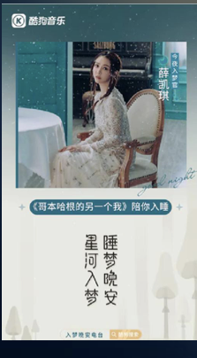

薛凯琪｜晚安电台海报

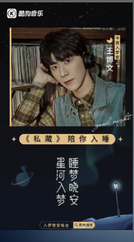

于文文｜晚安电台海报

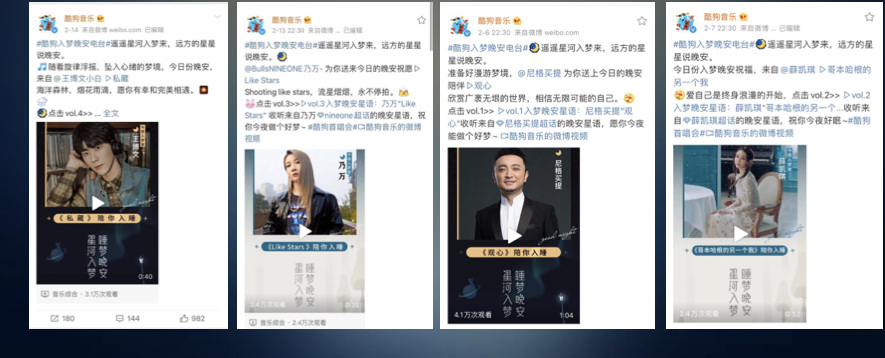

站外推广｜官方微博节选

**26期** 已上线内容

**84万** 站内播放

历史项目总结记录，统计周期待确认。

PROJECT OUTCOME

**200万+** 客户端引流 · 拉新及促活

从音乐内容、粉丝活动到产品功能与站内栏目，把内容策划与业务目标连接起来；通过独立策划、跨部门沟通及多平台统筹，推进内容与活动持续落地。

本人确认的历史项目口径，不含单纯访问。纯拉新21万另列；统计周期与包含关系待核实，两项不相加。

历史作品与截图按原貌展示。各项成果保留对应的平台、活动及统计范围；个人策划、统筹审核和团队制作职责分别说明。

[← 返回全部项目](../works.md)  [下一个案例 / 01

**日夜精华油**](oil.md)
