# 原版：童颜面膜（完整正文还原）

> 固定来源：`c9fc45a4417e7a8cfca30cc6536adcbaa66bcfe0`，原路由：`#/project/mask`。从原版现有渲染结果转录，不是重新撰写的页面稿；原有事实表述保留原样，不等于本轮已重新核实。图片引用原件，视频保留文件入口；折叠内容在此全部展开。Markdown 内章节导航回到对应全文，原版章节跳转与视觉表现见 UI/UX 基线。

[← 全部项目](../works.md)   / CASE 03

产品升级 · 复杂信息梳理

# 童颜面膜： 在旧品认知上讲清升级价值

承接王牌产品认知，梳理新增卖点、双膜组合与使用步骤，将升级理由延展到图文、视频、直播话术与详情页。

**100万+** 上新 GMV

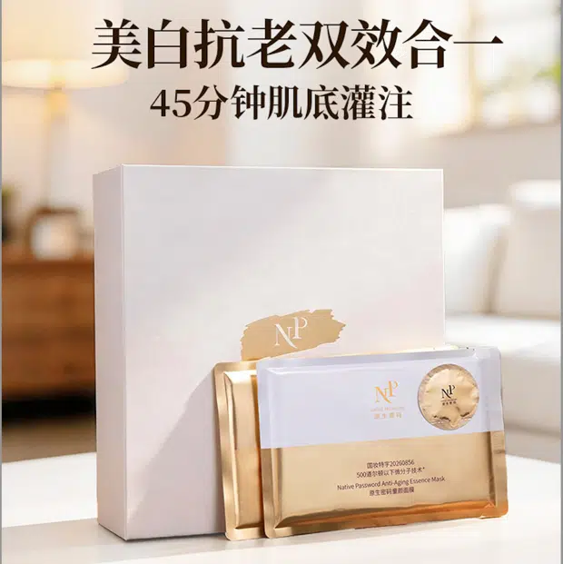

[项目概览](mask.md)  [策划主线](mask.md)  [海报线稿](mask.md)  [公众号](mask.md)  [朋友圈](mask.md)  [直播讲解](mask.md)  [商城详情页](mask.md)  [视频脚本](mask.md)  [项目成果](mask.md)

01 / THE BRIEF

## 项目任务与我的职责

童颜面膜是在品牌王牌胶原炮面膜基础上升级的产品。旧品已有成熟认知，我负责承接原有信任，讲清新增护理方向与体验，为用户理解和考虑新版提供内容。

 需要解决的问题

产品升级不能只罗列新增成分。内容需要解释继承了什么、增加了什么，以及这些变化为什么值得用户关注。

MY CONTRIBUTION

### 产品卖点与多渠道内容策划

- 制定升级卖点及私域种草内容

- 独立完成公众号标题、正文与图内文案

- 产品海报的图内文案与内容排版线稿

- 朋友圈配文、图内文案及信息顺序

- 一条明星合作、两条达人视频完整脚本与沟通

- 参与直播话术讨论，制定产品讲解内容

- 淘宝／天猫详情页整页文案与结构

图文视觉设计制作由设计师完成。直播部分为产品讲解话术，不将整场主播稿或直播运营计入个人职责。

02 / CONTENT THINKING

## 策划主线：先选择重点，再组织表达。

01

### 用观点组织配方信息

从抗氧化资料中提炼一个便于讲述的观点，再用漏水水桶的比喻解释护理思路。

> “先停龄，再抗老”

02

### 用熟悉认知承接升级

延续旧品的胶原护理和透皮技术认知，展开新版美白、护理组合及使用体验，减少重新理解产品的成本。

03

### 把新增价值落到选择

通过同价升级与45分钟居家护理体验，将科技、成分和组件组织成用户可以理解的选择理由。

03 / CONTENT STRUCTURE

## 海报线稿｜从内容结构到视觉成品

我将需求设问、双膜信息和成分内容拆成不同海报主题，规划标题、分区及图文对应关系。主展示问题切入与双膜信息两组，成分分组和资料展示作为补充展开。

产品价值、双膜信息与成分分组  本人：文案与内容线稿  设计师：视觉设计与制作

[查看4页简版线稿 PDF ↗](../../../portfolio-content/skincare-wireframes/tongyan-mask/mask-content-wireframes.pdf)

01 / 问题切入

### 先用问题建立入口，再用对照组织阅读。

围绕护理效果的疑问组织一张对照型海报，集中呈现产品希望沟通的差异化信息。

01 / CONTENT STRUCTURE **内容排版线稿**

简版线稿 PDF · 第1页

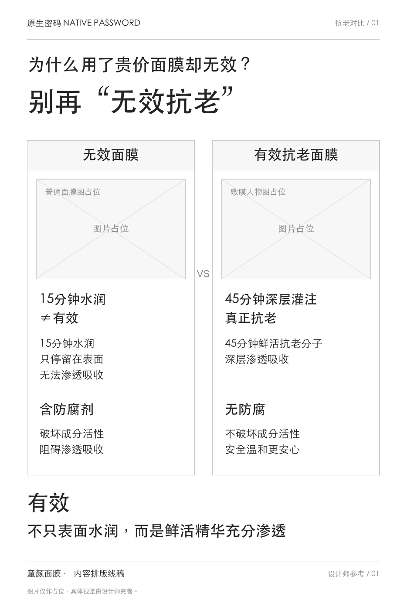

02 / FINISHED POSTER **海报成品**

文案与线稿：孙岩萍 · 视觉设计：设计师

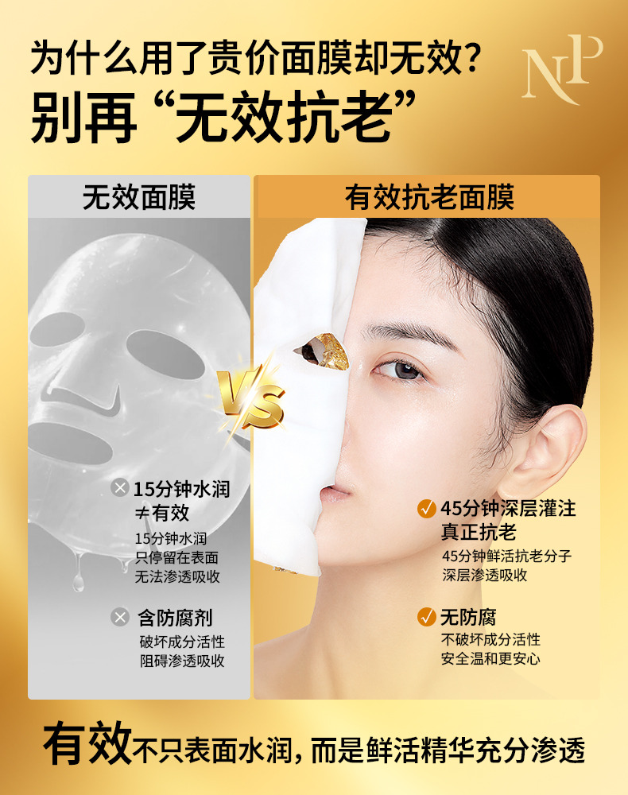

信息结构

标题先提出问题，主体划分两个对照区，各自安排名称、图片和说明，底部再归纳主张。线稿明确哪些信息需要成组呈现，让读者能够按相同维度对照浏览。

线稿与成品对照

成品通过不同底色、面膜与人物画面，以及勾叉等视觉标记强化分区。这里展示的是设问、对照与收束的内容结构，历史海报中的判断性表达按原作保留。

- 入口：标题先提出护理疑问

- 对照：同一维度的信息成组出现

- 收束：底部短句概括沟通主张

02 / 双膜信息

### 把双膜拆成两个信息组，讲清产品组合。

将白膜与金膜分别呈现，让一个组合产品中的不同组件各有名称、主张与说明。

01 / CONTENT STRUCTURE **内容排版线稿**

简版线稿 PDF · 第3页

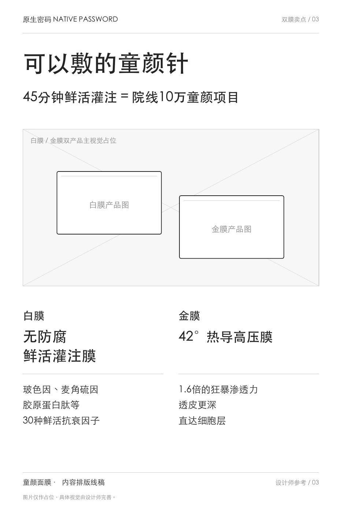

02 / FINISHED POSTER **海报成品**

文案与线稿：孙岩萍 · 视觉设计：设计师

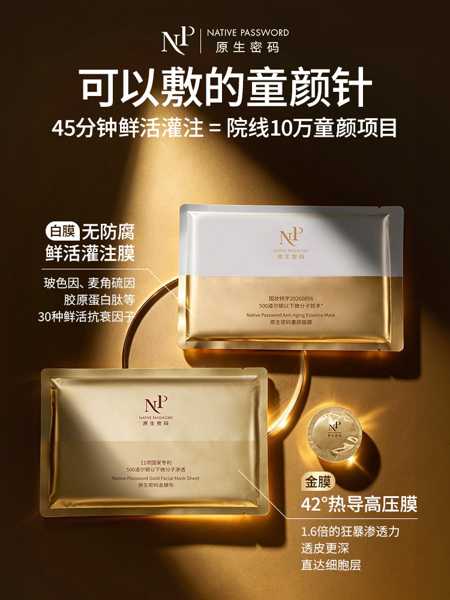

信息结构

先安排总标题，再为白膜和金膜分别组织名称、核心表达与补充说明。线稿预留双产品画面，并明确文字与对应组件的关系。

线稿与成品对照

成品以两款产品的位置、文字分区与引线建立对应关系，让读者可以辨认每组信息归属哪一个组件。本人负责文案及内容结构，设计师完成视觉设计与制作。

- 识别：白膜与金膜分别命名

- 分组：主张与说明归入对应组件

- 对应：引线连接产品与文字

#### 补充查看 2 组：成分分组、资料展示

> 转录说明：此组在原版默认折叠，以下完整保留。

03 / 成分分组

### 用角色标签，把两组成分分开讲。

为成分较多的内容建立分组方式，使总主张、成分名称与说明形成清楚层次。

01 / CONTENT STRUCTURE **内容排版线稿**

简版线稿 PDF · 第2页

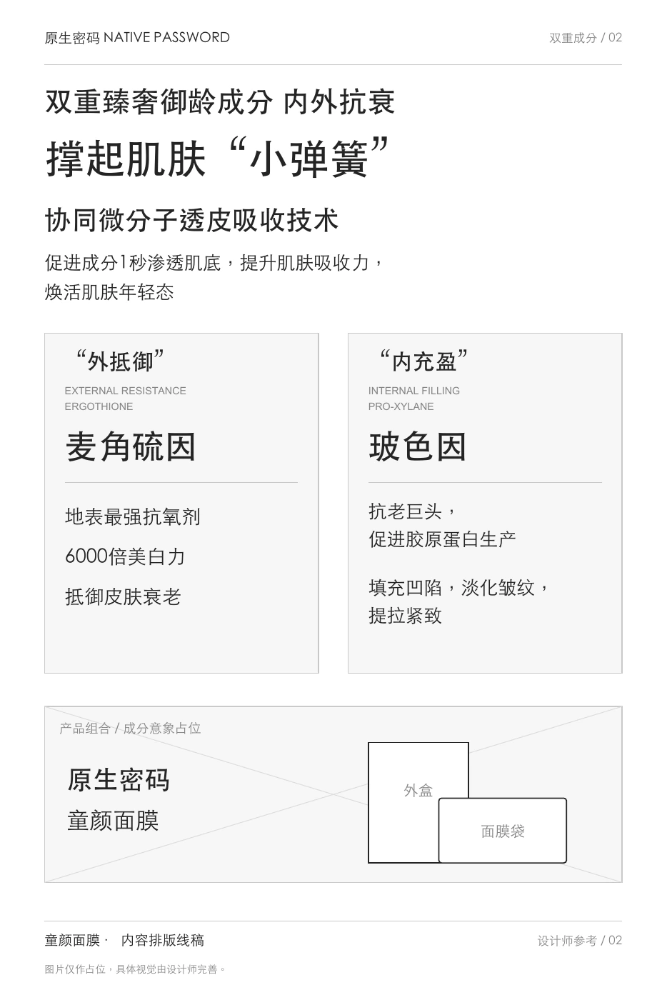

02 / FINISHED POSTER **海报成品**

文案与线稿：孙岩萍 · 视觉设计：设计师

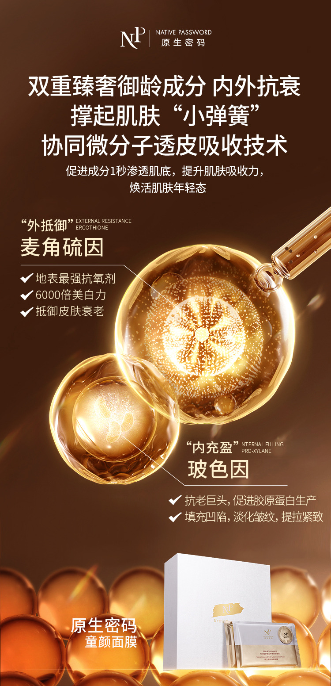

信息结构

先给出整体主张，再以历史传播中的“外抵御”和“内充盈”两个标签组织成分名与配套说明，另外安排技术介绍和产品组合位置。

线稿与成品对照

线稿用两个文字区说明内容分工；成品通过成分意象、字号与连线强化分组。分析关注信息组织，未据历史角色标签验证作用部位或功效。

- 主次：总主张与成分说明分层

- 标签：两组成分各有表达入口

- 图文：成分意象连接对应文字

04 / 资料展示

### 把不同资料分区，让图片与说明对应。

将报告、查询截图、产品与前后图片组织到一张海报中，展示资料型内容的版式安排。

01 / CONTENT STRUCTURE **内容排版线稿**

简版线稿 PDF · 第4页

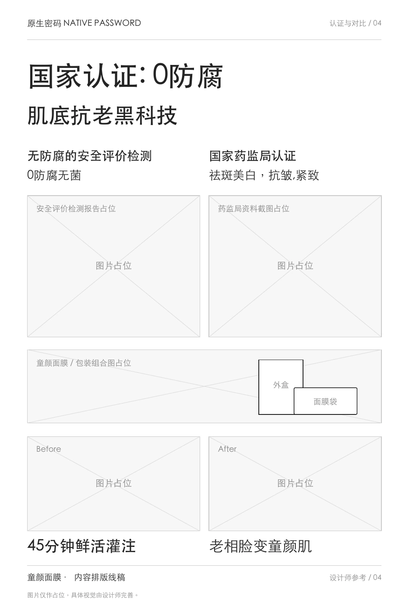

02 / FINISHED POSTER **海报成品**

文案与线稿：孙岩萍 · 视觉设计：设计师

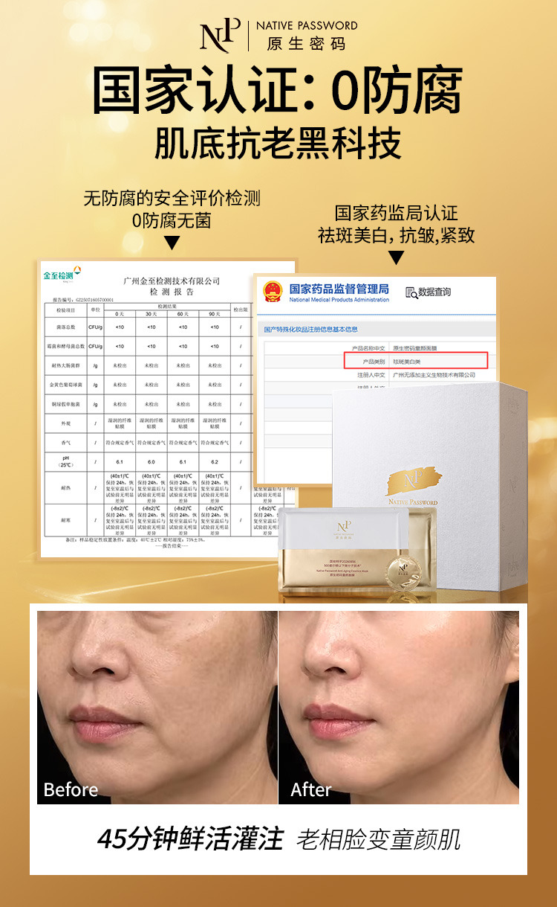

信息结构

上方安排总标题，中部为两类资料设置各自的说明和截图位置，再加入产品组合，底部独立放置前后图及收尾文字。

线稿与成品对照

成品通过截图边框、箭头、产品叠放与底部独立区域组织资料。标题和反馈按历史作品保留，本节说明资料与文案的对应关系。

- 来源：不同截图分别设置说明

- 层级：资料、产品与前后图区分

- 配对：文字与对应画面放在一起

简版线稿用于展示文案与信息层级，成品保留历史作品表达；结构说明依据现有材料整理。图中功效、数字及用户反馈未作本次独立核验，也不作为海报的销售归因数据。展示顺序按内容任务整理。

04 / SELECTED WORK

## 公众号｜建立完整的新版产品认知

独立完成标题、结构、正文、图内文案与文字排版方案。文章从护理话题进入，串联双膜、45分钟护理、抗氧、美白、胶原护理、面霜和首发套组。

主展示双膜结构和成分分组，呈现如何把多个组件与复杂资料安排成有层次的阅读内容。

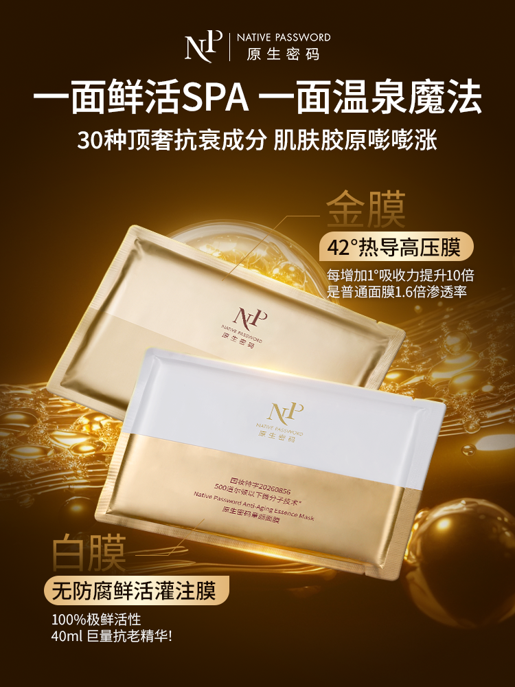

双膜结构｜拆清组件与使用顺序

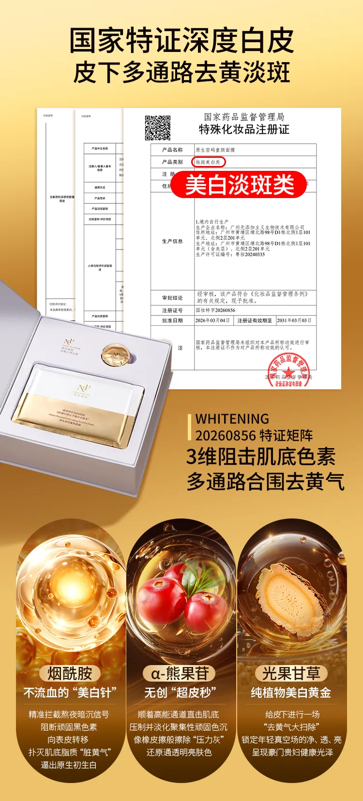

美白信息｜成分与护理利益分组

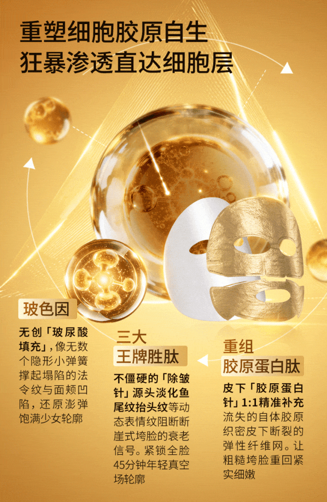

胶原护理｜组织多组成分信息

[查看完整公众号 · 31页 PDF](../../../portfolio-content/tongyan-mask/assets/wechat/mask-launch-article.pdf)

05 / SELECTED WORK

## 朋友圈｜三个主题，拆开升级理由

分别围绕新旧差异、安心美白与效果诉求组织原始图文。配文提出观点，图片补充信息，每组各有一个阅读重点。

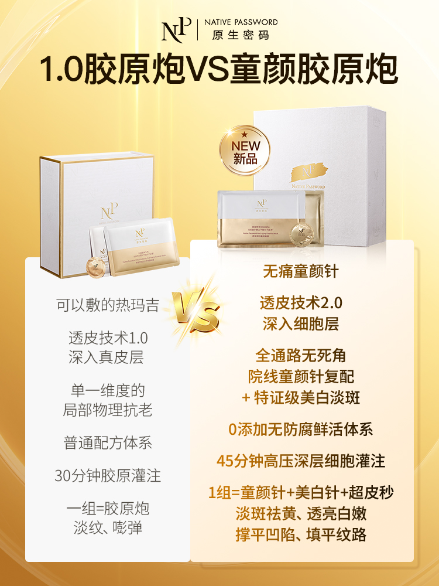

升级差异｜新旧对比

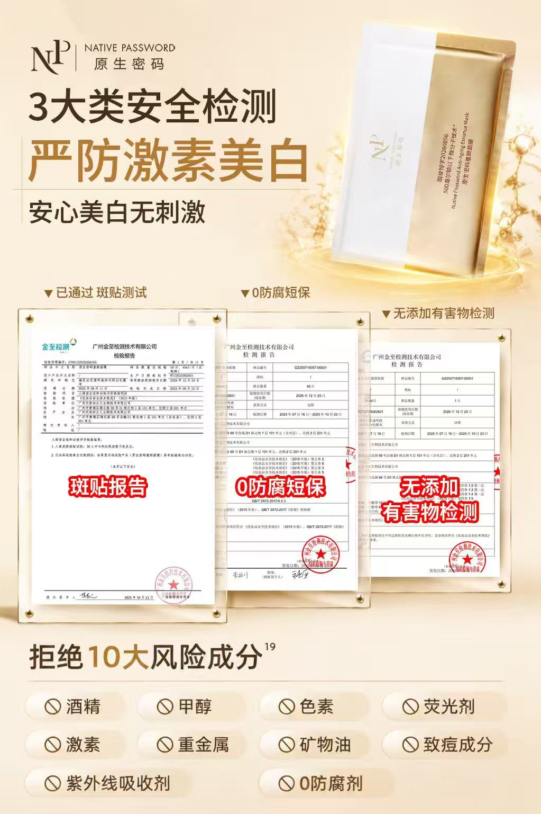

安心美白｜回应使用顾虑

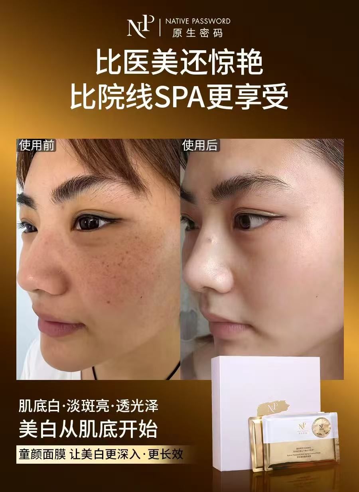

效果诉求｜直观表达护理利益

06 / SELECTED WORK

## 直播讲解｜让抽象信息跟得上、听得懂

参与话术讨论并制定产品讲解内容。用新旧对比、葡萄与葡萄干等生活比喻、演示安排与观察提示，降低实时讲解的理解门槛。

现有图片为主播实际表达的文字记录截图，用于说明讲解结构；并非完整历史交付稿。

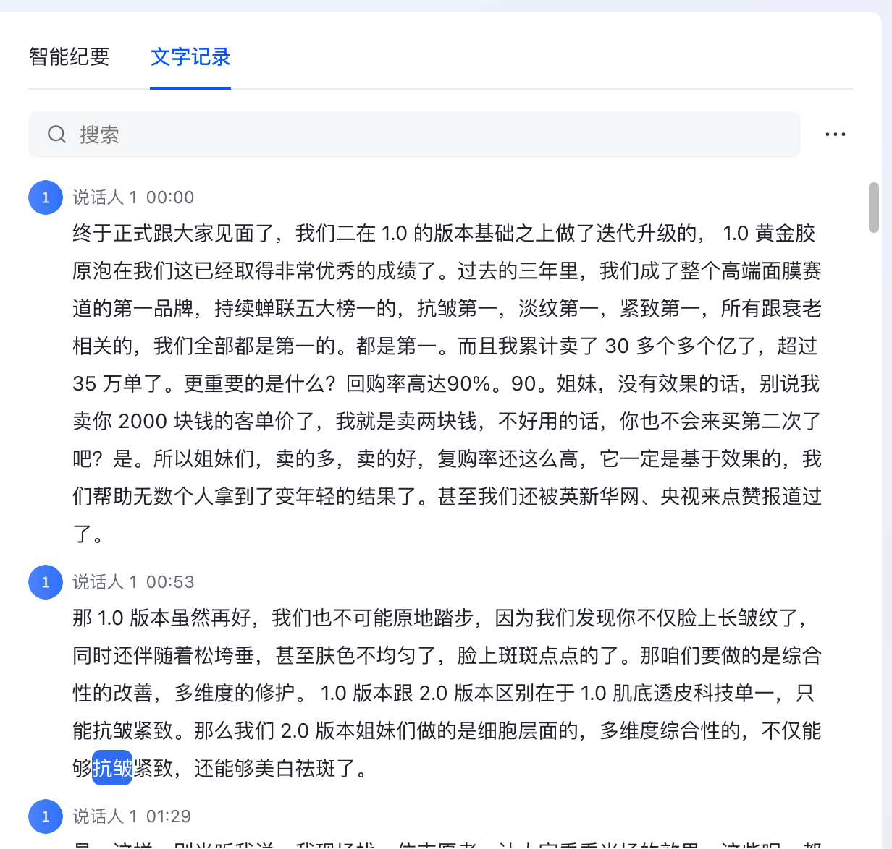

升级讲解｜从需求带出新版

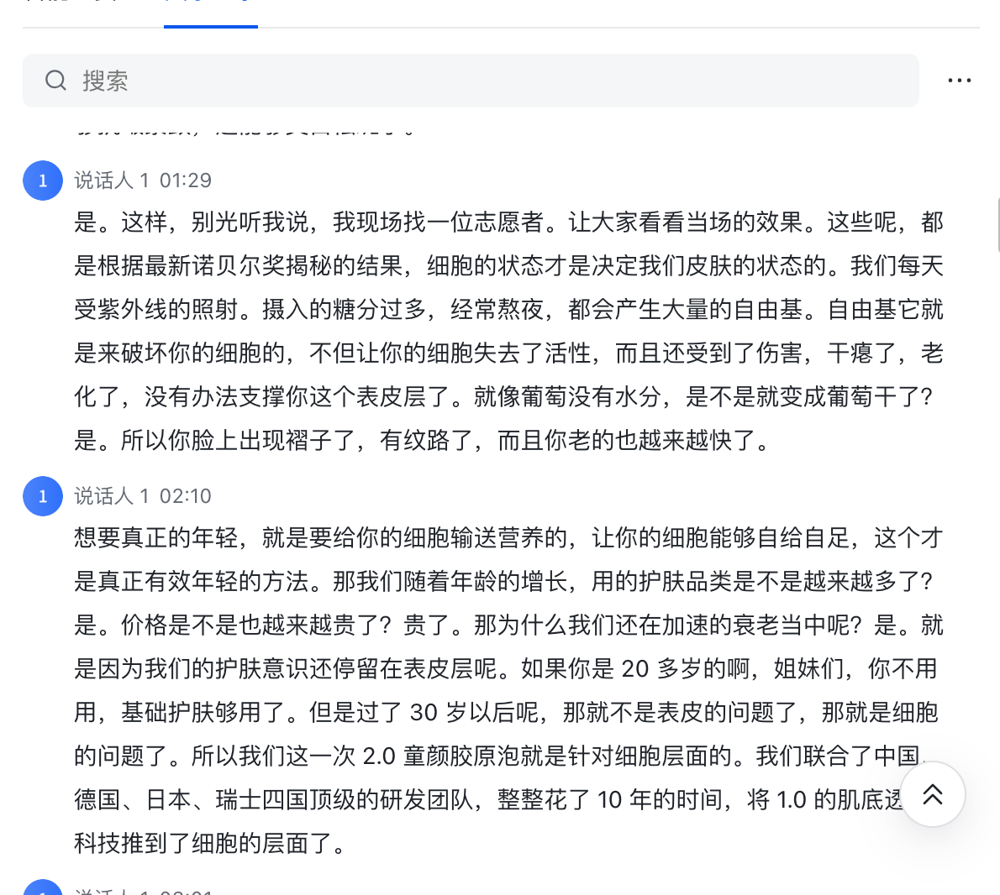

生活类比｜葡萄与葡萄干

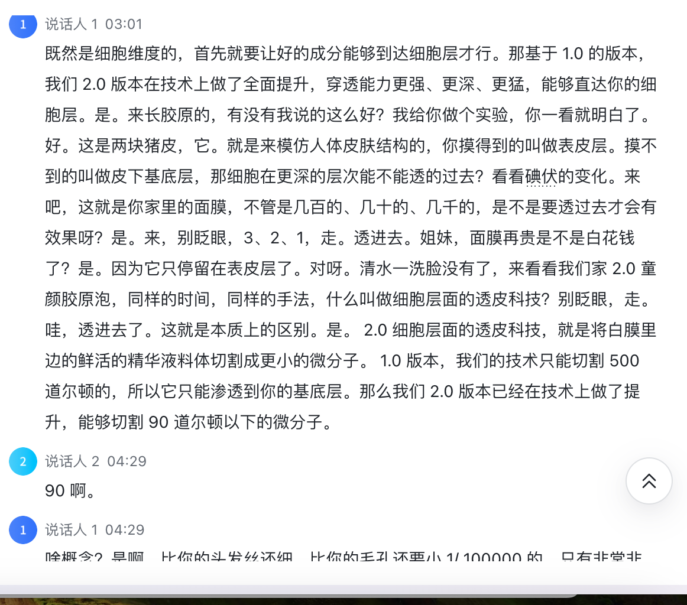

演示安排｜让观众有观察重点

07 / SELECTED WORK

## 商城详情页｜把升级信息组织成连续阅读

负责整页文案、内容结构与信息顺序。页面依次安排需求引入、新旧对比、技术及组件、成分分组、资料与用法，支持用户自主了解和比较。

完整详情页 · 上段

点击查看原尺寸

完整详情页 · 下段

点击查看原尺寸

08 / VIDEO SCRIPTS

## 视频脚本｜同一主线，不同讲述方式

三条视频均为本人撰写完整脚本。公开视频保留原时间轴，已处理个人通知及外围录屏界面。

[播放原视频：骆达华合作｜从人物故事自然转场](../../../portfolio-content/tongyan-mask/assets/videos/mask-luodahua-preview.mp4)

### 骆达华合作｜从人物故事自然转场

完整脚本撰写。以角色反差与片场状态进入，连接情绪“消耗”与居家护理，再回扣主题。

人物开场  情绪转场  护理场景  首尾呼应

[播放原视频：达人体验｜将护理步骤写进故事](../../../portfolio-content/tongyan-mask/assets/videos/mask-influencer-tutorial-preview.mp4)

### 达人体验｜将护理步骤写进故事

完整脚本撰写，并与达人沟通成片。以个人困扰和护理安排展开，再通过双膜演示解释使用步骤。

个人困扰  护理安排  资料说明  双膜演示

[播放原视频：夫妻日常｜从怀疑走向逐步理解](../../../portfolio-content/tongyan-mask/assets/videos/mask-influencer-story-preview.mp4)

### 夫妻日常｜从怀疑走向逐步理解

完整脚本撰写，并与达人沟通成片。以调侃和疑问制造对话，再通过查阅资料推进认知变化。

日常开场  提出怀疑  资料查证  价值回扣

PROJECT OUTCOME

**100万+** 上新 GMV

围绕升级价值形成一致的卖点表达，再根据长图文、短图文、故事视频、直播讲解与详情页调整信息组织，展示从卖点提炼到多渠道落地的内容策划能力。

项目及渠道共同完成的整体销售结果，使用“上新”口径。

图文与视频保留历史作品中的传播表达；本页聚焦内容组织与策划方法。项目 GMV 为整体成果，未作单条内容或个人销售归因。策略说明依据已确认职责及现有作品整理。

[← 返回全部项目](../works.md)  [下一个案例 / 04

**逆时光洁颜霜**](cleanser.md)
