# 原版：日夜精华油（完整正文还原）

> 固定来源：`c9fc45a4417e7a8cfca30cc6536adcbaa66bcfe0`，原路由：`#/project/oil`。从原版现有渲染结果转录，不是重新撰写的页面稿；原有事实表述保留原样，不等于本轮已重新核实。图片引用原件，视频保留文件入口；折叠内容在此全部展开。Markdown 内章节导航回到对应全文，原版章节跳转与视觉表现见 UI/UX 基线。

[← 全部项目](../works.md)   / CASE 01

复杂产品 · 内容主线

# 日夜精华油： 为双产品建立一条主线

从皮脂膜护理切入，串联“精华入油”与日夜场景，统一公众号、朋友圈、视频与销售沟通的表达。

**460万+** 上市两周 · 私域 GMV

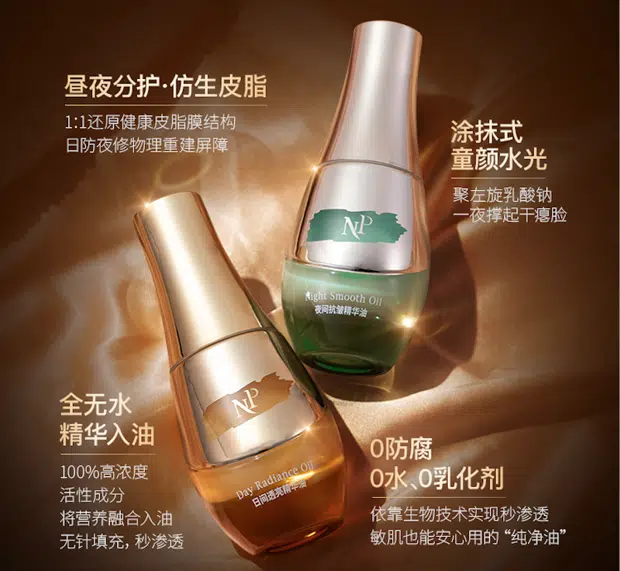

[项目概览](oil.md)  [策划主线](oil.md)  [海报线稿](oil.md)  [公众号](oil.md)  [朋友圈](oil.md)  [销售沟通](oil.md)  [视频脚本](oil.md)  [项目成果](oil.md)

01 / THE BRIEF

## 项目任务与我的职责

品牌已经确定日用、夜用两瓶的产品方案。我负责从产品信息出发，建立消费者能够理解的沟通主线，并把它延展成适合长文、短图文、人物口播与销售问答的内容。

 需要解决的问题

信息很多，但消费者先需要一个理解入口。皮脂膜是什么？为什么把精华和油放在一起？两瓶产品如何融入早晚护理？这些问题决定了内容的讲述顺序。

MY CONTRIBUTION

### 产品内容策划／文案

- 产品卖点梳理，参与成分与沟通重点讨论

- 公众号标题、正文、图内文案与版式规划

- 朋友圈配文、图内文案与信息顺序

- 日夜产品海报的文案与内容排版线稿

- 四条视频脚本及达人沟通调整

- 销售客服话术的内容组织

图文视觉设计由设计师完成；产品研发、规格、定价及包装由相关团队负责。个人贡献为卖点、内容与脚本策划。

02 / CONTENT THINKING

## 策划主线：先选择重点，再组织表达。

01

### 先解释为什么关注

从干燥、紧绷、上妆卡粉等具体困扰进入，以“保护层”的类比解释皮脂膜，让专业概念与日常护理建立联系。

02

### 再提炼一句记忆表达

将精华与油相的产品特点，压缩为可以在标题、短文与口播中持续展开的一句话。

> “表补油，里补精华”

03

### 最后落到日夜场景

在既定双瓶方案下，分别组织日间透亮护理与夜间修护、抗皱护理的沟通重点，让两款产品各有明确的讲述角色。

03 / CONTENT STRUCTURE

## 海报线稿｜从内容结构到视觉成品

在既定日夜双瓶方案下，我把两款产品的沟通重点分别写成海报文案，并通过简版线稿展示标题、卖点与图文关系。两张主展示呈现共同的系列结构和不同的产品角色，资料信息作为补充展开。

日夜产品卖点与资料信息  本人：文案与内容线稿  设计师：视觉设计与制作

[查看3页简版线稿 PDF ↗](../../../portfolio-content/skincare-wireframes/essence-oil/oil-content-wireframes.pdf)

01 / 日间透亮

### 把日间产品，放进提亮与妆前护理场景。

在日夜双瓶方案下，明确日间油的沟通重点，让一张海报能够集中讲述它的使用角色。

01 / CONTENT STRUCTURE **内容排版线稿**

简版线稿 PDF · 第1页

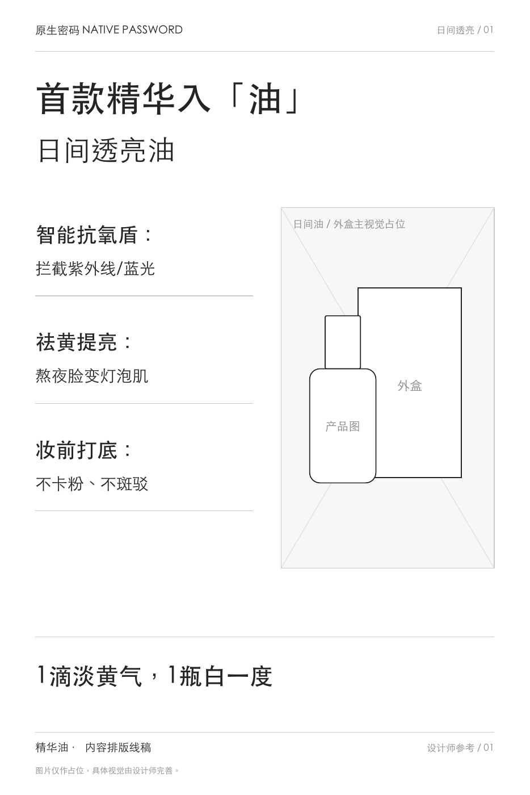

02 / FINISHED POSTER **海报成品**

文案与线稿：孙岩萍 · 视觉设计：设计师

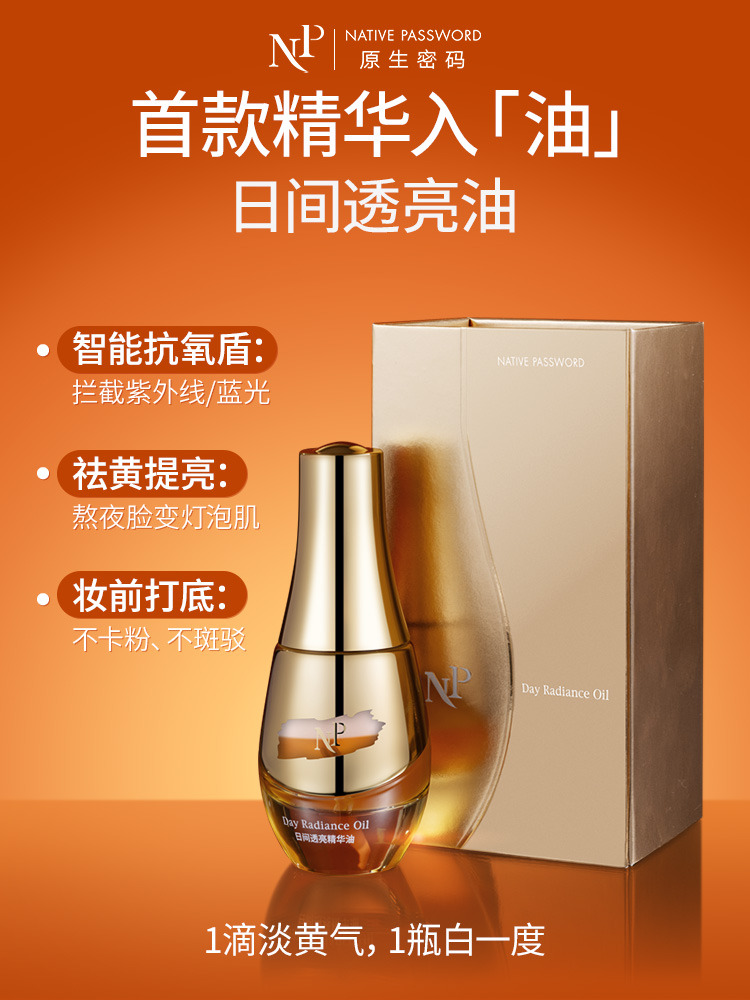

信息结构

先用产品主张与名称建立识别，再将抗氧、提亮、妆前打底分为三组短标签与解释。每组只展开一个方向，文案围绕日间护理与上妆场景组织。

线稿与成品对照

简版线稿划分标题、三组卖点和产品／外盒占位；成品用字号、标签与产品主视觉建立阅读主次，底部短句收束记忆。

- 标题：明确日间油的产品角色

- 卖点：三个主题分别展开

- 场景：连接护理与妆前使用

02 / 夜间修护

### 沿用系列结构，拉开夜间产品的表达重点。

让夜间油与日间油形成可比较的系列内容，同时突出各自的沟通方向。

01 / CONTENT STRUCTURE **内容排版线稿**

简版线稿 PDF · 第2页

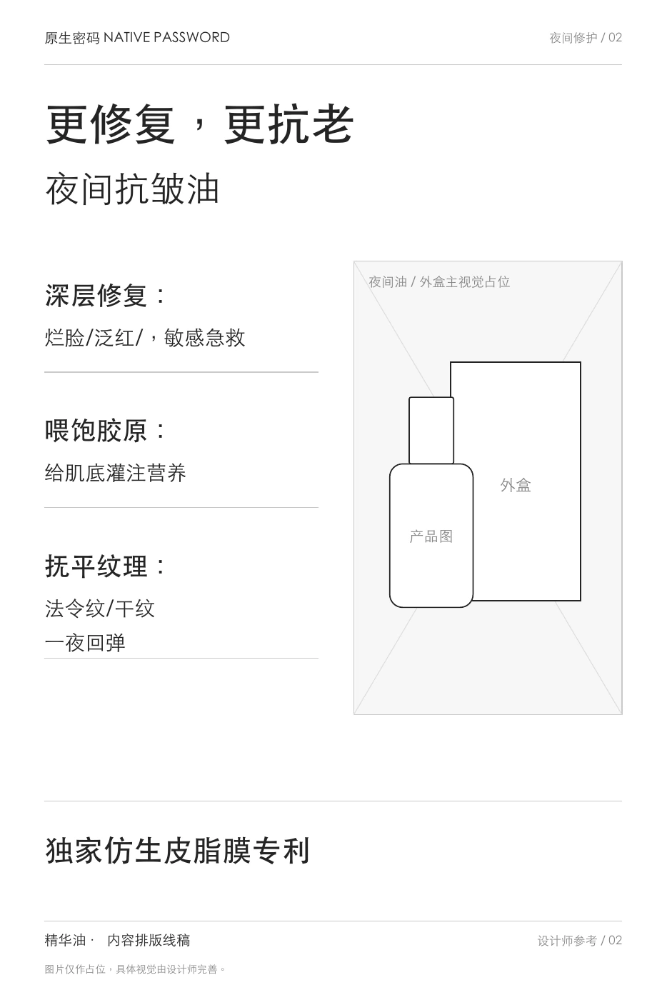

02 / FINISHED POSTER **海报成品**

文案与线稿：孙岩萍 · 视觉设计：设计师

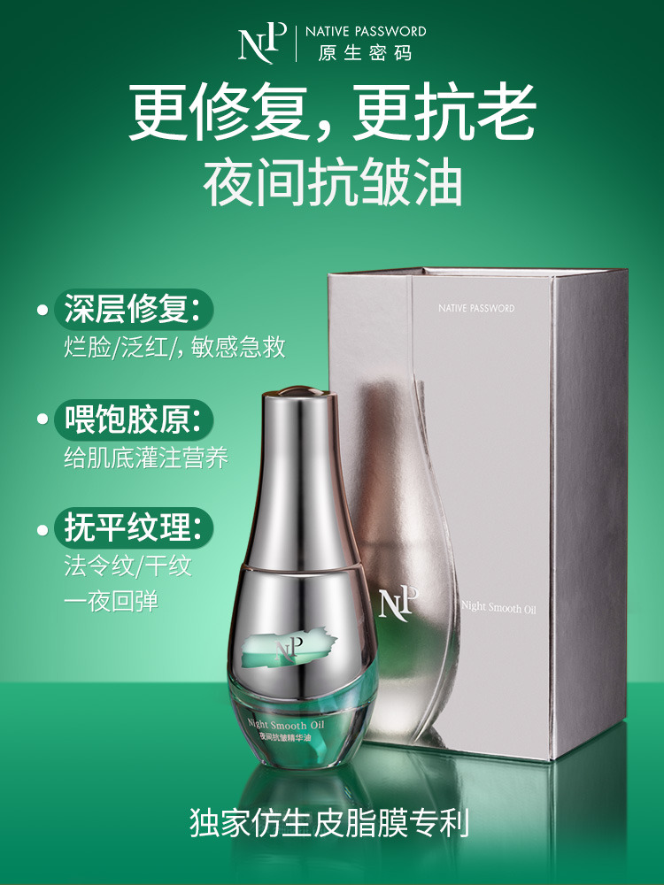

信息结构

保留与日间海报一致的标题、三组卖点和收尾信息结构，将主题转向修护与抗皱护理，分别安排对应的短标签与说明。

线稿与成品对照

两张线稿沿用相同的信息骨架，成品进一步以不同产品形象、色彩和文案主题区分日夜。内容结构与文案由我负责，视觉设计由设计师完成。

- 系列：共同结构便于比较

- 差异：夜间护理有独立主题

- 收尾：补充产品技术信息

#### 补充查看 1 组：资料信息

> 转录说明：此组在原版默认折叠，以下完整保留。

03 / 资料信息

### 让多项数字，各自对应一个清楚的信息标签。

将历史海报中的功效相关信息拆成标签与数字，作为产品介绍的补充素材。

01 / CONTENT STRUCTURE **内容排版线稿**

简版线稿 PDF · 第3页

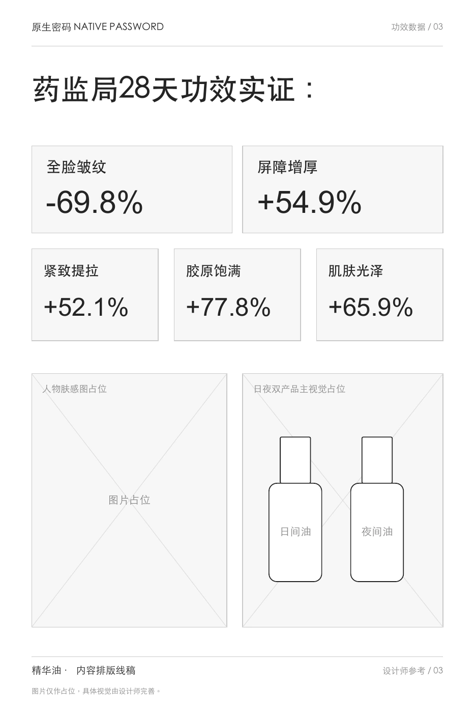

02 / FINISHED POSTER **海报成品**

文案与线稿：孙岩萍 · 视觉设计：设计师

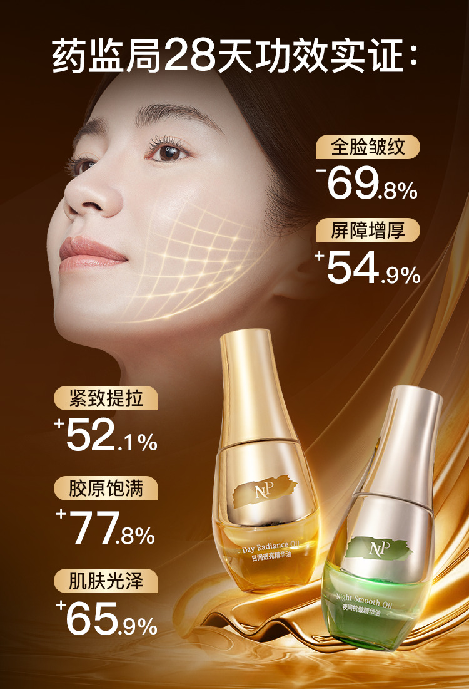

信息结构

线稿先明确总标题，再将五项标签与数字逐一配对，并划分人物肤感和日夜双产品的画面位置，避免资料信息挤成一段。

线稿与成品对照

成品将数字分组安排在人物与产品周围，通过字号与位置强调各项信息。本节关注信息编排，图内数据及标题按历史作品保留。

- 对应：每个数字配一个信息标签

- 分区：人物与双瓶各有位置

- 层级：总标题与分项信息分开

简版线稿用于展示文案与信息层级，成品保留历史作品表达；结构说明依据现有材料整理。图中功效、数字及用户反馈未作本次独立核验，也不作为海报的销售归因数据。展示顺序按内容任务整理。

04 / SELECTED WORK

## 公众号｜让一个概念，贯穿一篇上新长文

独立完成标题、正文、配图文案与版式规划。文章从人物与护理困扰进入，再依次展开皮脂膜、精华入油、日夜区别、使用方式及首发套组。

正文负责设问、解释和转场，配图负责产品结构、成分与使用信息的集中呈现。下方选择三个片段，展示从“是什么”到“怎样用”的信息推进。

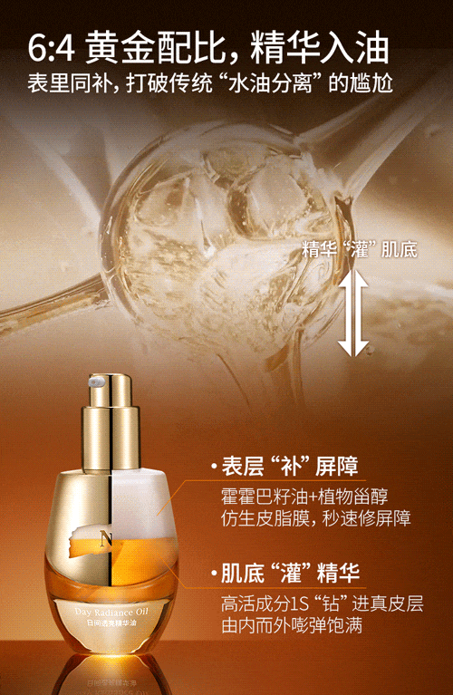

精华入油｜把产品结构讲清

原文 PDF 第14页

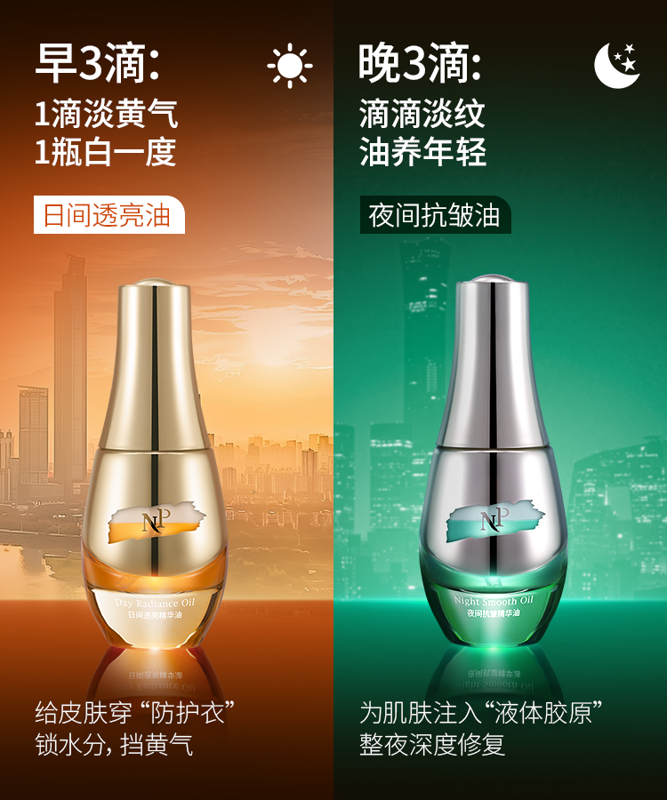

日夜双瓶｜建立场景差异

原文 PDF 第16页

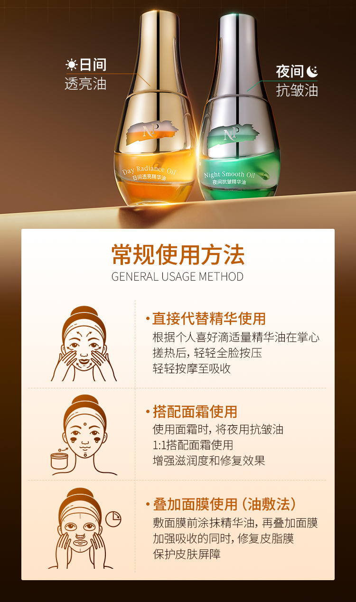

使用方式｜从理解走向实际动作

原文 PDF 第20页

[查看完整公众号 · 25页 PDF](../../../portfolio-content/essence-oil/assets/wechat/oil-launch-article.pdf)

05 / SELECTED WORK

## 朋友圈｜一次讲清一个理由

将核心主线拆为“概念与需求”和“产品特点”两类图文。前者从护理困扰进入，后者以精华入油建立产品记忆。

我负责配套文字、图内文案和信息顺序，让短内容各有一个明确重点；设计师完成视觉设计。

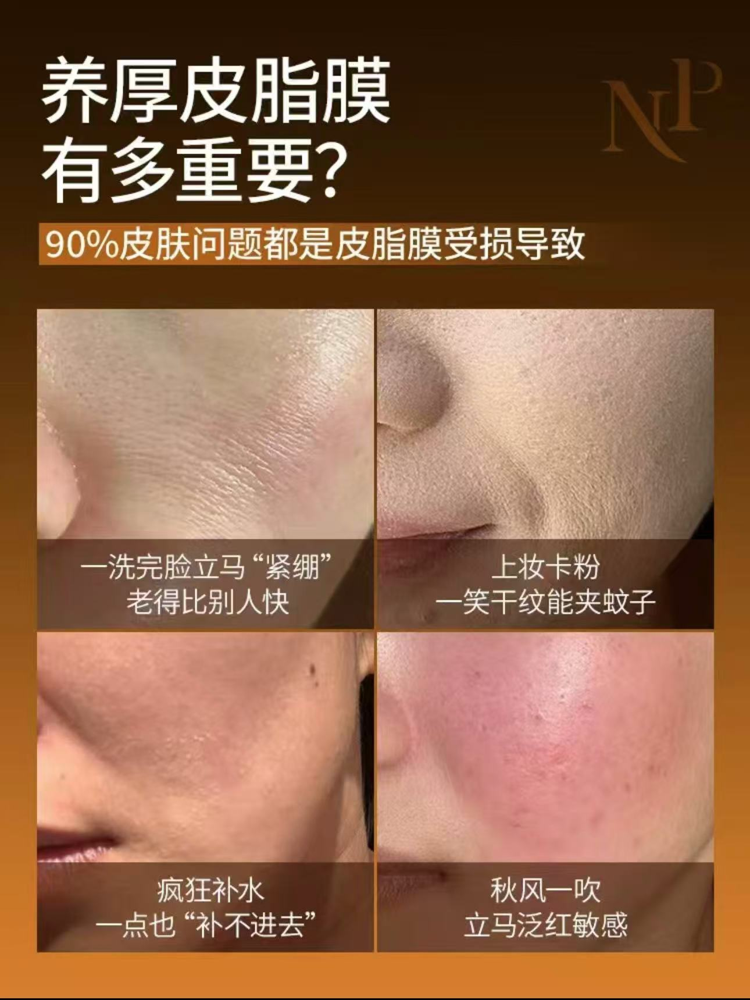

需求切入｜为什么关注皮脂膜

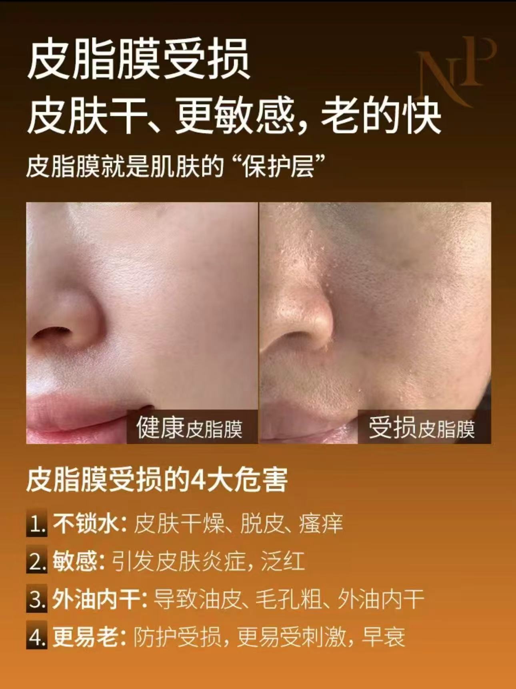

概念解释｜将专业信息变得易读

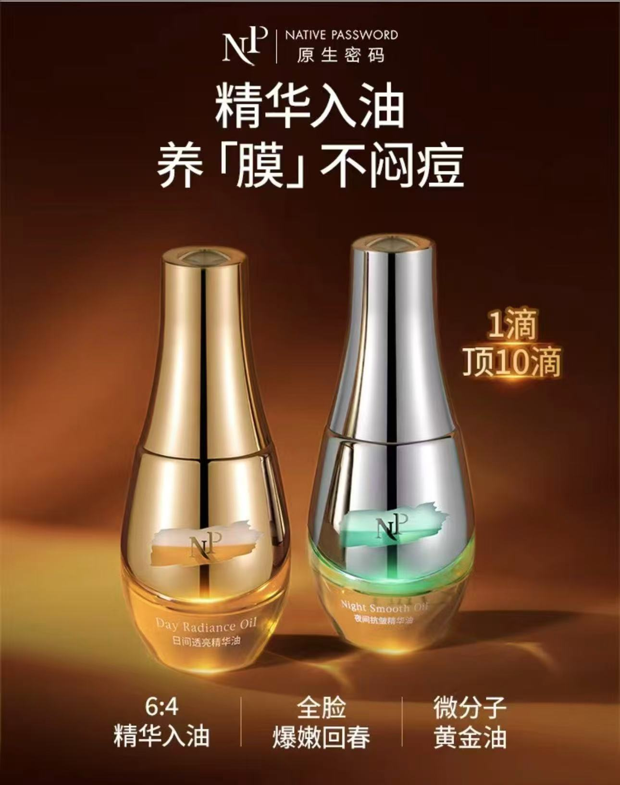

产品特点｜精华入油

06 / SELECTED WORK

## 销售沟通｜从资料，转向具体的问题

围绕概念解释、日夜区别、肤感顾虑和使用方式组织销售客服话术，让介绍能够从客户的关注点开始。

历史话术原稿未留存。这里以沟通结构说明策划方法，示例为后期重建。

方法示例 · 后期重建，非历史原稿

### 为什么精华油要分日用和夜用？

> 先了解客户的早晚护理习惯，再分别解释日间与夜间产品的沟通重点，最后连接具体使用方式。

了解护理习惯  选择相关卖点  解释日夜区别  承接使用说明

07 / VIDEO SCRIPTS

## 视频脚本｜同一主线，不同讲述方式

现有视频为压缩查阅副本，画质有限；脚本结构根据成片整理。拍摄、剪辑与商务由协作团队承担。

[播放原视频：品牌科普｜把专业概念讲得具体](../../../portfolio-content/essence-oil/assets/videos/oil-sebum-education.mp4)

### 品牌科普｜把专业概念讲得具体

独立完成脚本。从冬季干燥与清洁习惯的疑问进入，用生活类比解释皮脂膜，再连接油脂护理。

日常困扰  生活类比  产品连接

[播放原视频：刘晓庆合作｜让卖点进入人物讲述](../../../portfolio-content/essence-oil/assets/videos/oil-liuxiaoqing.mp4)

### 刘晓庆合作｜让卖点进入人物讲述

独立完成脚本。从熟龄护理话题展开，将皮脂膜、精华入油和日夜区别融入人物口吻。

人物话题  核心概念  日夜场景

[播放原视频：达人答疑｜用问题推进信息](../../../portfolio-content/essence-oil/assets/videos/oil-influencer-qa.mp4)

### 达人答疑｜用问题推进信息

负责脚本，并结合账号风格沟通调整。通过疑问、回应与反问逐步带出产品信息。

提出疑问  解释回应  使用场景

[播放原视频：达人演示｜把产品写成使用动作](../../../portfolio-content/essence-oil/assets/videos/oil-tutorial.mp4)

### 达人演示｜把产品写成使用动作

负责脚本，并结合账号风格沟通调整。用三个方法段落组织场景、步骤与动作。

场景进入  步骤安排  动作演示

PROJECT OUTCOME

**460万+** 上市两周 · 私域 GMV

从一个专业概念出发，建立可持续展开的内容主线，再根据各渠道的信息容量与讲述方式调整层次，形成公众号、朋友圈、视频和销售沟通的系列交付。

日夜精华油产品及套组的整体销售结果，由团队与渠道共同完成。

图文与视频保留历史作品中的传播表达；本页聚焦内容组织与策划方法。项目 GMV 为整体成果，未作单条内容或个人销售归因。策略说明依据已确认职责及现有作品整理。

[← 返回全部项目](../works.md)  [下一个案例 / 02

**高客单抗老防晒**](sun.md)
