# 原版：高客单抗老防晒（完整正文还原）

> 固定来源：`c9fc45a4417e7a8cfca30cc6536adcbaa66bcfe0`，原路由：`#/project/sun`。从原版现有渲染结果转录，不是重新撰写的页面稿；原有事实表述保留原样，不等于本轮已重新核实。图片引用原件，视频保留文件入口；折叠内容在此全部展开。Markdown 内章节导航回到对应全文，原版章节跳转与视觉表现见 UI/UX 基线。

[← 全部项目](../works.md)   / CASE 02

高价产品 · 价值沟通

# 高客单防晒： 让护理价值成为购买理由

围绕高端抗老定位，以精华护理解释价值、以轻薄肤感回应顾虑，并用图文、话术和视频承接同一主线。

**120万+** 上新半个月 · 私域 GMV

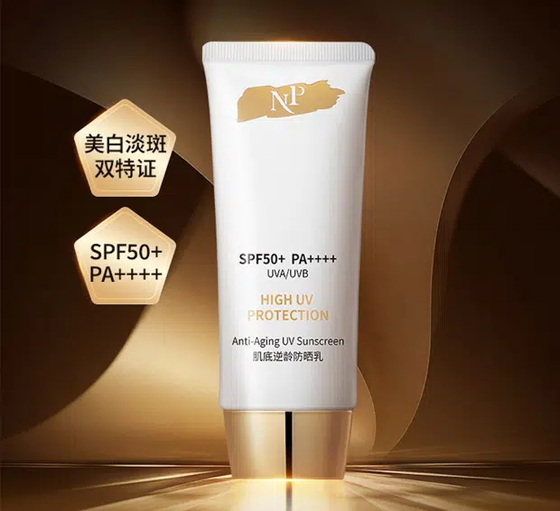

[项目概览](sun.md)  [策划主线](sun.md)  [海报线稿](sun.md)  [公众号](sun.md)  [朋友圈](sun.md)  [销售话术](sun.md)  [电商详情页](sun.md)  [视频脚本](sun.md)  [项目成果](sun.md)

01 / THE BRIEF

## 项目任务与我的职责

产品在项目开始时已确定高端抗老定位。我从0到1完成卖点与内容策划，核心任务是解释产品为什么值得这一价格，同时把护理价值与夏日使用时的轻薄、自然体验连接起来。

 需要解决的问题

消费者既会问“为什么贵”，也会问“加入精华会不会厚重、搓泥或假白”。内容需要同时建立价值参照与使用信心。

MY CONTRIBUTION

### 产品卖点与内容策划／文案

- 从0到1提炼卖点与内容主线

- 公众号上新文章与朋友圈图文

- 私域一对一及朋友圈海报的文案与内容线稿

- 一对一沟通、群内上新及培训话术

- 完整电商详情页的文案与信息结构

- 两条明星合作、两条达人视频脚本

个人贡献为产品卖点、文案、内容结构及视频脚本策划；图文视觉、拍摄剪辑及商务由相关团队协作完成。

02 / CONTENT THINKING

## 策划主线：先选择重点，再组织表达。

01

### 用精华护理建立价值参照

将防晒与美白、抗老护理放在同一条价值主线上，再分主题安排成分和技术解释。

> “1支防晒半支精华”

02

### 让轻薄体验成为独立理由

把厚重、搓泥和假白等顾虑单独展开，通过质地、推开、成膜与上妆内容，让高端价值变得可感知。

03

### 让渠道承担各自的任务

长文完整解释，朋友圈一次展开一个主题，话术回应疑问，详情页支持查阅，视频通过人物和动作展示。

03 / CONTENT STRUCTURE

## 海报线稿｜从内容结构到视觉成品

围绕防晒的养肤价值与使用顾虑，我负责海报文案及内容排版线稿，明确主标题、卖点层级和图文关系。主展示两组，新品预热与使用反馈作为补充展开。

私域一对一沟通与朋友圈种草  本人：文案与内容线稿  设计师：视觉设计与制作

[查看4页简版线稿 PDF ↗](../../../portfolio-content/skincare-wireframes/sunscreen/sunscreen-content-wireframes.pdf)

01 / 养肤价值

### 用总主张与分项信息，讲清养肤方向。

将产品的养肤定位拆成可快速阅读的利益点，支持一对一介绍与朋友圈种草。

01 / CONTENT STRUCTURE **内容排版线稿**

简版线稿 PDF · 第1页

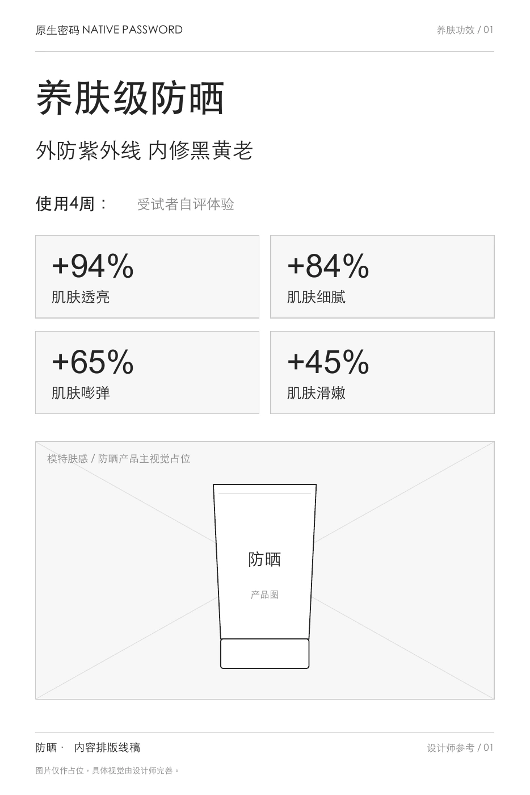

02 / FINISHED POSTER **海报成品**

文案与线稿：孙岩萍 · 视觉设计：设计师

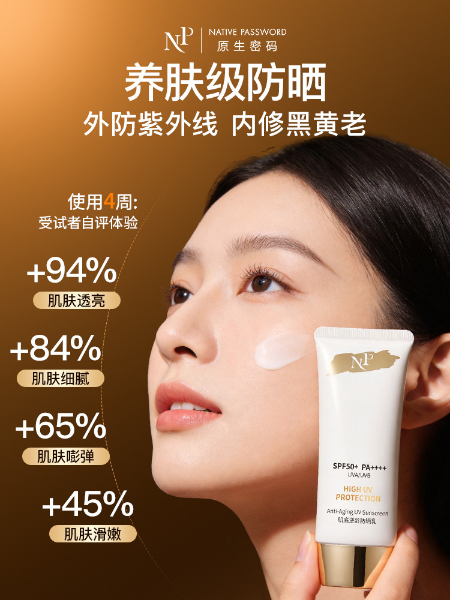

信息结构

先用总标题建立产品定位，再将透亮、细腻、嘭弹与滑嫩分项呈现。保留“使用4周”和“受试者自评体验”的限定，让数字与所描述的感受对应。

线稿与成品对照

线稿用四个信息块明确文案层级；成品将分项信息排在人物肤感与产品主视觉旁，形成主张、信息与产品的阅读关系。

- 总标题：先给出养肤定位

- 分项信息：一个数字对应一个感受

- 条件说明：保留时间与自评口径

02 / 肤感回应

### 把使用顾虑，拆成三个清楚的阅读点。

围绕质地、跟妆与温和诉求组织信息，方便销售按客户关注点调用素材。

01 / CONTENT STRUCTURE **内容排版线稿**

简版线稿 PDF · 第4页

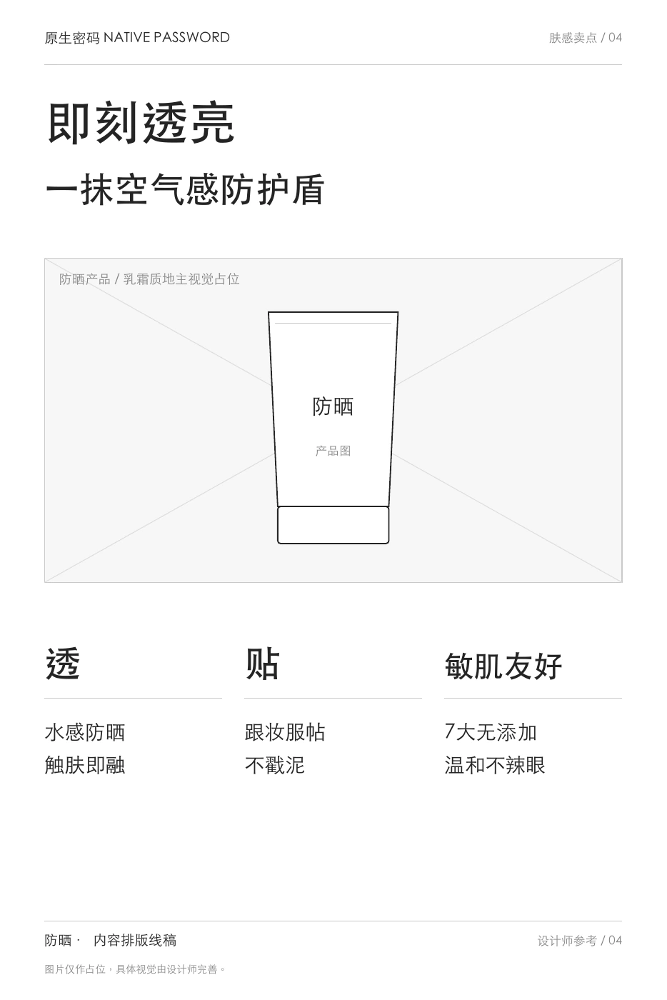

02 / FINISHED POSTER **海报成品**

文案与线稿：孙岩萍 · 视觉设计：设计师

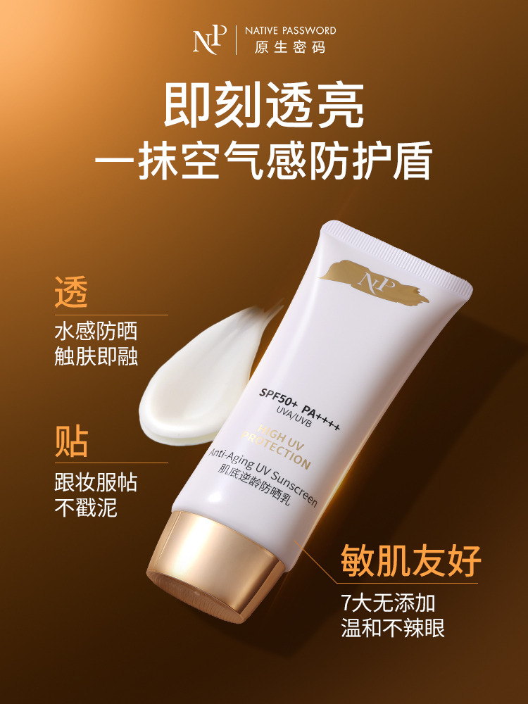

信息结构

以“透”“贴”“敏肌友好”三个短标签组织文案，每个标签下只保留对应的解释；产品与质地画面负责补充使用体验的想象。

线稿与成品对照

线稿明确三个卖点及其说明；成品将文字分布在产品与乳霜质地周围，用位置、字号与引线区分阅读重点。

- 短标签：让信息容易扫读

- 短说明：每组解释一个使用关注点

- 图文关系：质地与产品承接体验表达

#### 补充查看 2 组：新品预热、使用反馈

> 转录说明：此组在原版默认折叠，以下完整保留。

03 / 新品预热

### 先让新品被注意，再给出值得关注的信息。

围绕“即将上新”建立新品记忆，给私域介绍与朋友圈种草提供预热素材。

01 / CONTENT STRUCTURE **内容排版线稿**

简版线稿 PDF · 第2页

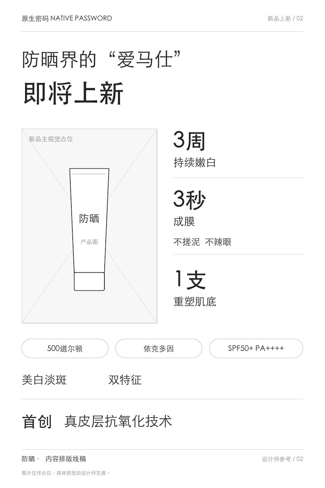

02 / FINISHED POSTER **海报成品**

文案与线稿：孙岩萍 · 视觉设计：设计师

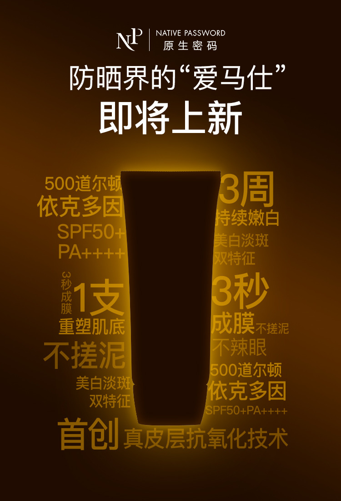

信息结构

标题集中呈现新品状态与高端联想，产品剪影保留悬念；数字、成分、使用感与技术词围绕主视觉，形成可继续展开的信息线索。

线稿与成品对照

简版线稿将标题、产品占位和卖点分区；成品通过剪影、明暗与字号进一步建立主次。文案与内容线稿由我负责，视觉表现由设计师完成。

- 标题：先传达“即将上新”

- 主视觉：产品剪影形成识别

- 辅助信息：给后续介绍留下话题

04 / 使用反馈

### 让场景和反馈分区，方便具体沟通。

将夏日场景与历史海报中的使用者反馈组合，补充私域种草和一对一介绍素材。

01 / CONTENT STRUCTURE **内容排版线稿**

简版线稿 PDF · 第3页

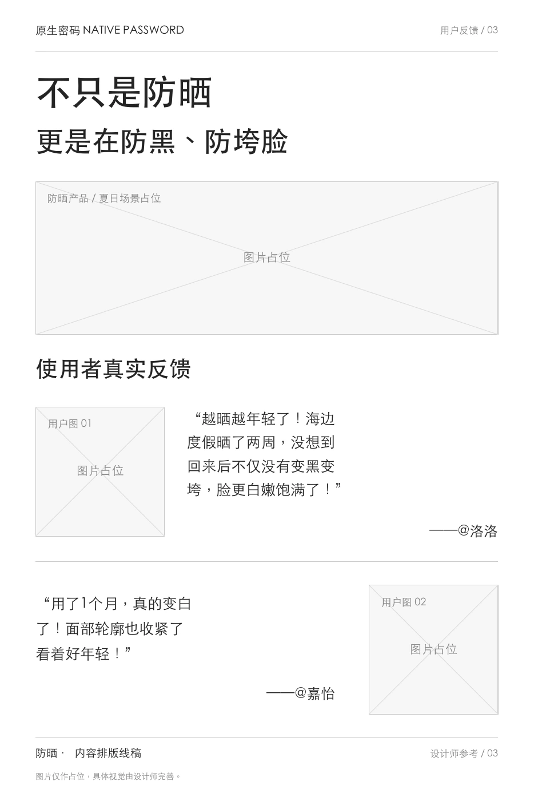

02 / FINISHED POSTER **海报成品**

文案与线稿：孙岩萍 · 视觉设计：设计师

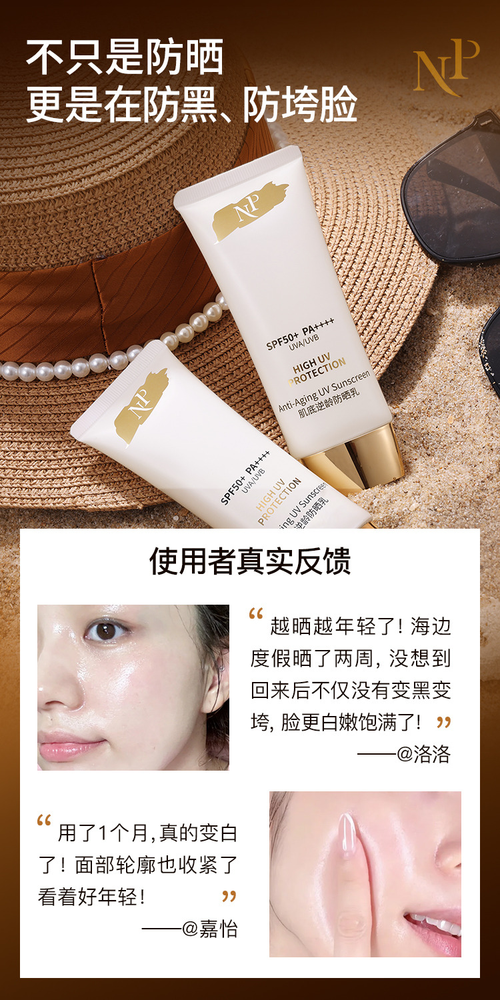

信息结构

上半部用场景和产品承接主张，下半部集中安排反馈；每条文字与对应人物图片、署名配对，避免长段文字混在一起。

线稿与成品对照

线稿划分场景区与反馈区，明确两组图文对应关系；成品用独立底色和错落排版，让使用反馈形成单独的阅读部分。

- 场景区：交代夏日使用语境

- 反馈区：集中呈现体验表达

- 对应关系：图片、文字与署名成组

简版线稿用于展示文案与信息层级，成品保留历史作品表达；结构说明依据现有材料整理。图中功效、数字及用户反馈未作本次独立核验，也不作为海报的销售归因数据。展示顺序按内容任务整理。

04 / SELECTED WORK

## 公众号｜先建立价值，再接住使用疑问

文章先亮出防晒、美白与抗老的组合定位，再展开护理成分、美白、成膜与肤感，最后承接首发套组。

正文用于设问和转折，配图集中呈现价值对照、成分分组和使用顾虑。两个代表片段分别回答“为什么关注”和“使用起来怎样”。

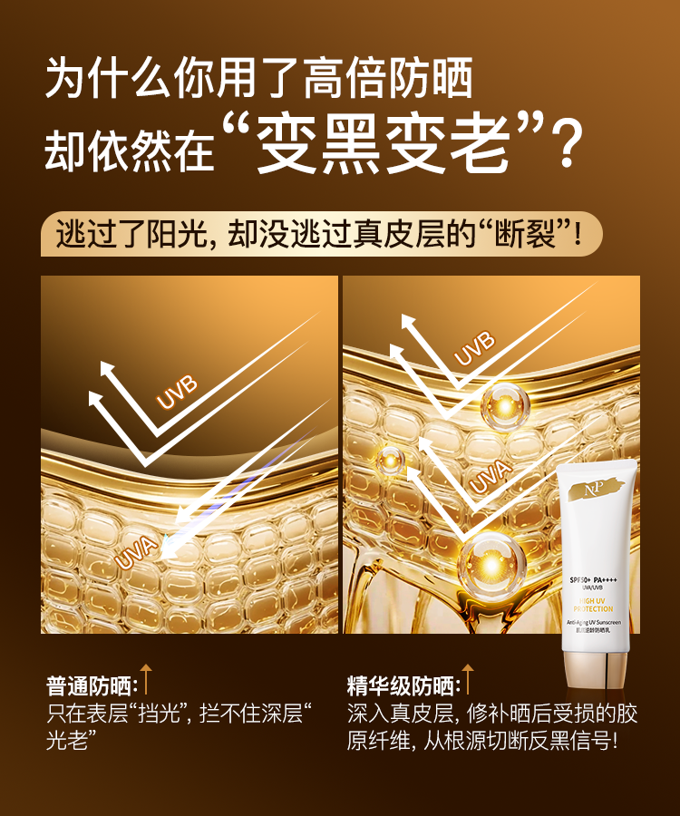

护理价值对照｜解释附加价值

原文 PDF 第5页

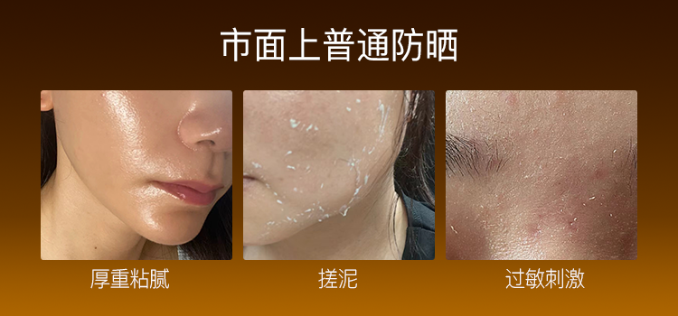

肤感顾虑｜接住厚重、搓泥的问题

原文 PDF 第19页

[查看完整公众号 · 31页 PDF](../../../portfolio-content/sunscreen/assets/wechat/sunscreen-launch-article.pdf)

05 / SELECTED WORK

## 朋友圈｜从价值参照，走到具体用法

三组图文分别围绕检测信息、精华护理价值与肤质搭配展开。主展示后两组，让购买理由与日常使用各有一张清晰的内容载体。

补充四张用于私域一对一与朋友圈种草的海报，全部文案与内容排版线稿由我负责。线稿、成品对照及信息结构说明见本项目“海报线稿”章节。

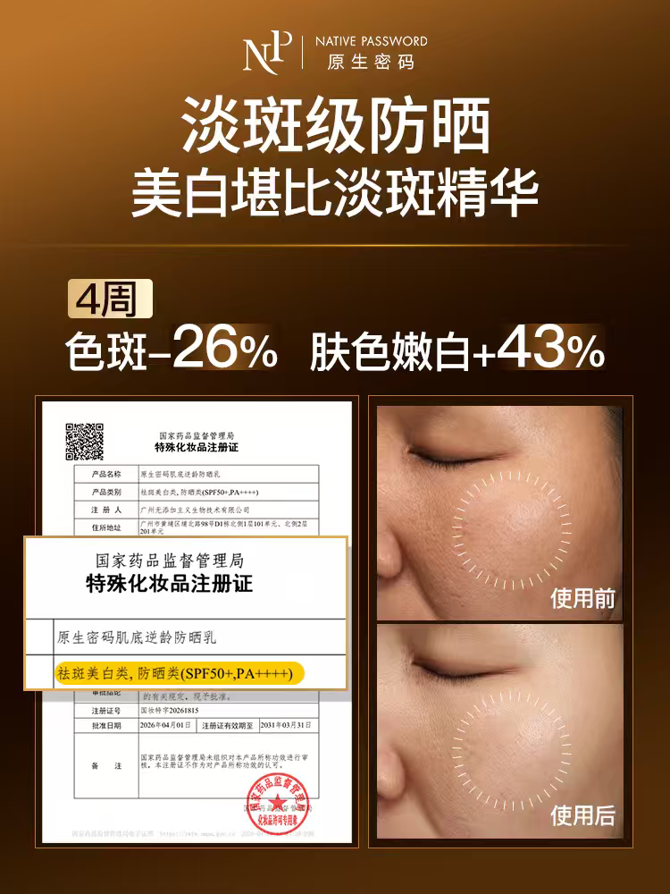

精华护理价值｜为什么值得关注

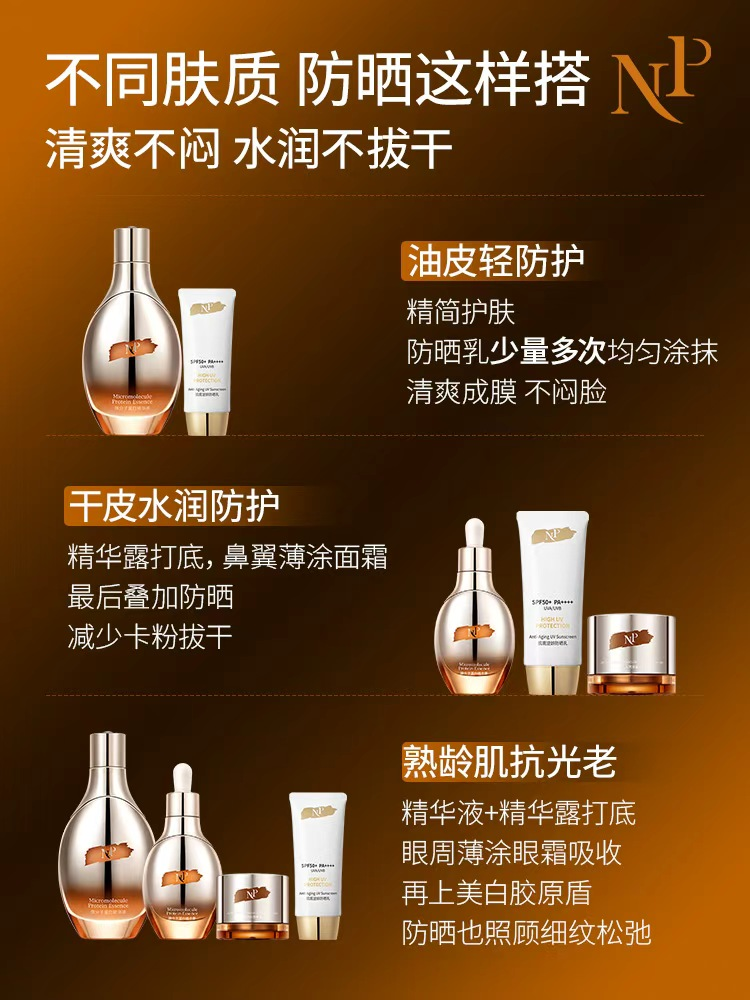

肤质搭配｜如何理解护理安排

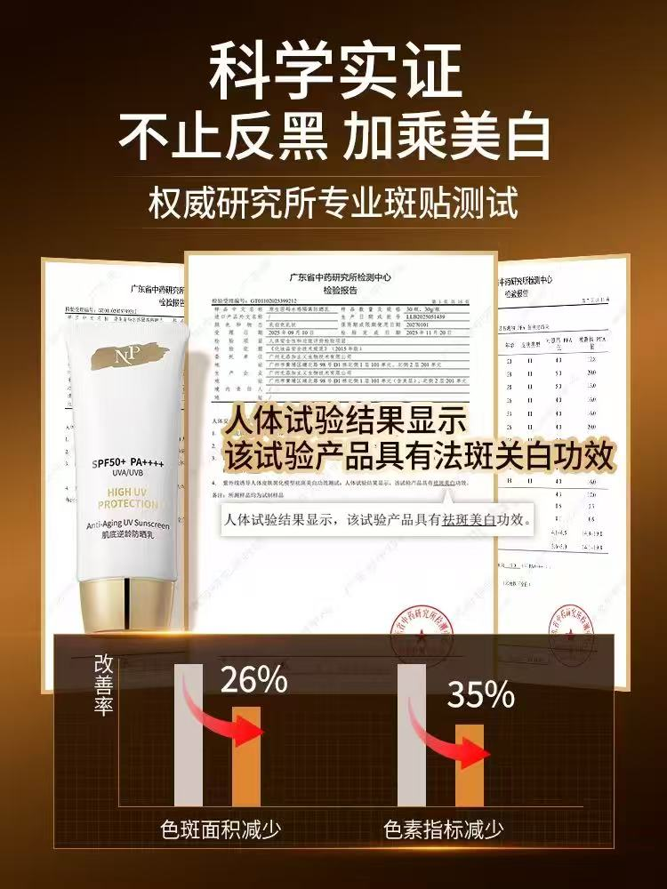

资料说明｜补充产品信息

06 / SELECTED WORK

## 销售话术｜把顾虑写成可调用的回应

话术用于一对一沟通、群内上新与销售培训。我从客户实际会问的问题进入，再选择护理价值、肤感或活动信息继续解释。

历史话术原文节选

### 价格怎么这么贵？外面一瓶防晒才一两百块。

> 姐，明白您的顾虑。但咱们这款真的不是普通的防晒，而是“防晒型的抗老美白精华”。

接住价格顾虑  调整比较维度  展开护理价值

节选自原稿 P37—P39，保留历史口语表达。

07 / SELECTED WORK

## 电商详情页｜让用户可以自主理解与查阅

负责整页文案与内容结构。首屏建立总主张，之后分区解释防护、美白、抗皱滋养和使用感，再补充资料与商品信息。

精选成分分组与肤感模块，展示复杂信息如何被组织成标题、说明与阅读层次。

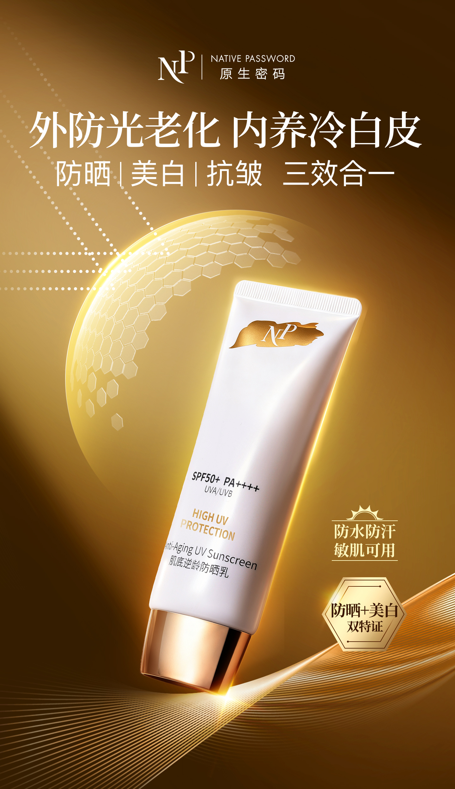

首屏定位｜建立新品识别

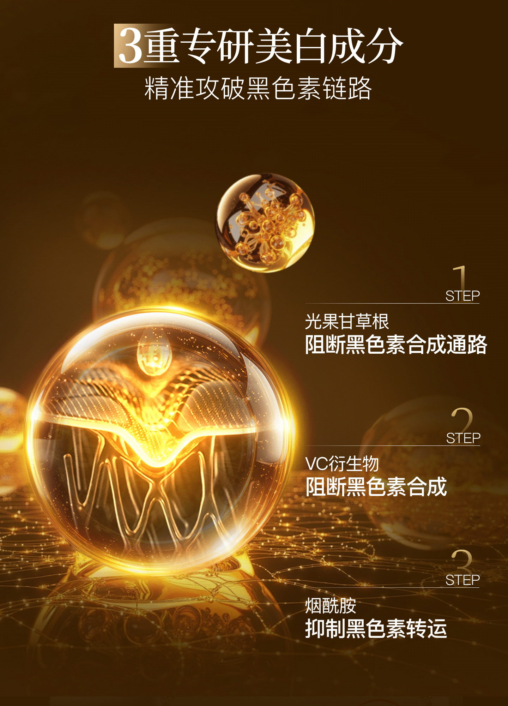

成分分组｜拆解护理价值

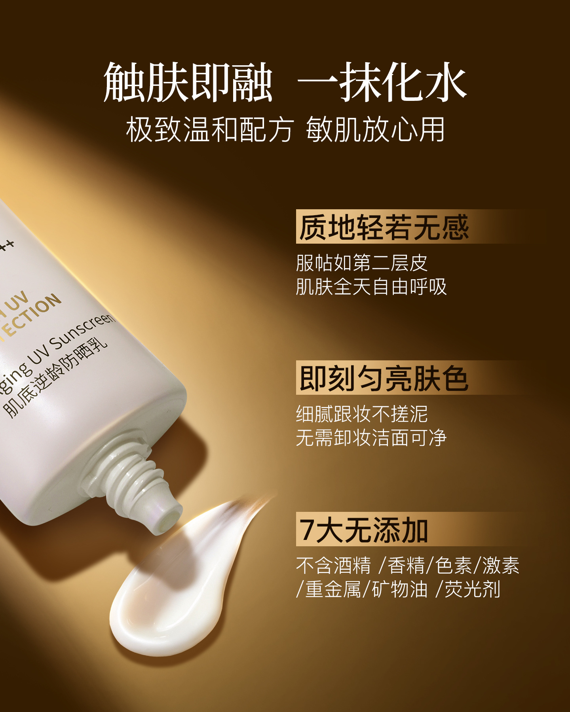

肤感分区｜回应使用顾虑

[查看完整详情长图](../../../portfolio-content/sunscreen/assets/detail/sunscreen-detail-full.jpg)

08 / VIDEO SCRIPTS

## 视频脚本｜同一主线，不同讲述方式

本人负责四条脚本。使用保留声音与时间轴的网页查阅副本；向海岚录屏通知已处理。

[播放原视频：李颖合作｜从质疑到体验改观](../../../portfolio-content/sunscreen/assets/videos/sunscreen-liying.mp4)

### 李颖合作｜从质疑到体验改观

将高价与宣传疑问写成人物冲突，再用亲试、推开、上脸和上妆等动作推进态度转折。

价格质疑  亲自体验  原理追问  推荐收束

[播放原视频：达人体验｜先让肤感被看见](../../../portfolio-content/sunscreen/assets/videos/sunscreen-influencer-04.mp4)

### 达人体验｜先让肤感被看见

从可观察的使用动作进入，再补充防护与护理价值，让抽象卖点有对应的演示。

质地演示  上脸体验  护理价值

[播放原视频：向海岚合作｜让产品连接人物态度](../../../portfolio-content/sunscreen/assets/videos/sunscreen-xianghailan.mp4)

### 向海岚合作｜让产品连接人物态度

从人物选择观走向精简护肤，再回扣不将就的生活态度，形成首尾呼应。

人物主题  护理选择  产品转场  主题回扣

[播放原视频：达人讲述｜逐层解释为什么贵](../../../portfolio-content/sunscreen/assets/videos/sunscreen-influencer-03.mp4)

### 达人讲述｜逐层解释为什么贵

从防晒选购标准进入，围绕高价疑问组织产品资料与价值说明。

选购标准  价格问题  资料说明

PROJECT OUTCOME

**120万+** 上新半个月 · 私域 GMV

用一条一致的价值主线，组织解释、种草、演示和销售沟通。把高客单定位转化为消费者能够理解的理由，也为各渠道提供可以落地的内容。

沿用简历已披露口径，为参与内容策划项目的整体销售成绩，由团队与渠道共同完成。

图文与视频保留历史作品中的传播表达；本页聚焦内容组织与策划方法。项目 GMV 为整体成果，未作单条内容或个人销售归因。策略说明依据已确认职责及现有作品整理。

[← 返回全部项目](../works.md)  [下一个案例 / 03

**童颜面膜**](mask.md)
