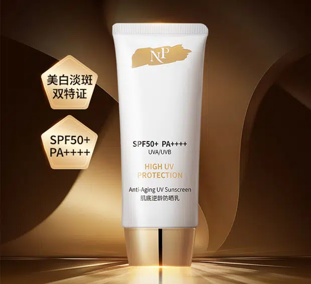
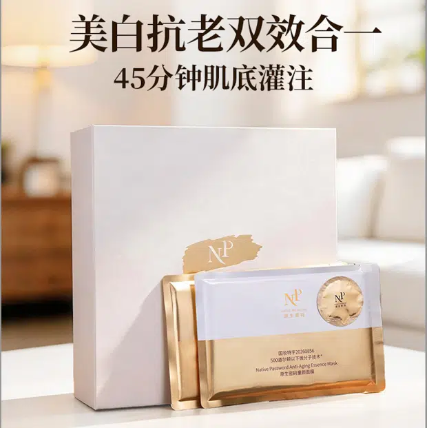
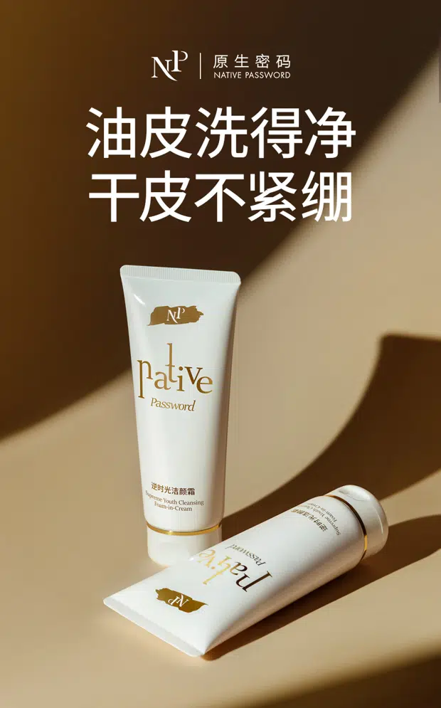
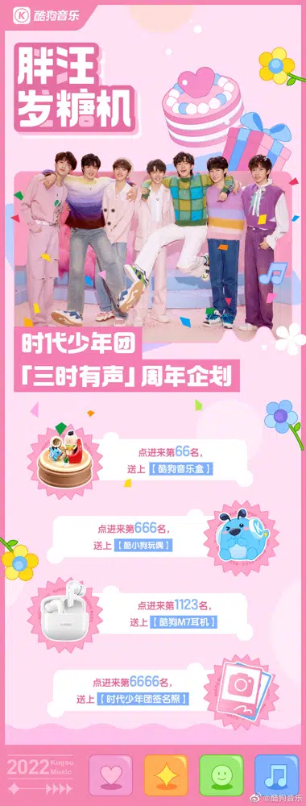

# 原版：项目目录（完整正文还原）

> 固定来源：`c9fc45a4417e7a8cfca30cc6536adcbaa66bcfe0`，原路由：`#/works`。从原版现有渲染结果转录，不是重新撰写的页面稿；原有事实表述保留原样，不等于本轮已重新核实。图片引用原件，视频保留文件入口；折叠内容在此全部展开。Markdown 内章节导航回到对应全文，原版章节跳转与视觉表现见 UI/UX 基线。

PROJECT INDEX / 05

# 五个项目， 展开不同的策划判断。

[01

 复杂产品 · 内容主线

**日夜精华油：为双产品建立一条主线** 卖点提炼 · 公众号 · 朋友圈 · 视频脚本 · 销售沟通](projects/oil.md)  [02

 高价产品 · 价值沟通

**高客单防晒：让护理价值成为购买理由** 卖点提炼 · 公众号 · 朋友圈 · 销售话术 · 详情页 · 视频脚本](projects/sun.md)  [03

 产品升级 · 复杂信息梳理

**童颜面膜：在旧品认知上讲清升级价值** 卖点制定 · 公众号 · 朋友圈 · 视频脚本 · 直播话术 · 详情页](projects/mask.md)  [04

 产品价值 · 清洁力与肤感

**逆时光洁颜霜：把清洁力与肤感讲清楚** 卖点提炼 · 公众号 · 产品海报](projects/cleanser.md)  [05

 团队协作 · 平台与资源统筹

**酷狗音乐：从内容策划到多平台协同** 微博 · 小红书 · 抖音 · 公众号 · 视频号 · 站内栏目](projects/kugou.md)
