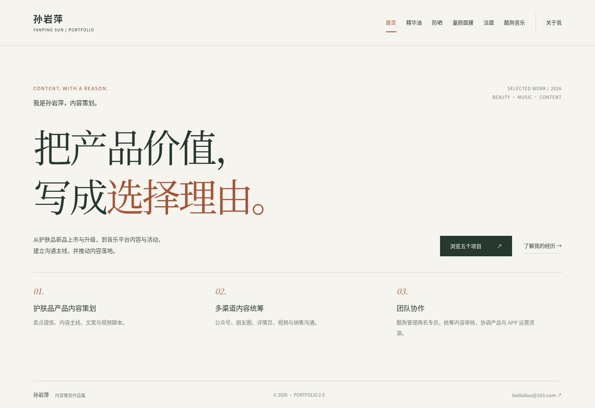
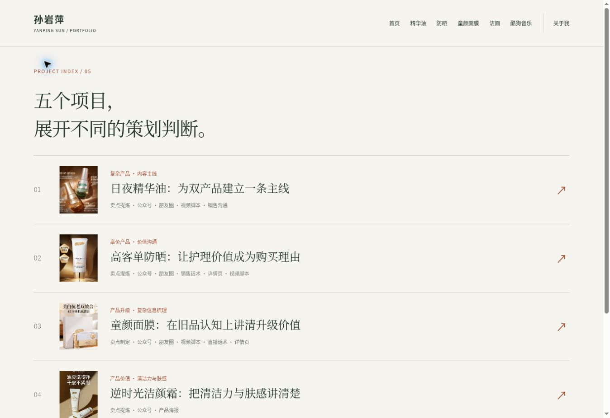
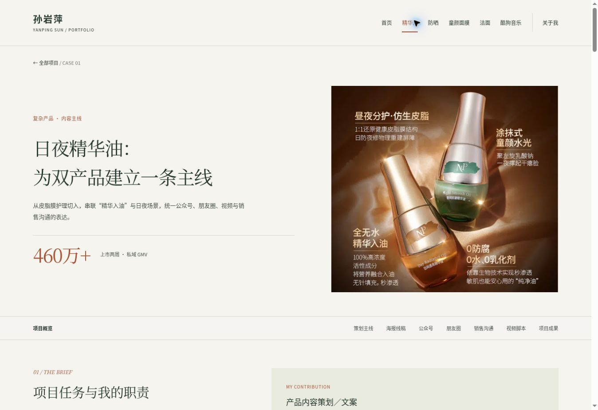
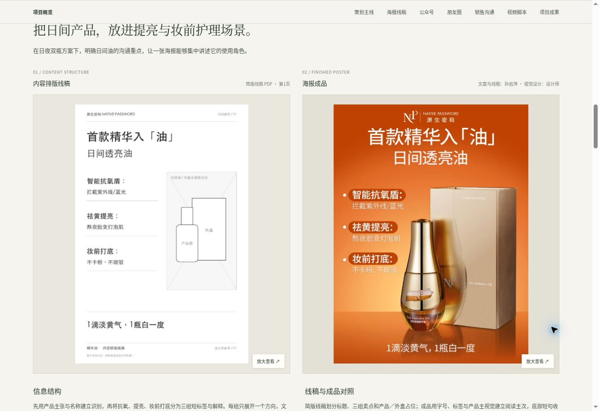

# 原版 UI/UX 还原

固定源码：`c9fc45a4417e7a8cfca30cc6536adcbaa66bcfe0`。2026-11-01实看正式站的首页、目录、精华油与关于页，并核对源文件。首页采样视口为1363×936 CSS px，其余桌面截图为1348×926像素；下方截图是相应位置的节选，不是完整案例。内容全文另见[阅读入口](README.md#原版完整正文)。

“浏览器实看”描述本轮观察；“源码记录”描述已实现的配置或逻辑；“还原判断”解释可能的作用。没有用这些观察推导招聘效果，也未声称完成全站移动端、可访问性、性能或媒体播放测试。

## 页面、导航与阅读路径

| 页面／入口 | 原版安排 | 证据类型 |
| --- | --- | --- |
| 全局导航 | 姓名回首页；首页、五个具名项目、关于我直接可达；当前项目以强调色和下划线标识 | 浏览器实看与源码 |
| 首页 | 杂志式标题、两行简介、浏览五项目／了解经历两个入口、三个能力块；本页未摆放案例卡片 | 浏览器实看 |
| 项目目录 | 纵向五行，每行由编号、作品缩略图、内容问题、工作范围和箭头组成；顺序与顶栏一致 | 浏览器实看，五张缩略图均加载 |
| 案例 | 大标题与作品图、项目数字；随后有吸顶章节条；正文展开职责、判断、作品与成果 | 精华油浏览器实看；五案模板和数据核对 |
| 关于页 | 工作范围与方法，三项方法块，邮件联系；原页没有履历时间线或简历按钮 | 浏览器实看与源码 |
| 长文与原图 | 案例内给代表片段和图注，再单独打开全文或图片原件 | 浏览器实看与源码 |
| 案例尾部 | 返回全部项目与按原顺序进入下一案例；共用页脚有邮箱 | 浏览器实看与源码 |

还原判断：原版把“快速认识候选人”“选一个项目”“深入核对作品”分开，顶栏则给熟悉项目名称的读者直接入口。新版首页展示两个主案例、顶栏改为三项，是重新分配入口与优先级，不是首次建立层级；它可能减少部分阅读路径的步骤，也可能削弱其他案例的直接可达性，需要用具体任务比较。

## 案例中的内容层级与版式

| 模块 | 桌面已实现形式 | 内容上的作用（还原判断） |
| --- | --- | --- |
| 开篇 | 左标题、摘要、数字，右侧代表作品图 | 快速辨认案例问题与成果；数字早于详细分工出现 |
| 概览 | 任务／难点与独立职责色块并排 | 把业务任务、个人工作和团队分工放在相邻位置 |
| 策略 | 三个判断卡块，必要时配历史原文表达 | 让读者在看大量作品前理解主线 |
| 海报 | 线稿与成品两列；下方有结构说明、对照分析与要点 | 显示文案、信息层级与成品的关系，而不只展示成品 |
| 其他图文 | 解释段落、图组、各图图注、全文入口 | 用代表片段承接分析，长原件继续可查阅 |
| 视频 | 两列成片播放器；每条有标题、脚本处理和讲述步骤 | 用实际作品支持脚本能力，各条可以独立选择 |
| 补充材料 | 原生可展开区域，默认收起次要海报组 | 保留深度，同时控制默认阅读长度 |

这组线稿是护肤品项目中的作品材料，与我们制作的网站 UX 线框不是同一种产物。比较时不能用一页网站线框代替整组作品或原案例全文。

## 视觉语言与中文阅读

浏览器实看：原版是统一的暖白／米灰底、深绿色正文、赤褐色强调，配大字号宋体类标题、无衬线正文、细分隔线及较大留白。作品本身保留色彩，数字和关键短语沿用强调色。它已经有完整的编辑式视觉语言，不是尚待设计的裸 HTML。

源码及本轮生效样式：背景 `#f6f4ef`、主色 `#26382f`、正文色 `#46534a`、强调色 `#a65336`；内容区为88.8%宽、最大1280px。桌面首页主标题本轮为88px，简介13px、行高26px，顶栏链接12px。宋体／系统无衬线分别用于标题与正文，并设置平台字体回退。颜色与字号描述的是原版，不作为其符合任何可读性标准的证明。

实际样式以 `index.html` 的加载顺序为准：基础样式、海报对照样式、`portfolio-2.css` 覆盖。基础文件中还留有旧版布局类；未被当前模板使用的规则，不应算作当前 UI。

## 手机布局：源码还原，待专项实测

| 已实现条件 | 原版响应式安排 |
| --- | --- |
| 900px以下 | 顶栏换行，项目菜单可占独立一行，隐藏英文副标 |
| 760px以下 | 首页简介与按钮改为上下排列；三个能力块改为单列；标题、间距及字号收敛 |
| 案例正文 | 封面、任务与职责、策略、图组、视频和海报对照都改为单列；章节条保留横向浏览空间 |
| 目录 | 缩小缩略图、行间距和标题字号，继续保留问题、范围及入口 |
| 图片查看 | 弹层接近整屏，缩小内边距；原图仍在可滚动区域查阅 |
| 380px以下 | 进一步收敛导航间距、标题及目录缩略图尺寸 |

上述来自固定 CSS，不能写成已在320／390px真实手机上验证。此前项目状态记录过首页与精华油的窄屏框架查看；本轮没有将该记录升级为全站移动端通过。后续应比较长图细节、目录密度、章节条操作和视频查阅的实际表现。

## 已有交互与本轮核对

| 行为 | 原版实现／观察 | 本轮范围 |
| --- | --- | --- |
| 章节跳转 | 哈希路由定位对应章节，章节导航吸顶 | 实际点击精华油海报章节，跳转可见 |
| 额外作品 | 默认收起，点击展开补充组；直接深链接可打开所属补充区 | 实际展开精华油资料信息组 |
| 图片查看 | 可见放大按钮打开原生对话框，提供原图链接和关闭按钮 | 实际打开精华油线稿，看到原图及关闭入口 |
| 关闭与焦点 | Escape关闭；源码记录关闭后恢复到触发按钮 | 本轮实际按Escape关闭，并核对焦点回到原按钮 |
| 视频 | 原生控件、手动播放、`playsinline`、预载元数据；不支持时有文件入口 | 确认精华油四个控件和来源，未逐条观看、测试时长或字幕 |
| 键盘与辅助信息 | 跳到正文、焦点样式、当前导航标识、图片按钮标签和替代文本 | 源码记录；未做完整键盘／读屏测试 |
| 返回位置 | 路由切换一般回页顶，章节链接滚到目标 | 源码记录；浏览器历史与滚动恢复未专项实测 |

因此，图片可放大、Escape关闭、返回焦点、章节入口和补充展开都是原版已有能力。新版应先继承，再验证改动的具体收益；不能把计划继续支持这些能力写成已新增的改善。
