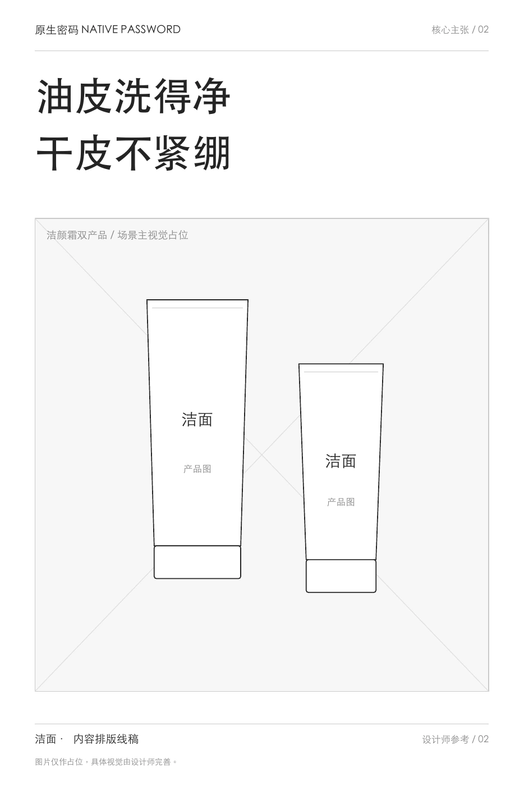
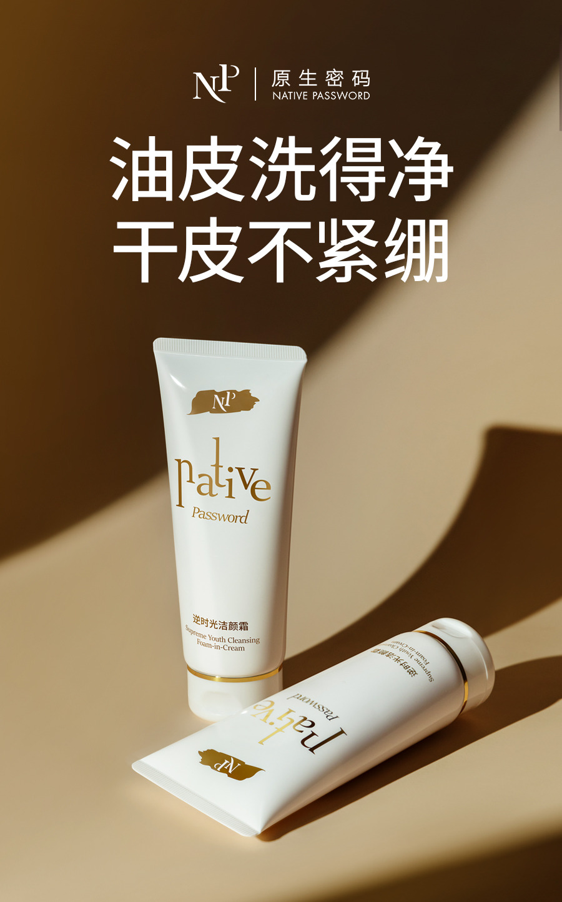
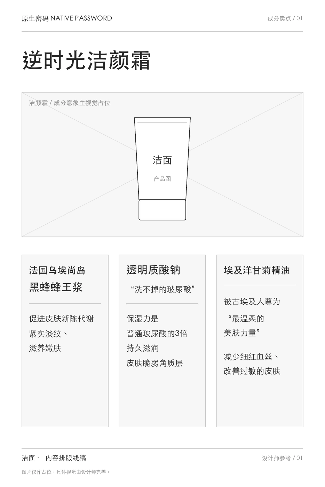
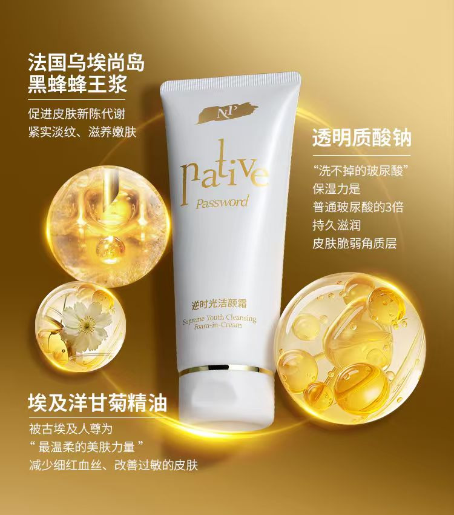
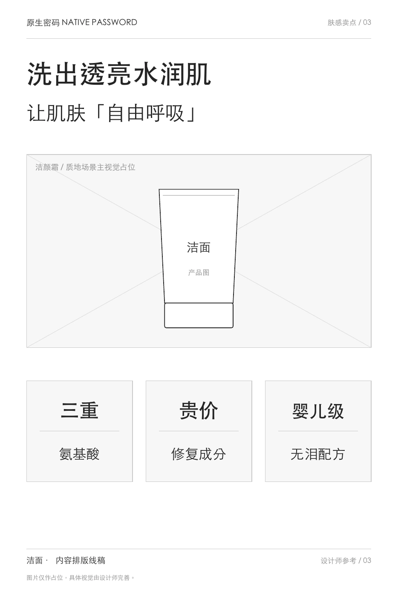
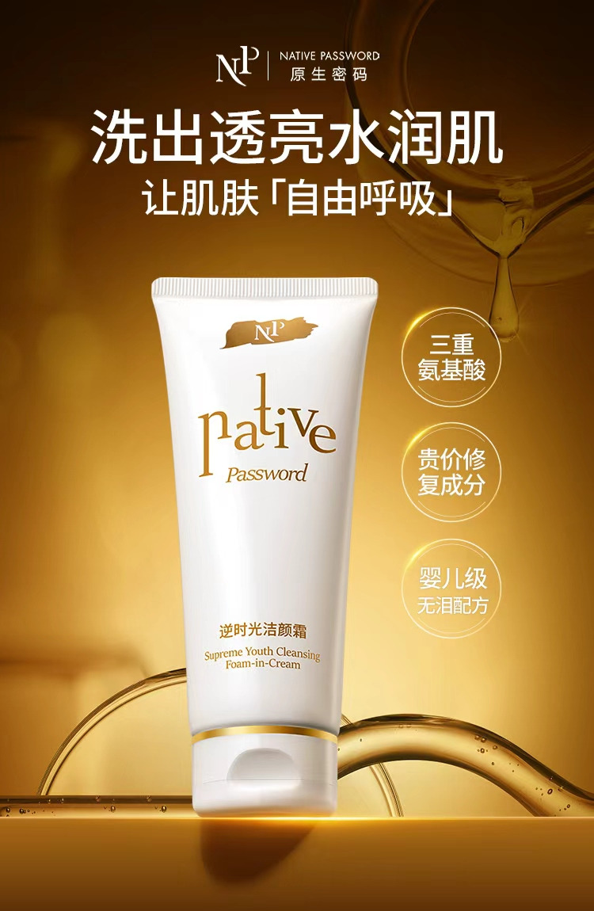
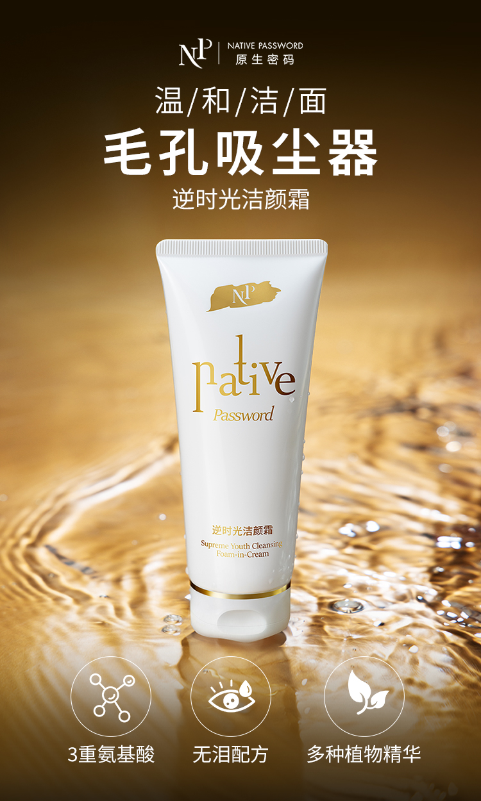

# 逆时光洁颜霜内容稿

版本：`general` 内容 r3，2026-11-02。保留精简案例定位，完整作品与补充结构仍可查阅，尚未接入网站。

## 网页正文

### 逆时光洁颜霜｜一句话回应两种使用顾虑

消费者既担心洗不净，也担心洗后紧绷。我独立完成产品卖点提炼、整体内容策划与文案，把这两类顾虑写进上新长文与系列海报。

这一案重点呈现短文案取舍，以及同一产品信息怎样分别写成主张、成分分组和肤感表达。配方、研发与测试来自产品资料，摄影和视觉设计未计入个人已确认职责。

### 主海报：让清洁与洗后感受相互对应

历史文案“油皮洗得净，干皮不紧绷”将两个关注点放进对称的两行标题。主海报集中表达一个理由，其余空间留给产品画面，让读者先看到产品希望回应的问题。

简版内容线稿明确标题与产品陈列的关系，成品通过字号、位置与光影强化主次。

[查看主海报原件](../../portfolio-content/cleanser/assets/posters/cleanser-main.jpg)

### 补充对照：让较多资料有清楚的位置

#### 成分分组：名称与说明逐组对应

将成分名称与各自说明拆成三个信息组，产品画面独立安排。成品再用成分意象与文字位置强化归属，避免资料挤成一个长段落。

#### 肤感表达：总标题之后，保留三个短标签

用一句整体肤感表达建立主题，再以三个短标签承接配方相关信息。线稿确定总标题、产品和分项说明的主次，成品用字号与位置形成阅读层级。

[查看三页简版线稿 PDF](../../portfolio-content/skincare-wireframes/cleanser/cleanser-content-wireframes.pdf)

### 上新长文：从记忆入口继续展开产品

2024年7月11日的上新文章，用“可以睁眼洗”的历史传播表达建立温和性记忆，再展开配方资料、洗卸与清洁信息、使用感受及首发选择。

海报负责快速传递一个重点，长文则通过解释和转场，继续回应“温和是否也能洗干净”的问题，再接购买与互动信息。

[查看上新文章30页全文](../../portfolio-content/cleanser/assets/wechat/cleanser-launch-article.pdf)

补充清洁感海报以“毛孔吸尘器”的历史比喻组织短文案，与主海报的双重顾虑、肤感图的水润主题分别展开同一产品。

### 项目结果

**洁面上新 GMV 80万+。** 这是项目整体上新成果，未归因为单篇文章、某张海报或个人内容；统计时长尚未补充。

这组作品主要展示从顾虑中选择主张、压缩短文案，再为不同信息量安排表达层次。图文中的产品功效、配方与体验按历史作品保留，未作本轮独立核验。

继续查看：[防晒的价值与顾虑回应](sun.md) · [其他项目](../home.md#代表项目) · [查看简历](../../portfolio-resume.pdf)

## 编辑依据与呈现说明

依据[原版完整案例](../../baseline/pages/projects/cleanser.md)、[本人确认与素材索引](../../portfolio-content/cleanser/洁面作品集内容.md)及[线稿来源](../../portfolio-content/skincare-wireframes/cleanser/README.md)。在r2的短文案基础上恢复三组结构对照及补充清洁感海报，保留完整文章；精简指叙述集中，不等于去掉其他独特作品。

三页简版线稿及成品于2026年10月29日补充提供，不标为已核实的当年原始稿。两组补充对照在内容稿展开，网页阶段可沿用原版主展示加补充查看的层次，不提前规定页面高度。

沿用本人确认的“上新80万+”，不采用CV的一个月限定。“睁眼洗”等仅按历史传播表达分析，不作为当前使用建议或已验证测试结论。现有卖点Excel及原件继续保留，未声称本轮重新解析完整原表；未新增调研、投放测试或归因事实。原件、CV和网页未改动，取舍见[通用版r3对照](../reviews/general-r3-vs-baseline.md)。
