# 酷狗音乐内容稿

版本：`general` 内容 r3，2026-11-02。基于原版完整案例校准，尚未接入网站。

## 网页正文

### 酷狗音乐｜把粉丝互动连接到客户端参与

在酷狗官方新媒体工作中，我独立负责微博内容与活动，管理两位专员，统筹其他平台的内容及脚本审核。除持续组织音乐与品牌内容，也参与微博到客户端的引流合作，策划互动机制，协调产品和运营资源推进落地。

**我的职责：内容与活动策划、资源沟通、团队管理及统筹审核。**

### 任务与分工：让站外内容承接业务目标

账号已有品牌积累、增粉趋缓后，内容工作需要继续服务客户端拉新与促活。我根据微博可合作资源提出跳转合作思路，与产品经理、APP运营沟通，将音乐兴趣和活动参与连接到站内内容。

| 工作范围 | 我的工作与协作分工 |
| --- | --- |
| 微博内容与活动 | 独立策划选题、文案和活动并推进执行，日常涵盖新歌、品牌节点、明星生日与热点 |
| 跳转合作与发糖机 | 提出合作思路、沟通资源并策划活动；技术开发和产品实现由相关团队完成 |
| 其他平台 | 负责方向、选题及脚本／内容审核，管理两位专员承担相关制作与剪辑 |
| 站内电台栏目 | 负责整体策划、主题内容与站外推广，协同版权及电台团队推进 |

内容上有三个重点：为站外兴趣提供明确的站内入口；围绕粉丝习惯设计参与动力；将音效、栏目等功能放进具体的音乐和生活场景。

### 发糖机：让艺人节点变成具体参与内容

粉丝有签到、打榜和互动等参与习惯。我围绕艺人节点与福利策划“胖汪发糖机”H5，组织玩法、规则和传播内容，协调产品与设计落地，后续形成月度固定活动。

在活动迭代中，围绕参与门槛、福利与主题开展A/B内容测试，关注不同安排与参与、转化之间的关系。现有资料保留了这一工作回顾，未提供逐轮分组与结果明细。

#### 一个实际期次：时代少年团“三时有声”周年企划

2022年11月23日的发布微博同时给出网页链接与客户端搜索口令。微博负责交代艺人节点、参与理由和入口，长图继续展开主题与奖励规则。

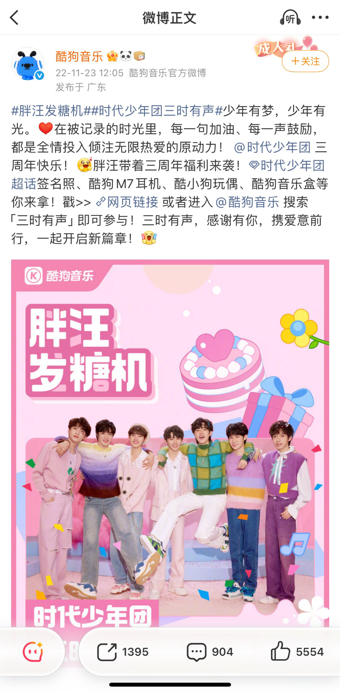

活动长图将第66、666、1123、6666名参与者与相应福利配对，让指定参与序号和奖励有清楚的对应关系。这是该期玩法，不据此概括所有发糖机都采用同一奖励机制。

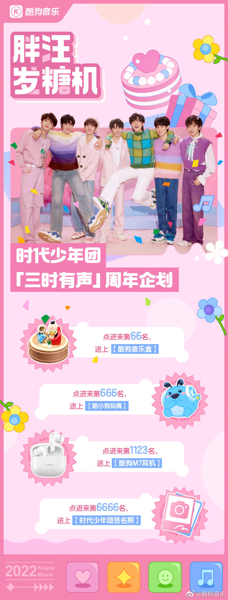

历史活动总结记录：**发糖机累计参与8万人次，拉新及促活2.2万人次。** 这是活动层面的阶段记录，具体统计周期尚待补充，不归为上述单期企划的成绩，也不与整体引流数字相加。

### 小红书：从活动机制到用户表达

#### 直播票根：给参与一个可执行的动作

我策划鹿晗直播票根活动，以预约直播、保存截图、带话题发布笔记和参与抽奖组织路径，通过签名照与周边提供参与动力。

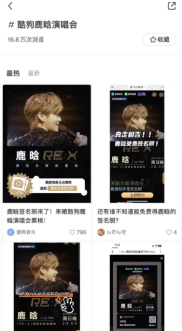

话题截图显示累计浏览**16.8万次**，按截图时点记录，不能等同于去重参与人数或新增预约量。

#### 音效征集：让功能进入官号之外的用户内容

围绕音乐场景和用户表达组织歌曲宣发、音效征集，目标是让功能与实际内容产生联系。日常内容以统筹审核为主，具体制作按团队分工完成。

### 抖音：用音乐现场表达音效体验

选取热门或用户熟悉的现场Live，将蝰蛇音效放入具体的听觉场景。我负责内容统筹、选题及脚本审核，专员制作剪辑。

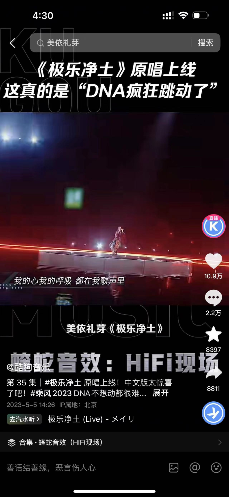

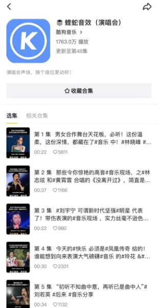

合集截图显示**1763万播放、更新至48集**，属于截图时点的合集累计数据。本页材料为静态截图，未提供可播放原片；合集播放与功能新增使用人数分别看待。

### 微信渠道：定位调整与内容供给

#### 公众号：音乐兴趣之后，接产品功能与收听

我负责官号运营与定位调整，将纯音乐内容转为“音乐内容＋产品功能”。代表文章从音乐人物、新歌或专辑进入，再安排音效说明、设置方法与收听引导。单篇的具体撰写、排版与审核分工按作品核实。

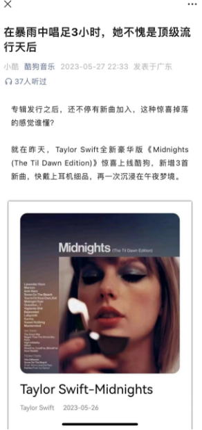

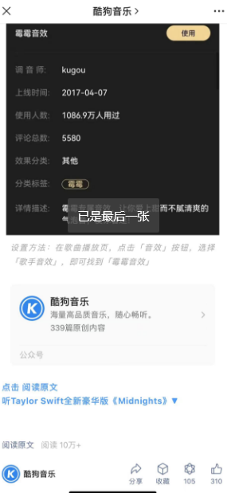

代表文章截图显示阅读**10万+**。它说明内容的历史阅读表现，未据此认定这篇文章带来了相同数量的功能新增用户。

#### 视频号：从0到1组织新歌与热点Live

视频号从0到1起步，以新歌和热点现场持续组织内容。我负责统筹审核，相关制作与剪辑由专员承担。

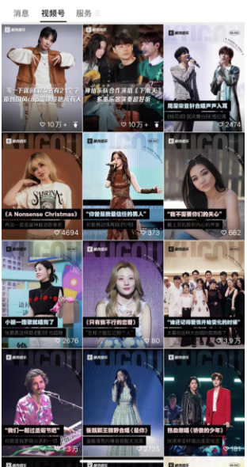

截图中前排两条内容的爱心标识旁显示**10万+**，按互动量记录，不改写成播放量。本组与抖音的音效任务分别说明。

### 入梦晚安电台：围绕场景组织持续栏目

围绕睡前陪伴，将艺人声音、歌词分享、延伸祝愿与晚安收尾组织为3分钟内音频。历史方案安排每周二、周四22:30更新，具体稿件随艺人与歌曲调整。

我负责整体策划、主题内容和站外推广；版权团队沟通艺人录制，电台团队配合站内推广。栏目需要持续内容与资源协作共同推进。

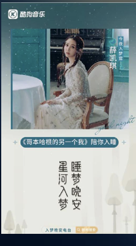

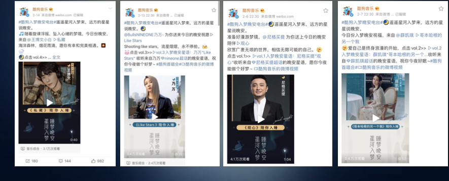

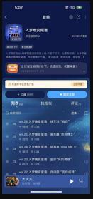

历史总结记录为**上线26期、站内播放84万**，统计周期尚待确认。两项分别描述内容数量与站内播放，不作为其他平台或当前累计成果。

### 这些作品体现的工作

从合作思路和活动机制，到音乐功能内容与持续栏目，我的工作是选择用户愿意参与的理由，组织入口、规则和表达，再通过独立策划、团队审核与跨部门沟通推进落地。

本页按任职期间的不同平台和内容任务组织作品。活动参与、话题浏览、合集播放、阅读和互动各有范围，分别记录；没有将它们相加为一个总成绩。

继续查看：[日夜精华油的产品内容策划](oil.md) · [其他项目](../home.md#代表项目) · [查看简历](../../portfolio-resume.pdf)

## 编辑依据与呈现说明

依据[原版完整案例](../../baseline/pages/projects/kugou.md)、[项目稿](../../portfolio-content/kugou/project.md)、[本人职责与数据记录](../../portfolio-content/kugou/酷狗作品集内容.md)及[素材索引](../../portfolio-content/kugou/asset-index.md)。补回r2未呈现的音效UGC、视频号和另一艺人电台海报，同时保留r2补充的站内节目截图；原版各平台独特证据全部保留。

客户端整体引流的200万+与CV的256万人次、21万的两种名称及统计范围仍待核对，r3继续不将其作为正文成果；原始记录与原版转录保留。发糖机8万人次／2.2万人次是活动阶段记录，不套用整体引流周期或单期截图日期；不据此计算转化率。电台仅保留原版26期／84万并注明统计期缺口，未新加基数未齐的完播率等指标。详见[共同证据清单](../evidence.md)。

A/B内容测试及安装状态跳转来自本人项目回顾，未伪造实验日志、逐轮胜出方案或转化提升。截图只支持公开入口与规则，不代表本轮验证过历史下载／拉起链路。原版与既有资料中的未来性业务目标不改写成已实现增长。

视听作品身份保持原样：抖音、视频号为截图；公众号两张截图为同一篇文章；电台方案与总结为历史资料，未验证当前排期或在播状态。微博独立策划、其他平台统筹审核和团队制作分别说明。原件、CV与网页未修改，取舍见[通用版r3对照](../reviews/general-r3-vs-baseline.md)。
