# 童颜面膜内容稿

版本：`general` 内容 r3，2026-11-02。基于原版完整案例校准，尚未接入网站。

## 网页正文

### 童颜面膜｜在旧品认知上讲清升级价值

童颜面膜是在品牌已有胶原炮面膜基础上升级的产品。旧品已有成熟认知，内容需要讲清继承了什么、增加了什么，以及用户为什么考虑新版。

我的工作是梳理升级卖点，将其写成上新长文、海报与朋友圈、故事视频、直播产品讲解和商城详情页，让不同阅读与沟通场景各有合适的解释。

**我的职责：产品卖点与多渠道内容策划、文案及视频脚本。** 直播部分为参与话术讨论并制定产品讲解内容，视觉设计制作由设计师完成。

**项目整体结果：童颜面膜上新 GMV 100万+，由团队及渠道共同完成。**

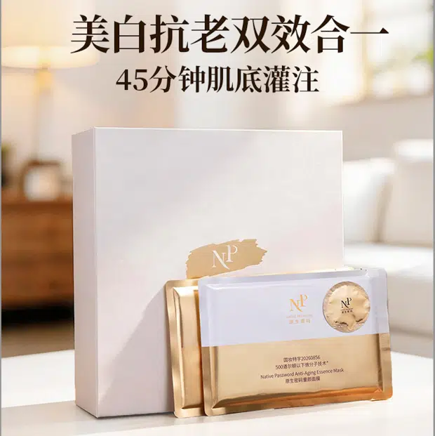

### 内容判断：承接熟悉认知，再展开新增价值

**让复杂资料有一个便于讲述的观点。** 从抗氧化资料中提炼“先停龄，再抗老”的历史传播表达，以漏水水桶一边漏水、一边加水的比喻组织护理叙事，给长文和销售讲解提供共同入口。

**用旧品认知承接升级。** 延续原有胶原护理与透皮技术的认知，再展开新版美白方向、双膜组合与使用体验。新旧对比负责解释变化，组件信息负责说明组合。

**把新增价值落到选择。** 将同价升级与45分钟居家护理体验作为当时的选择理由。老客理解并考虑新版是内容目标，现有材料没有可确认的用户迁移比例。

### 海报：用设问、分组与对应关系安排阅读

我负责图内文案、内容线稿和信息层级，设计师完成视觉制作。以下为本人补充提供的四组简版内容排版线稿与历史成品。

#### 问题切入：先提出护理疑问，再按相同维度对照

标题建立问题，主体划分两栏，将名称、图片和说明分别成组安排，底部再归纳主张。成品用底色与视觉标记强化分区。这里展示的是历史海报的对照结构，和后文的新旧产品升级图属于不同作品。

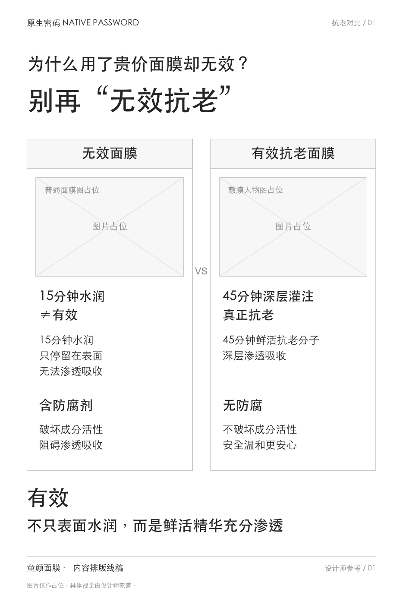
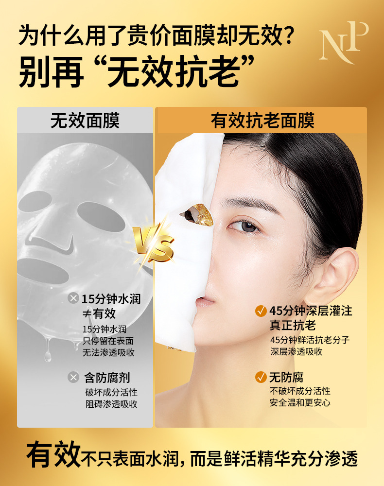

#### 双膜信息：让每个组件有自己的说明

先给总标题，再为白膜、金膜分别组织名称、主张与说明。成品通过产品位置、文字分区与引线，明确每组内容对应哪一张膜。

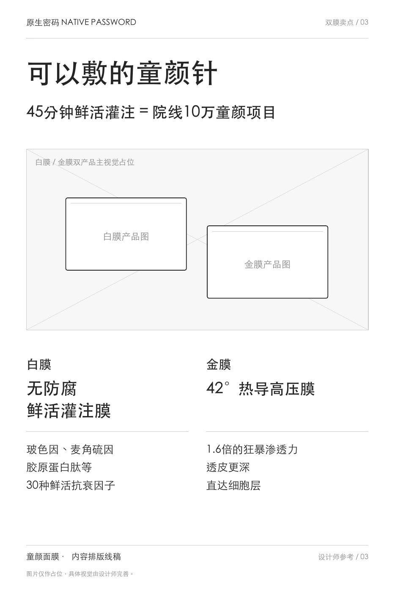
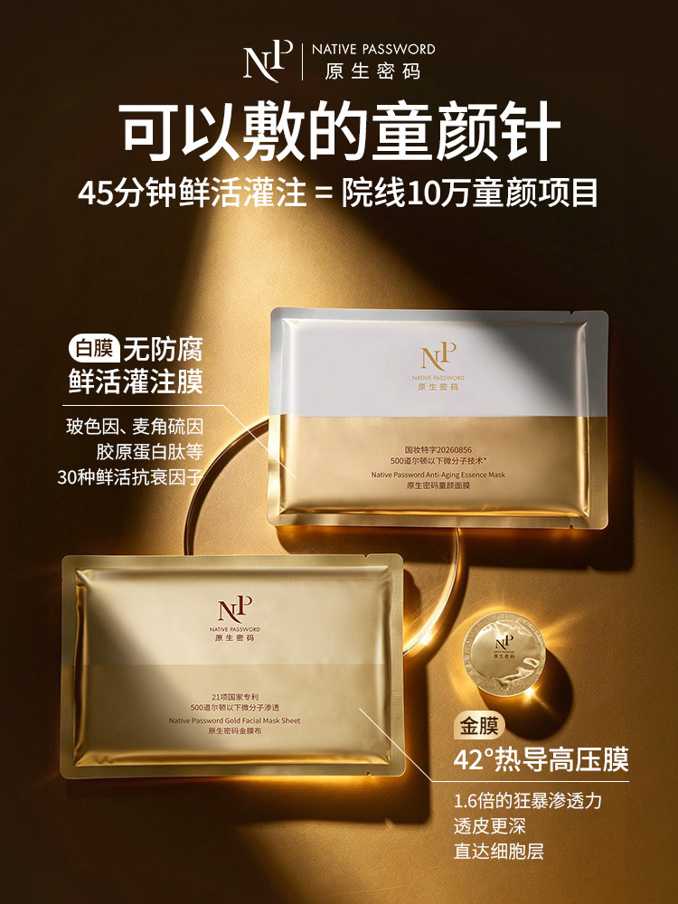

#### 成分分组：总主张之下，建立两组阅读入口

以历史表达中的“外抵御”“内充盈”分组安排成分名称和说明，技术介绍与产品组合另设位置。线稿明确文字区域，成品再用意象、字号和连线强化对应关系。

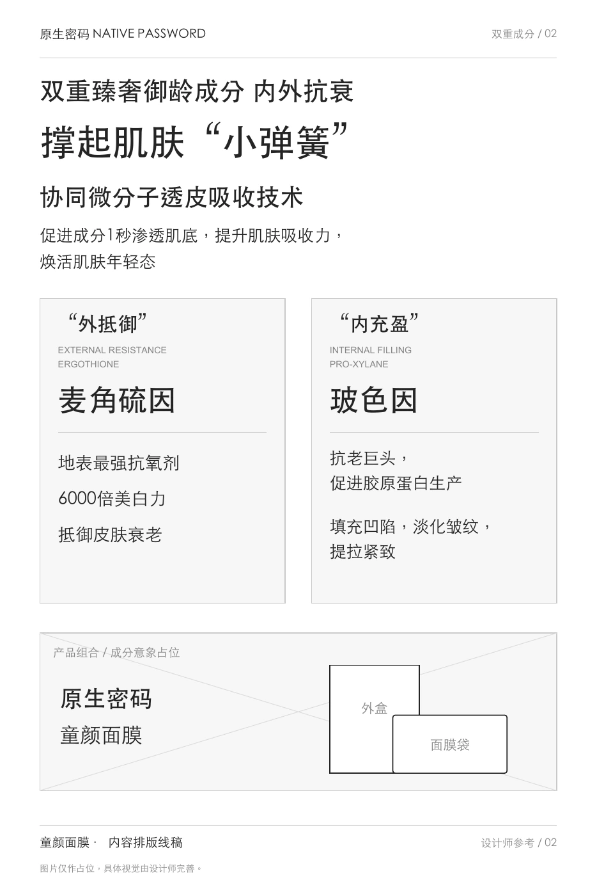
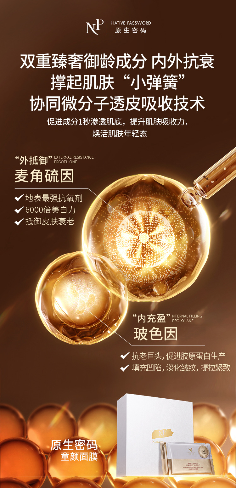

#### 资料展示：让截图与各自的说明放在一起

中部为两类资料分别安排说明与截图位置，加入产品组合，底部独立放置前后图片与收尾文字。本组保留历史标题和画面，阅读重点是资料分区及图文对应关系。

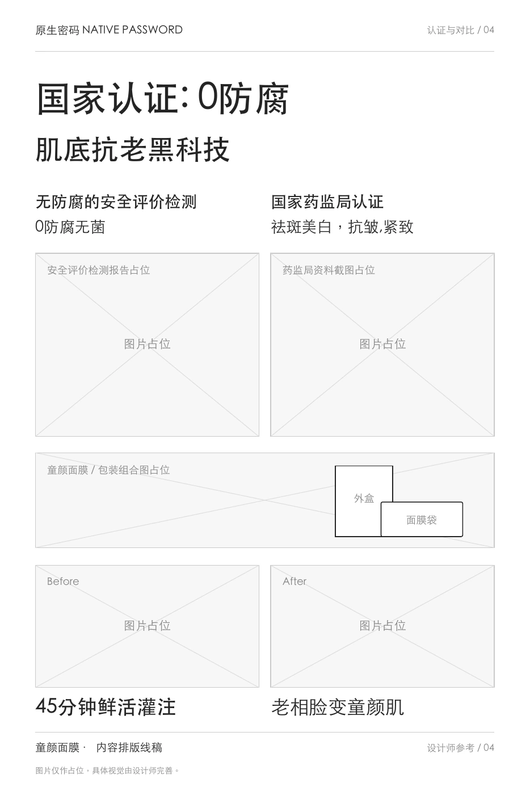
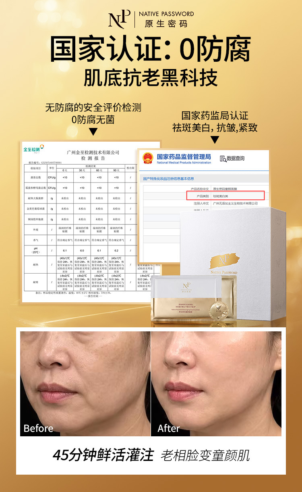

[查看四页简版线稿 PDF](../../portfolio-content/skincare-wireframes/tongyan-mask/mask-content-wireframes.pdf)

### 公众号：把多个组件与资料组织成连续阅读

我独立完成标题、结构、正文、图内文案与文字排版方案，设计师制作配图。文章从护理话题进入，串联新品特点、双膜、45分钟护理、抗氧、美白、胶原护理、面霜与首发套组。

**双膜结构。** 将白膜、金膜及其产品信息分开说明；具体使用安排结合文章上下文查阅。

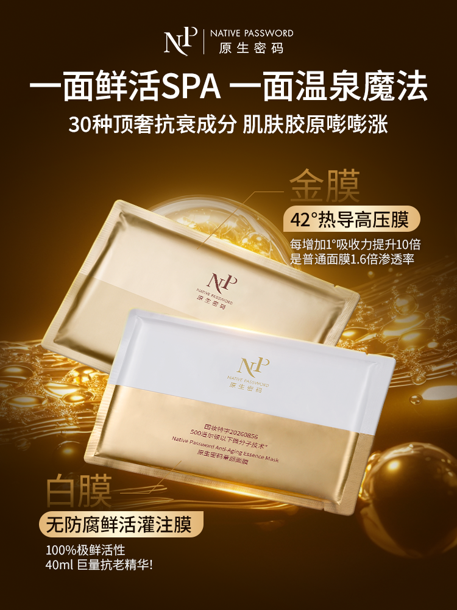

**美白信息。** 将成分名称与对应的护理表达归组，让较多资料有可辨认的阅读层级。

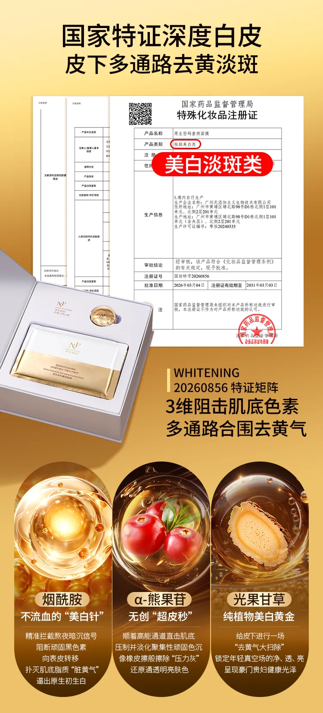

**胶原护理。** 将多组成分与说明安排到同一主题中，延续前文对产品特点的解释。

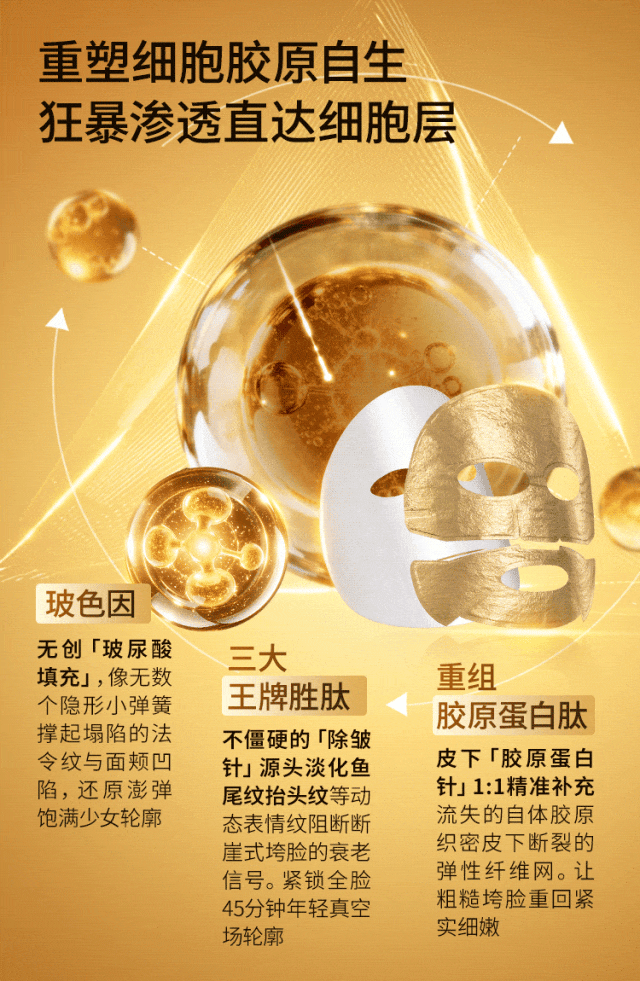

[查看公众号31页全文](../../portfolio-content/tongyan-mask/assets/wechat/mask-launch-article.pdf) · [查看文章结构分析](../../portfolio-content/tongyan-mask/docs/wechat-analysis.md)

### 朋友圈：配文提出观点，图片继续展开

我负责配文、图内文案与信息顺序，设计师做图。三组分别围绕升级差异、安心美白和效果诉求，避免一段短文重复整张海报的全部信息。

**新旧升级。** 配文集中提出技术升级角度，图片通过并列关系补充差异维度。

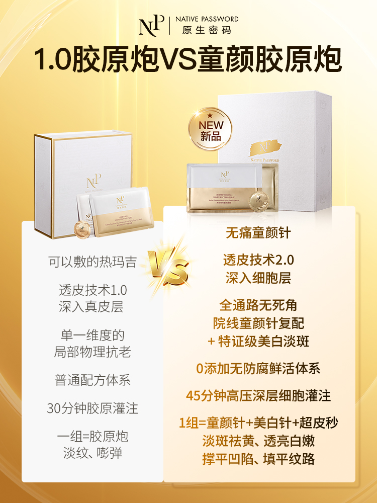

**安心美白。** 从效果诉求与使用顾虑的关系进入，将报告和配方信息组织为一个主题。

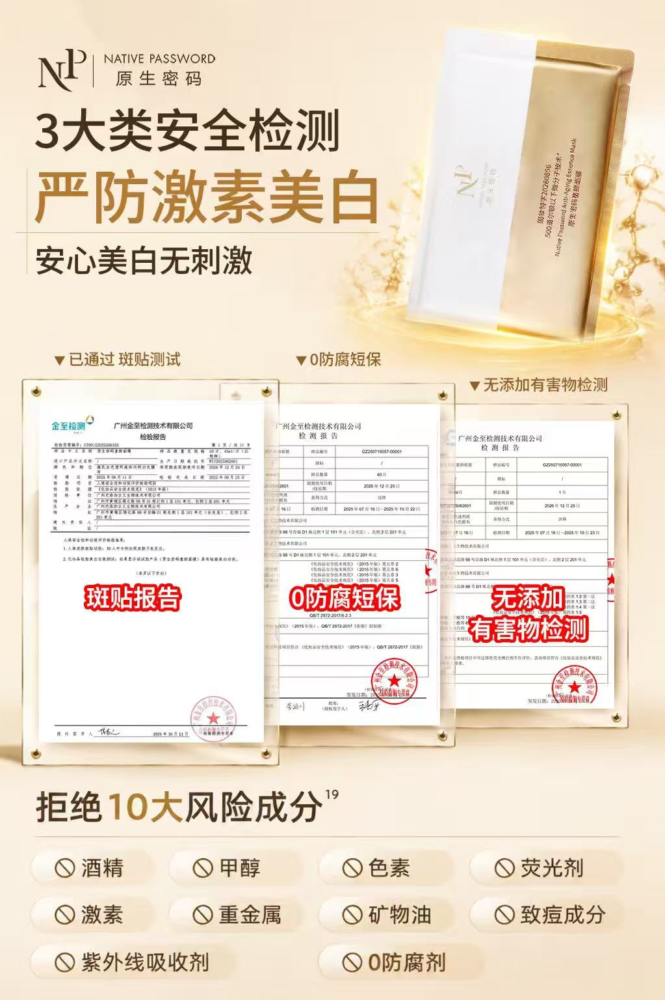

**效果表达。** 配文与图片分别承担记忆入口和直观观察对象，呈现当时的传播表达。

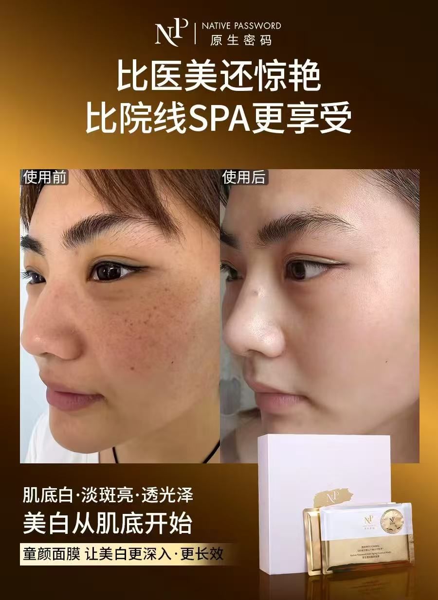

[查看三组历史配文及对应分析](../../portfolio-content/tongyan-mask/docs/moments-analysis.md)

### 三条视频：把产品转场写进不同的人物故事

三条完整脚本均由我撰写，达人合作中也沟通调整表达。以下结构依据现有成片整理，拍摄、剪辑及商务不归入已确认的个人职责。

#### 骆达华合作：从职业故事转到居家护理

以角色反差和片场状态进入，将情绪“消耗”连接到护理场景，再安排居家使用、产品资料与主题回扣。产品出现之前，先让人物故事为转场提供理由。

[观看骆达华合作视频](../../portfolio-content/tongyan-mask/assets/videos/mask-luodahua-preview.mp4)

#### 达人体验：让护理步骤有故事承接

从个人困扰与护理安排进入，经由个人故事和资料说明，落到双膜演示。片中分别展示白膜25分钟、金膜20分钟的历史使用内容，让步骤在人物叙事中被说明。

[观看达人体验与双膜演示](../../portfolio-content/tongyan-mask/assets/videos/mask-influencer-tutorial-preview.mp4)

#### 夫妻日常：通过怀疑与查阅推进理解

从妻子研究面膜的日常进入，以调侃、怀疑和查看资料形成对话，推动人物逐步认可，再回到新版护理方向与自我护理。信息随着对话展开。

[观看夫妻日常视频](../../portfolio-content/tongyan-mask/assets/videos/mask-influencer-story-preview.mp4)

[查看三条视频逐段分析](../../portfolio-content/tongyan-mask/docs/video-analysis.md)

### 直播讲解：让观众跟得上抽象信息

我参与话术讨论并制定产品讲解内容。以下图片是主播实际表达的文字记录截图，用于观察直播中的内容呈现；它们并非我的完整历史交付稿。

**先承接旧品，再说明新版。** 从用户熟悉的产品与护理困扰进入，交代升级理由，给后面的资料和组件说明建立背景。

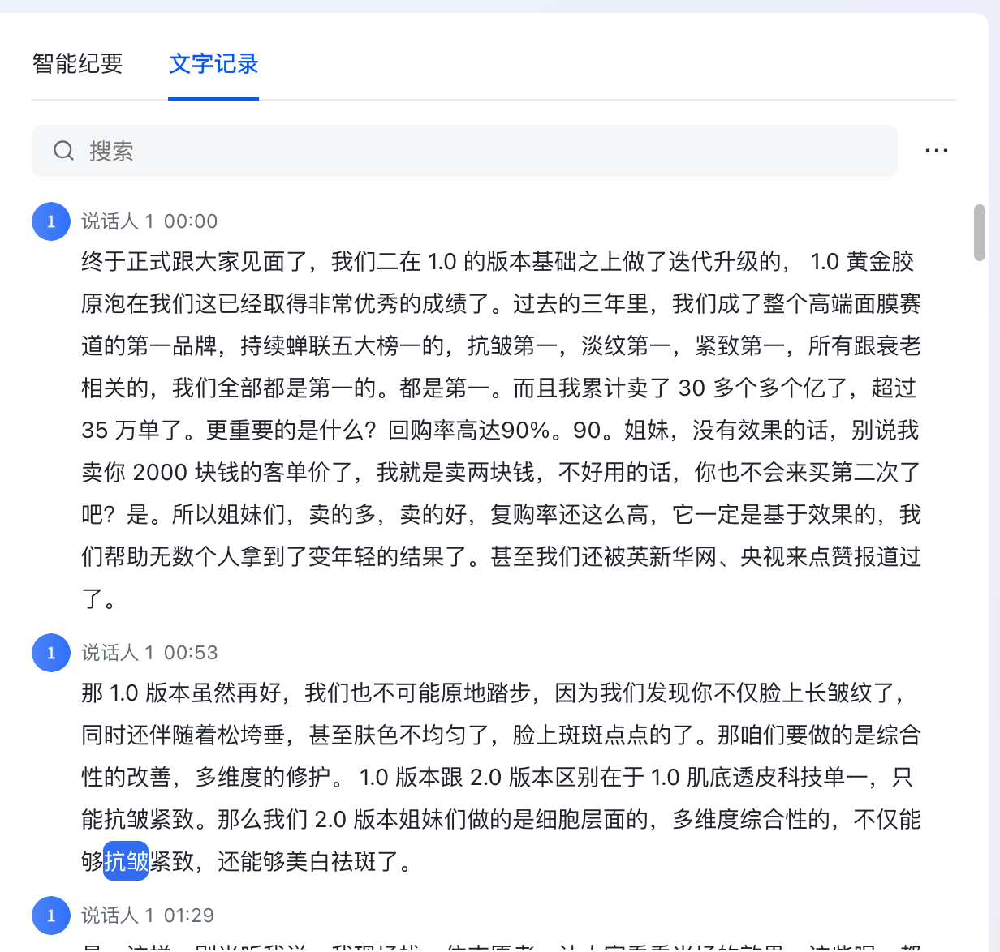

**用熟悉事物承接抽象概念。** 葡萄与葡萄干的比喻帮助观众形成直觉，再接回产品讲解。

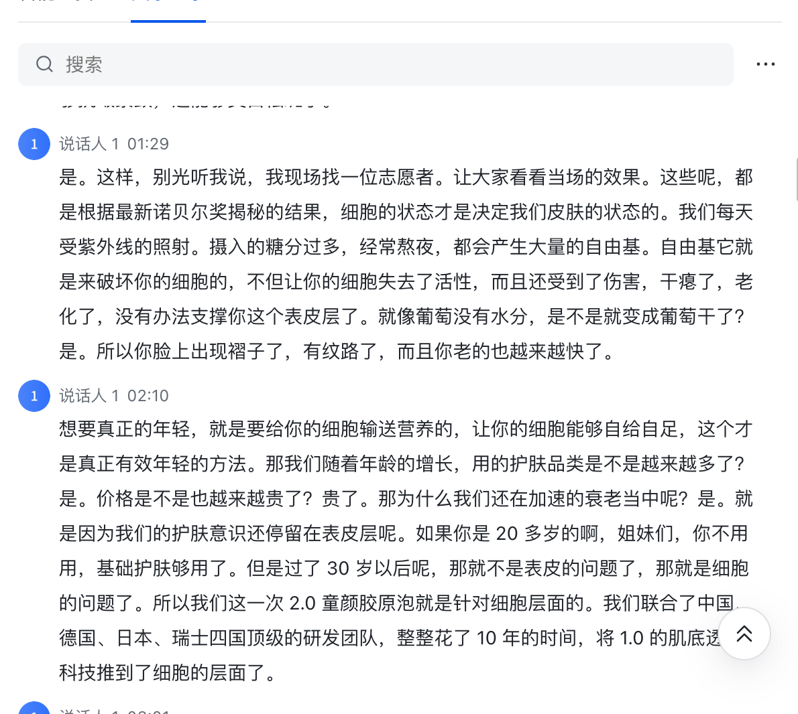

**给演示设置观察重点。** 对照演示与尺度解释配合，让观众知道当前看哪里，再继续说明护理步骤与产品资料。

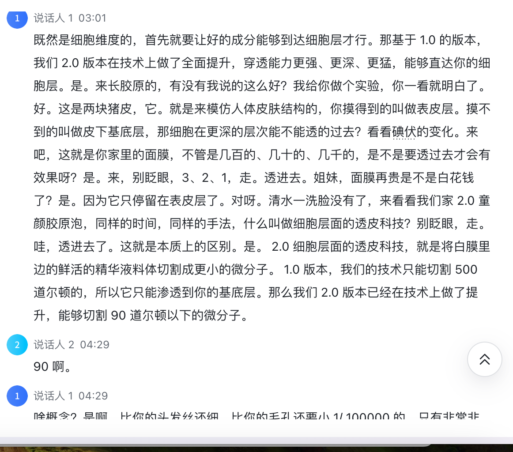

[查看完整11张记录及讲解分析](../../portfolio-content/tongyan-mask/docs/live-analysis.md)

### 商城详情页：把升级信息组织成自主阅读

我负责整页文案、内容结构与信息顺序，设计师完成视觉制作。页面将需求、新旧对比、技术与组件、成分分组、资料和使用方法串成连续阅读。

长文可以通过正文转场，详情页则需要让模块标题、图片和短说明各自交代重点。以下两张完整长图保留原页，便于连同上下文查阅。

[查看详情页结构说明](../../portfolio-content/tongyan-mask/docs/detail-analysis.md)

### 私域沟通：保留方法示例的材料身份

原项目中也负责销售话术。历史原稿未留存，现有资料包中的沟通示例是后期依据产品资料重建，用于说明需求了解、卖点选择、顾虑回应与使用说明的组织方法。

[查看后期重建示例，非历史原稿](../../portfolio-content/tongyan-mask/docs/private-sales-reconstructed.md)

### 项目结果与我的贡献

**童颜面膜上新 GMV 100万+。** 这是项目及渠道共同完成的整体成绩，未提供老客迁移比例或单条内容成交归因。

本案展示的是承接旧品认知、解释升级变化，并按图文、人物故事、实时讲解与自主查阅的不同任务重组信息。

图文和成片中的技术、功效、比较、数值及历史活动按原作保留。案例说明聚焦内容组织，未将历史表达转为本轮独立核实的产品结论。

继续查看：[洁面的短文案与信息层级](cleanser.md) · [其他项目](../home.md#代表项目) · [查看简历](../../portfolio-resume.pdf)

## 编辑依据与呈现说明

依据[原版完整案例](../../baseline/pages/projects/mask.md)、[项目稿](../../portfolio-content/tongyan-mask/project.md)、[视频分析](../../portfolio-content/tongyan-mask/docs/video-analysis.md)与[直播分析](../../portfolio-content/tongyan-mask/docs/live-analysis.md)。以原版为起点恢复四组海报、完整图文、三条视频及直播证据；未将其列为补充案例理解为删减独特能力证据。

线稿身份见[来源说明](../../portfolio-content/skincare-wireframes/tongyan-mask/README.md)：2026年10月29日本人补充提供的简版内容排版稿，不写成已核实的当年原始稿。问题切入海报不是已核实的新旧产品对比；朋友圈新旧升级图另行展示。双膜结构图的图注只说明组件与层级，具体使用内容由全文和成片支持。

直播为参与讨论及制定产品讲解，不等于整场主播稿、全程逐字独立写作或直播运营。未将截图中的所有比喻认定为本人独创。完整11张截图保留原入口；后期整理SOP不作为历史原始方案，未新增为本页主要作品。

沿用本人2026年10月27日确认的“上新GMV100万+”，不写首月。三条视频结构使用既有分析，未新增逐字脚本、统一排期、用户调研或迁移结果。原始材料、CV与网页未改动，取舍见[通用版r3对照](../reviews/general-r3-vs-baseline.md)。
