# 日夜精华油内容稿

版本：`general` 内容 r3。精华油于2026-11-01完成单案修订，2026-11-02纳入通用版完整内容校准；原单案归档继续保留。网页正文与编辑说明分开，尚未接入网站。

## 网页正文

### 日夜精华油｜为双产品建立一条内容主线

品牌已确定日用、夜用两瓶精华油的产品方案。内容需要继续回答：消费者为什么关注这类产品，怎样理解“精华入油”，以及两款产品如何放进早晚护理场景。

我从产品信息出发，梳理卖点和沟通重点，再将同一条主线延展为海报、公众号、朋友圈、视频脚本与销售沟通内容。

**我的职责：产品内容策划、文案、内容结构与视频脚本。**

**项目整体结果：产品／套组上市两周，私域 GMV 460万+，由团队及渠道共同完成。**

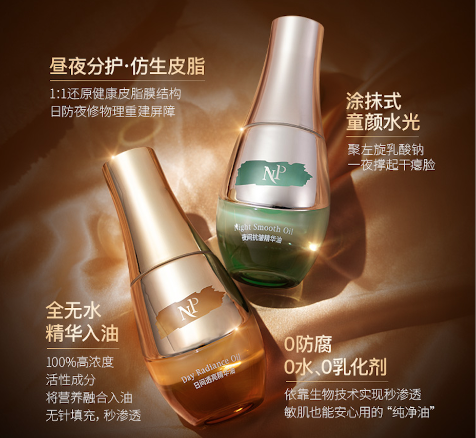

### 项目任务与我的分工

两瓶产品需要共同的介绍入口，也需要各自清楚的角色。如果直接堆叠成分、技术和使用信息，读者仍然不容易复述它们的区别。因此，我先选择解释顺序，再安排不同形式的内容。

| 由我负责 | 团队协作 |
| --- | --- |
| 参与产品信息与沟通重点讨论，完成卖点梳理 | 配方、规格、定价及日夜产品方案由相关团队确定 |
| 公众号标题、正文、图内文案与版式规划 | 设计师制作配图与视觉成品 |
| 海报及朋友圈的文案、信息层级和图文顺序 | 设计师负责视觉设计与制作，包装设计不计入个人贡献 |
| 四条视频脚本与达人表达调整 | 拍摄、剪辑及明星商务由相关团队或合作方完成 |

### 内容判断：先给理解入口，再展开产品与场景

**从具体困扰进入。** 从干燥、紧绷、上妆卡粉等护理话题切入，以“皮脂膜”作为贯穿内容的解释线索，用“保护层”的类比连接日常经验，再转到产品信息。

**提炼一句可以延展的表达。** 用“表补油，里补精华”概括当时的产品沟通特点。短句承担记忆入口，正文、结构图和口播继续展开精华与油相的信息。

**把既定双瓶方案放进早晚场景。** 在共同主线下，分别梳理日间透亮护理与夜间修护、抗皱护理的表达重点。产品方案由团队确定，我负责两款产品如何被介绍、比较和讲述。

### 海报：把卖点变成看得见的信息层级

海报需要集中解释一个主题。我负责文案、内容层级及图文关系，视觉成品由设计师完成。以下保留三组对照：日间与夜间显示系列结构和不同角色，资料信息组显示多项信息怎样分区。

以下使用本人补充提供的**简版内容排版线稿**，与对应历史成品配对，展示文案、信息层级和图文关系。每组先列线稿，再列成品。

#### 日间透亮：围绕日间角色选择信息

简版线稿先放产品主张与名称，再以“智能抗氧盾”“祛黄提亮”“妆前打底”三个历史文案标签组织短说明，另一侧预留产品与外盒画面。信息都围绕日间护理与上妆场景展开，底部短句收束记忆。

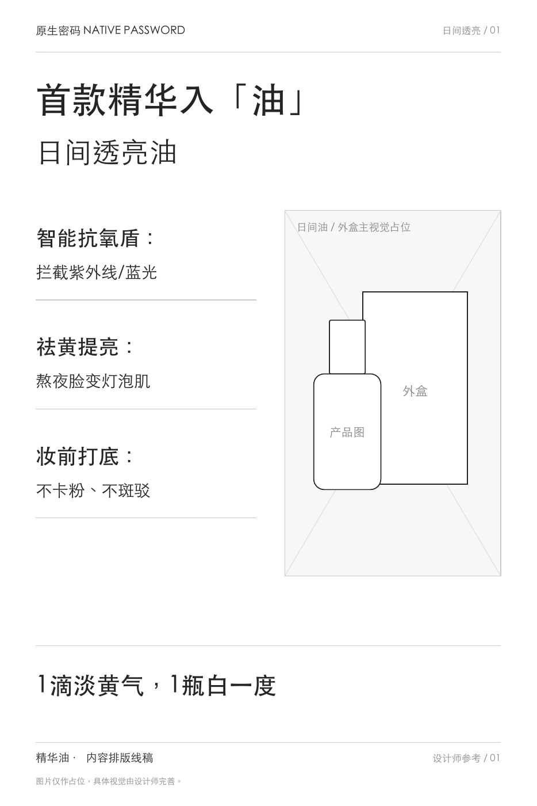
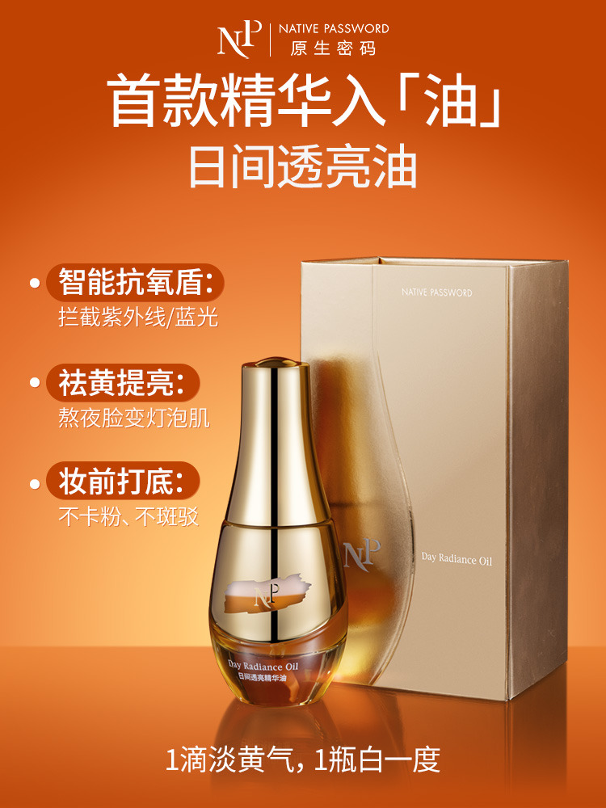

对照重点：标题先交代产品角色，三组标签分别解释一个方向；成品用字号、标签和主视觉强化主次。产品与外盒在这里承担画面位置，不将包装设计归为本人工作。

#### 夜间修护：保留共同结构，区分讲述重点

夜间海报沿用标题、三组卖点与收尾信息的骨架，把标签换为“深层修复”“喂饱胶原”“抚平纹理”等当时的传播表达。系列的共同结构便于比较，两款各自的主题则通过文案和视觉进一步区分。

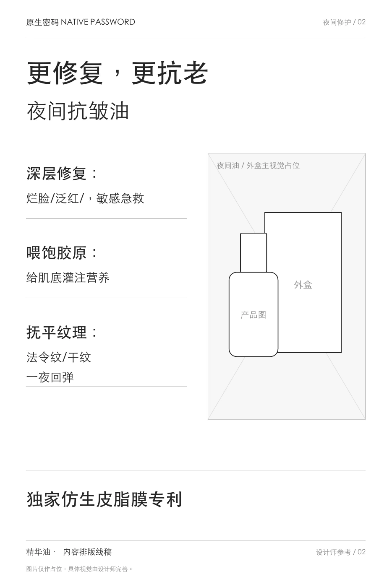
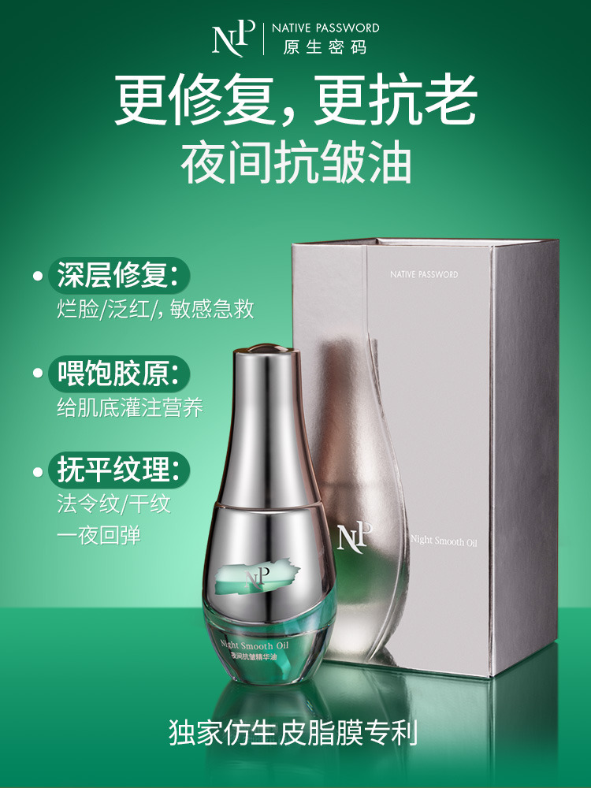

对照重点：相同的信息位置承接不同内容，让两张海报既属于同一组产品，又各有明确角色。本人负责内容结构与文案，视觉由设计师完成。

#### 资料信息：让五组标签与数字分别对应

这张作品把多项资料拆成五组标签与数值，并区分人物、双瓶产品与信息的位置。线稿用分组明确归属，成品再通过字号和位置突出各项内容。

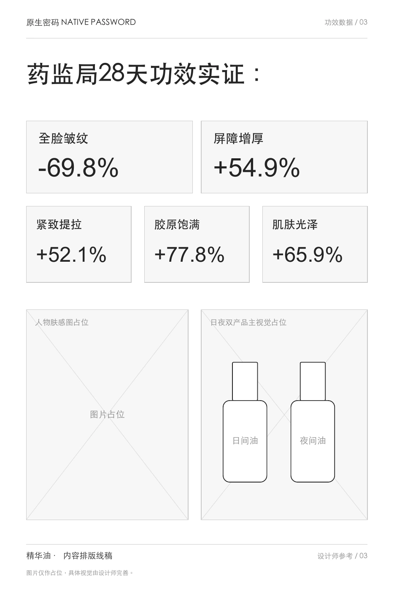
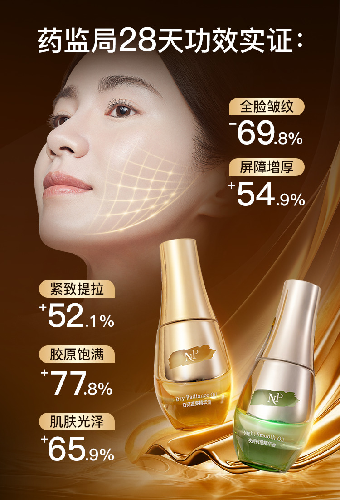

本组的阅读重点是标签与数值如何配对，以及信息怎样围绕人物和产品展开。图中数字与标题按历史作品保留，未作本轮独立核验。

[查看三页简版线稿 PDF](../../portfolio-content/skincare-wireframes/essence-oil/oil-content-wireframes.pdf)

### 公众号：让核心概念贯穿一篇完整上新长文

我独立完成标题、正文、图内文案与版式规划，由设计师制作配图。2025年12月26日发布的文章，以人物与护理问题进入，随后展开概念、产品特点、日夜区别、使用信息及首发选择。

正文负责设问、解释和转场，配图集中解释一个主题。全文不是把所有卖点并列，而是让前一部分为后一部分提供理解基础。

| 阅读部分 | 内容如何承接 |
| --- | --- |
| 人物与护理困扰 | 为“为什么关注”提供进入话题的情境 |
| 皮脂膜概念与资料 | 建立后续产品介绍共用的解释线索 |
| 精华入油与日夜双瓶 | 从共同特点转到两款产品的不同角色 |
| 使用、首发选择与互动 | 从理解产品转到具体动作、方案查阅和结尾互动 |

#### 产品结构：短句之后，继续解释是什么

原文第14页以标题、产品形象、结构和比例组织同一主题，用图内层次接住“精华入油”的记忆表达。我负责这里的内容与图内文案。

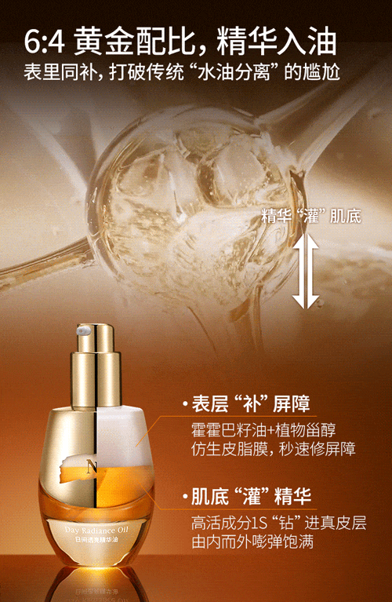

#### 日夜双瓶：从共同主线转到不同场景

原文第16页把两款产品并列到早晚场景中。读者可以沿着相同结构比较两款各自的介绍重点；这是对既定双瓶方案的内容表达。

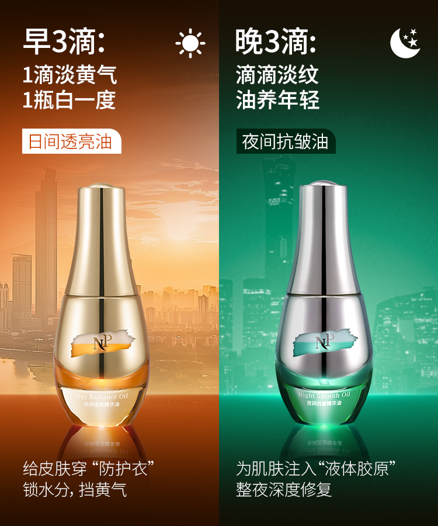

#### 使用方式：让信息对应具体动作

原文第20页呈现三种不同使用方式，每组将方法名称、示意图与说明放在一起，便于按需要查阅。

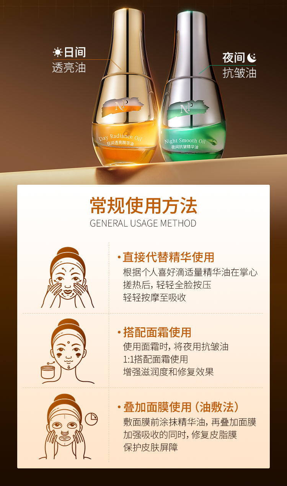

[查看公众号25页全文](../../portfolio-content/essence-oil/assets/wechat/oil-launch-article.pdf)

### 朋友圈：一次集中解释一个理由

长文可以连续展开，朋友圈则需要更明确的单次沟通重点。我负责配文、图内文案及信息顺序，设计师完成视觉制作。以下三张作品保留两类任务：从护理困扰进入概念，以及解释精华与油相的产品特点。

#### 需求与概念：先提出读者能识别的问题

第一张从护理困扰进入，第二张继续解释皮脂膜话题。两张图各有重点，形成从问题到概念的阅读关系。

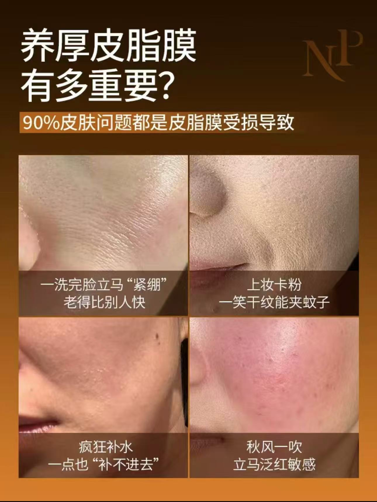

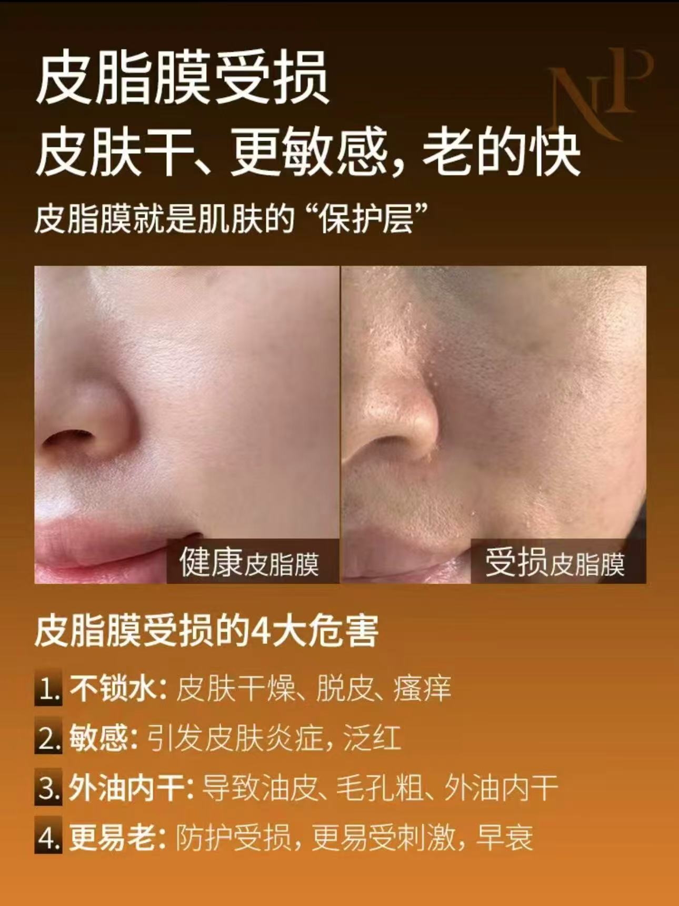

#### 产品特点：短图文围绕一个主题展开

这张以“精华入油”为主标题，配合双瓶形象及下方的信息分组，让标题、产品和补充说明围绕同一个主题。

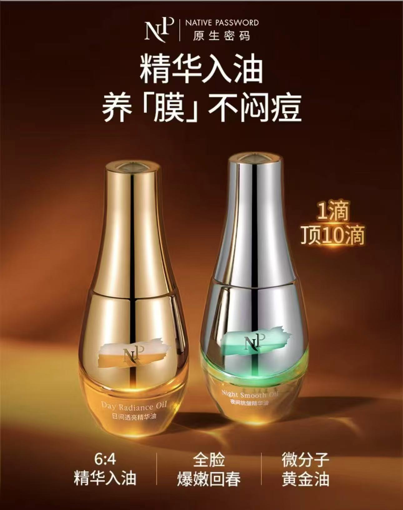

### 四类视频脚本：同一内容方向，不同讲述方式

四条脚本均由我撰写，其中品牌科普与刘晓庆合作推广脚本独立完成；达人合作中，根据账号风格和发布要求沟通调整表达。拍摄、剪辑与商务由相关团队或合作方完成。

#### 品牌科普：先让专业概念有日常入口

从冬季干燥与清洁习惯的疑问进入，用生活类比解释皮脂膜，再转到油脂护理、原料和使用画面。与直接介绍本品的内容相比，它更侧重概念与品类理解。

脚本处理：生活现象引出疑问，再解释概念，用转折把话题收回油脂护理，最后落到原料与动作。

[观看品牌科普成片](../../portfolio-content/essence-oil/assets/videos/oil-sebum-education.mp4)

#### 刘晓庆合作推广：让卖点进入人物讲述

从熟龄护理话题进入，将皮脂膜、精华入油和日夜区别串进人物口吻；后段再补充使用、价值判断与推荐。产品信息由人物话题带入，并穿插产品和使用画面。

脚本处理：人物关注点与核心概念相接，再逐一解释两款的角色，最后回到选择理由。

[观看刘晓庆合作推广成片](../../portfolio-content/essence-oil/assets/videos/oil-liuxiaoqing.mp4)

#### 达人答疑：用问题、回应与反问推进

以护肤疑问开场，经由日常护理的类比进入皮脂膜和产品，再展开早晚场景。连续对话承接了较多信息，表达仍保持达人式口语。

脚本处理：开头先留出需要回应的问题，随后逐层带入概念、产品及日夜区别，让信息有连续的推进关系。

[观看达人问题答疑成片](../../portfolio-content/essence-oil/assets/videos/oil-influencer-qa.mp4)

#### 达人使用场景：把信息写成可以演示的动作

从使用体验和用法疑问进入，以三个方法段落组织场景、步骤和动作画面。不同方法各有标题、操作和收尾，口播可以与产品、手部混合和上脸画面对应。

脚本处理：先交代场景和方法，再将信息拆成可演示的动作；每个段落集中完成一个方法的说明。

[观看达人使用场景成片](../../portfolio-content/essence-oil/assets/videos/oil-tutorial.mp4)

脚本结构依据现有成片整理，历史逐字原稿未留存。提供的文件为压缩查阅版，画质有限。

[查看四条视频的逐段分析](../../portfolio-content/essence-oil/docs/video-analysis.md)

### 销售沟通：把内容组织成可回应的问题

原项目中，我也负责销售客服话术，将概念、日夜区别、肤感顾虑和使用方式组织成可调用的沟通内容。

**以下为后期重建的结构示例，非当年话术原稿或真实客户对话。**

> 问题：为什么精华油要分日用和夜用？
>
> 组织方式：先了解客户的早晚护理习惯，再分别解释日间与夜间产品的沟通重点，最后连接具体使用方式。

这个例子展示从客户关注点选择解释内容的方式：了解护理习惯，选择相关卖点，解释两款区别，再承接使用说明。

[查看销售沟通后期重建全文](../../portfolio-content/essence-oil/docs/private-sales-reconstructed.md)

### 项目结果与我的贡献

**日夜精华油产品／套组上市两周，私域 GMV 460万+。** 这是团队及渠道共同完成的项目整体成绩，没有单篇文章、单条视频或个人内容的销售归因数据。

我的贡献是从产品资料中选择沟通重点，形成可以持续展开的主线，再根据海报、长文、短图文、人物讲述和问答的不同任务安排信息。海报对照呈现内容层级，公众号呈现连续解释，朋友圈呈现单次重点，四条视频则呈现不同讲述方式。

图文和视频保留历史传播表达。原图中的人物、功效、比例与技术说法作为历史作品查看，不视为本次作品集已独立核实的产品结论。

继续查看：[酷狗音乐的活动与运营](kugou.md) · [其他代表项目](../home.md#代表项目) · [查看简历](../../portfolio-resume.pdf)

## 编辑依据与呈现说明

精华油正文沿用2026年11月1日的单案r3，本轮仅更新版本关联。以[原版完整案例](../../baseline/pages/projects/oil.md)为默认起点，保留原有任务、分工、三个判断、三组海报对照、公众号、朋友圈、四条视频、重建示例与成果范围；不把恢复遗漏内容称为新增能力。

海报来源见[原件说明](../../portfolio-content/skincare-wireframes/essence-oil/README.md)：本人于2026年10月29日提供三页简版线稿和三张成品。正文只称简版内容线稿，未写成已确认的历史原始底稿；图片原件与既有来源文件均未修改。

公众号与视频依据[项目稿](../../portfolio-content/essence-oil/project.md)、[文章分析](../../portfolio-content/essence-oil/docs/wechat-analysis.md)、[脚本分析](../../portfolio-content/essence-oil/docs/video-analysis.md)及[既有选材要求](../../portfolio-content/essence-oil/selected-materials.md)。日期和25页已在此前核对；使用图展示三种方法，不写成连续三步。图文分组与四条视频按内容任务整理，不据此补造统一发布排期；未留存的朋友圈配文不补写为历史原文。“表补油，里补精华”按历史传播表达处理，不扩展为本轮验证的分层作用机制。

本稿把三组海报对照、六张图文及代表封面直接嵌入，四条视频各有独立文件入口。网站实现时可延续原版日间／夜间主展示、资料信息折叠补充的方式，审阅稿完整展开；当前不制作新的代码交互或视觉版式。

销售示例沿用原版已展示的重建结构，全文仍另附；不将重建文字作为本人当年的原始交付。成果沿用产品／套组上市两周私域 GMV 460万+，不突出待核对的“0投放”。

逐项取舍与素材覆盖见[原版对照](../reviews/oil-r3-vs-baseline.md)。本文件即完整内容工作稿，含全部正文、13幅图像及四条视频查阅入口，不另制作内容报告 PDF。已有作品 PDF 继续作为原始资料引用；网页视觉与实现留到后续。
