# 高客单防晒内容稿

版本：`general` 内容 r3，2026-11-02。以原版完整案例为起点校准，尚未接入网站。

## 网页正文

### 高客单防晒｜解释护理价值，也回应肤感顾虑

高客单定位在项目开始时已经确定。内容要回答两个相互关联的问题：为什么值得这个价格，以及加入精华护理后，会不会厚重、假白、搓泥，影响后续上妆？

我从0到1梳理卖点与内容主线，将护理价值与轻薄体验分别展开，再写成公众号、朋友圈、销售话术、详情页和四条明星／达人视频脚本。

**我的职责：产品卖点与内容策划、文案、海报内容线稿及视频脚本。** 视觉设计、拍摄剪辑与商务由相关团队协作完成。

**项目整体结果：防晒上新半个月，私域 GMV 120万+，由团队及渠道共同完成。**

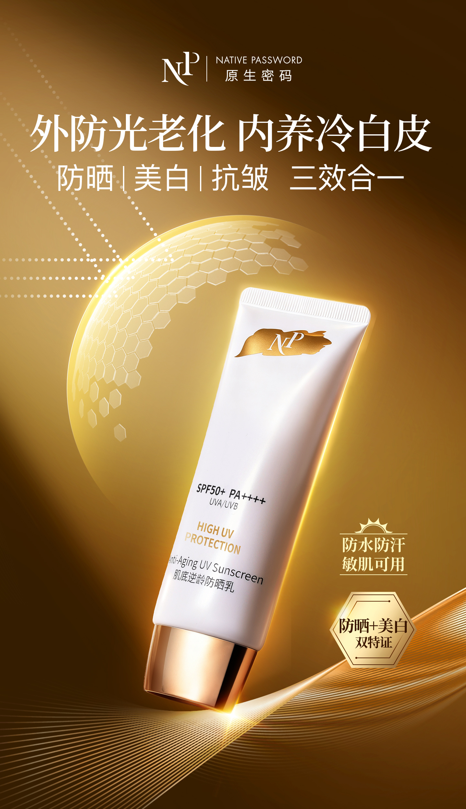

### 内容判断：价值解释之后，还要接住使用疑问

**先建立价值参照。** 以“1支防晒半支精华，外防光老化，内养冷白皮”作为当时的传播表达，将防晒与精华护理联系起来，再分主题安排成分与技术资料。“半支精华”承担记忆和价值表达的任务。

**让肤感有独立篇幅。** 护理价值越丰富，越需要回应使用负担。我把厚重、搓泥、假白单独展开，让质地、推开、成膜与上妆各有对应内容。

**按阅读与沟通任务改写。** 长文解释完整价值，朋友圈一次集中一个主题，话术按客户问题调用信息，详情页支持查阅，视频通过人物与动作推进。定价和产品方案由团队确定，我负责如何介绍与讲述。

### 海报：四种内容任务，分别安排信息层级

四组海报用于私域一对一与朋友圈种草，文案和内容线稿由我负责，设计师完成视觉制作。以下按内容任务列出本人补充提供的简版内容排版线稿及历史成品。

#### 养肤价值：总主张之下，让四组信息分别对应

总标题建立养肤定位，下方将透亮、细腻、嘭弹、滑嫩分为四组。原图保留“使用4周、受试者自评体验”的条件，数值与各自描述配对。线稿明确文字分组，成品将信息安排在人物与产品旁。

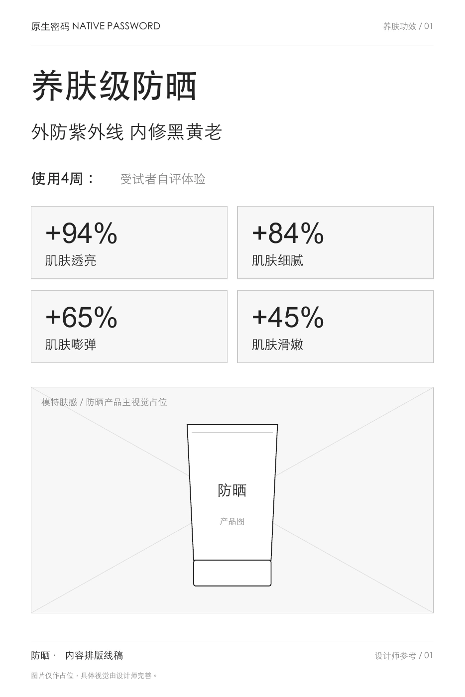
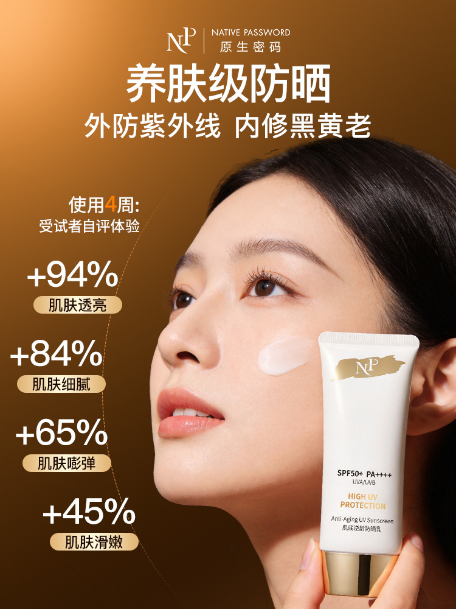

#### 肤感回应：三个短标签，方便按顾虑查找

用“透”“贴”“敏肌友好”组织三个阅读点，每组接一段对应说明。成品通过文字位置、字号与引线，将产品、乳霜质地和各项解释连接起来。

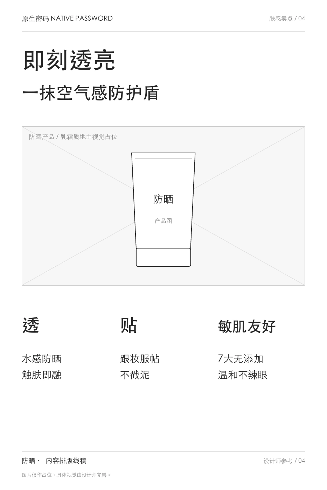
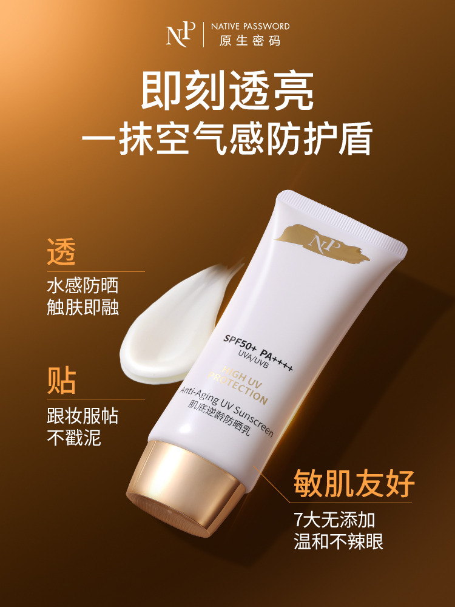

#### 新品预热：先传达上新状态，再留下展开线索

标题集中呈现新品状态与高端联想，主体保留产品占位，再安排数字、成分和使用感信息。成品用产品剪影、明暗和字号建立主次，给后续介绍提供可继续展开的话题。

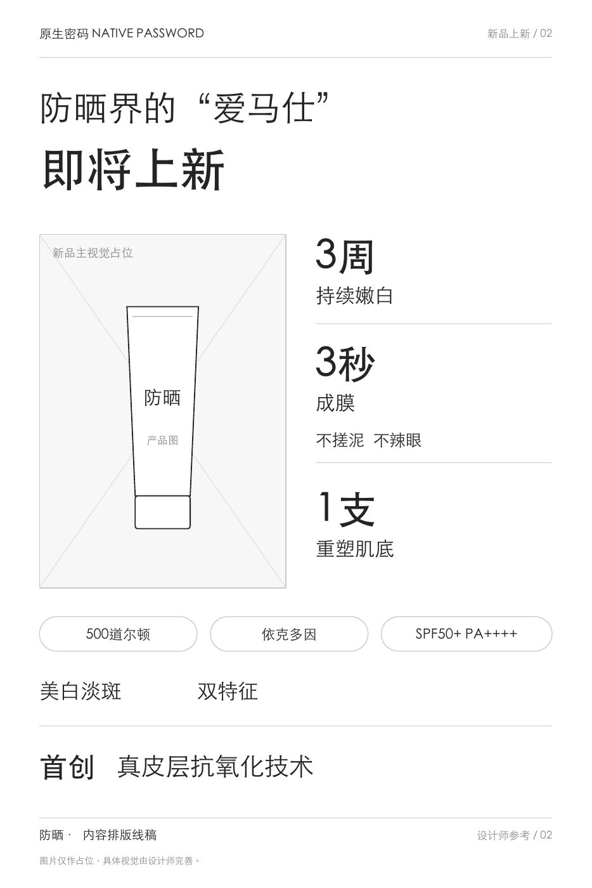
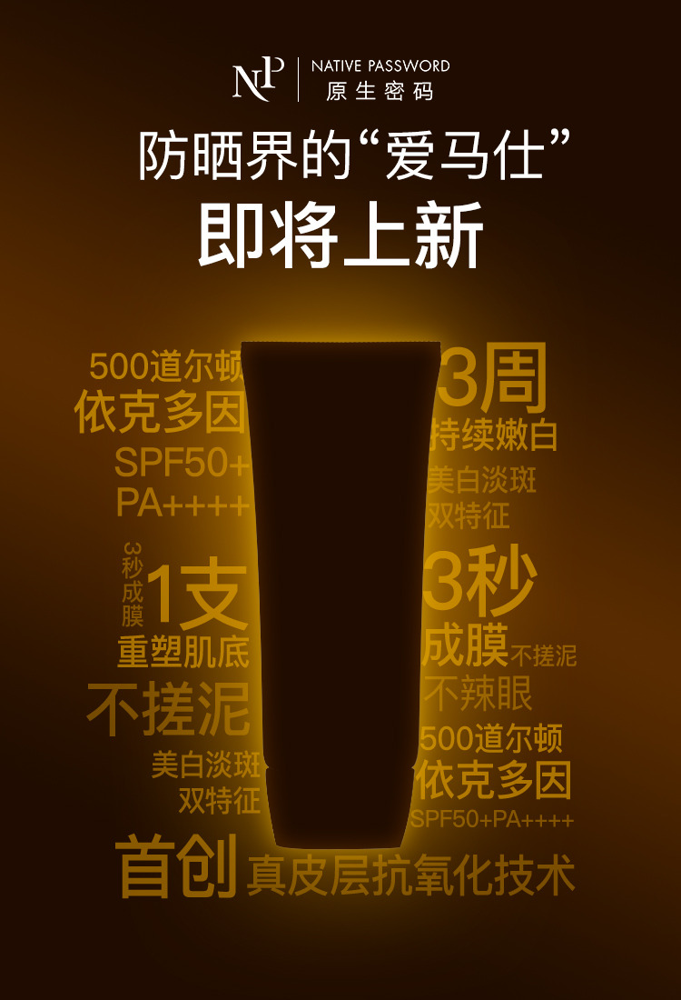

#### 使用反馈：场景与反馈分区，图文逐条配对

上半部以夏日场景和产品承接主张，下半部集中放置反馈。两组文字分别配人物图片与署名，让场景、产品和历史体验表达各有位置。图中反馈按历史作品保留，未作本轮独立核验。

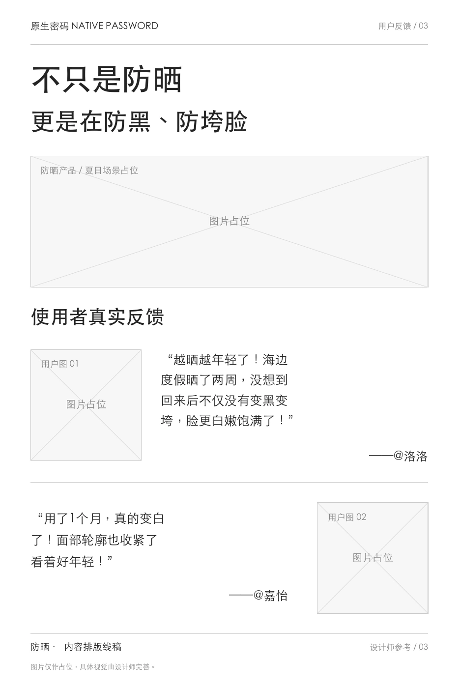
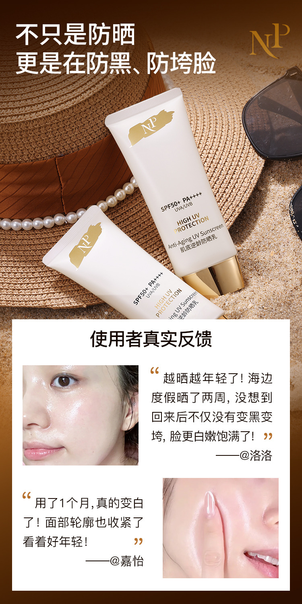

[查看四页简版线稿 PDF](../../portfolio-content/skincare-wireframes/sunscreen/sunscreen-content-wireframes.pdf)

### 公众号：先建立价值，再接住使用疑问

我负责上新长文的内容与文案。文章先亮出防晒、美白与抗老的组合定位，再展开护理成分、成膜与肤感，后部承接资料、人物反馈和首发套组。正文负责设问与转折，配图集中解释一个主题。

**第5页：护理价值对照。** 将防护与护理放在同一张图中组织，给后续成分说明建立价值参照。

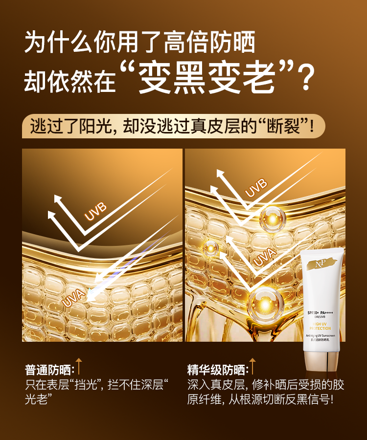

**第19页：使用顾虑切入。** 将厚重、搓泥等问题先列出来，为后面的质地与肤感解释建立明确对象。

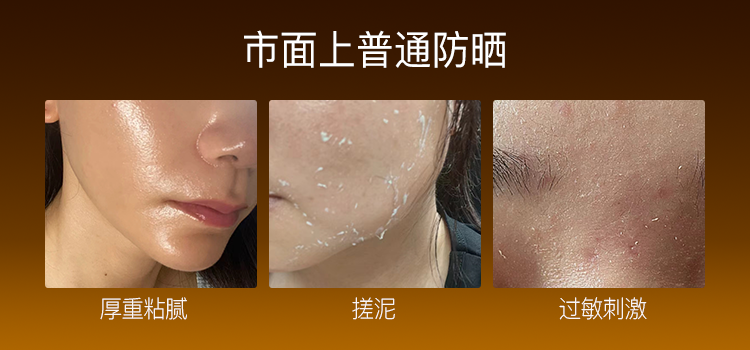

[查看公众号31页全文](../../portfolio-content/sunscreen/assets/wechat/sunscreen-launch-article.pdf)

### 朋友圈：把同一主线拆成三个单主题

我负责配文、图内文案及信息顺序，设计师制作图片。三组内容分别承担资料说明、精华价值与肤质搭配的任务；配文点题，图片继续展开。

**精华护理价值。** 将防晒连接到精华护理的价值参照，集中说明为什么关注这款产品。

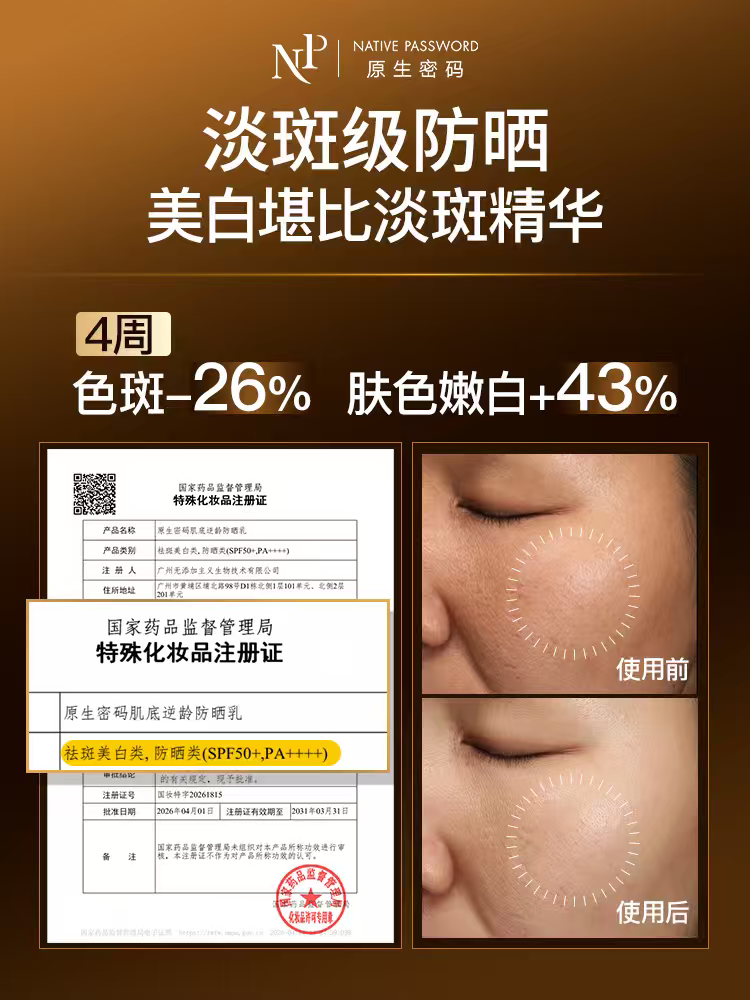

**护理搭配。** 按油皮、干皮与熟龄护理三个关注点分组，用产品图和短句连接不同的护理安排。

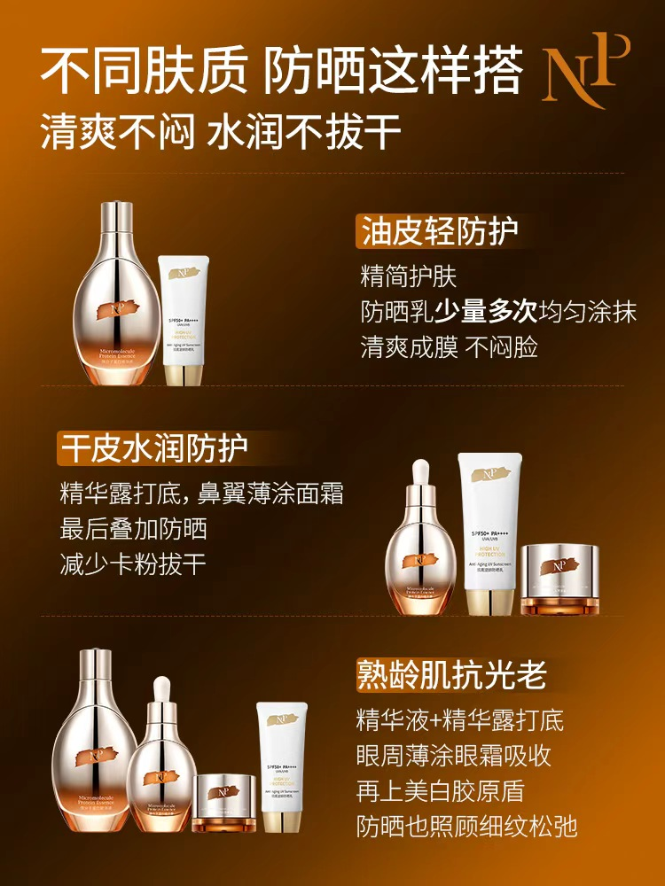

**资料说明。** 围绕检测信息组织图片与说明，补充介绍时可调用的材料。

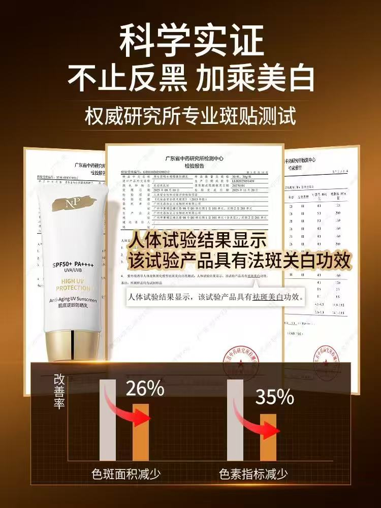

[查看三组原始配文与图片分析](../../portfolio-content/sunscreen/docs/moments-analysis.md)

### 销售话术：从客户的问题选择解释内容

话术用于一对一客户沟通、群内上新介绍与销售培训。资料中既有对客表达，也有帮助销售理解回应方向的内部提示。

**历史原稿节选：**

> 问：价格怎么这么贵？外面一瓶防晒才一两百块。
>
> 姐，明白您的顾虑。但咱们这款真的不是普通的防晒，而是“防晒型的抗老美白精华”。

这段先承接价格顾虑，再将比较维度转到护理组合，之后展开产品资料。原稿另有从厚闷、泛白、搓泥切入的需求介绍，适合与价格回应一起查看：价值解释与即时使用观感分别回答不同的问题。

[查看历史话术原文件](../../portfolio-content/sunscreen/assets/sales/private-sales-source.docx) · [查看全文文字](../../portfolio-content/sunscreen/assets/sales/private-sales-text.txt)

### 详情页：让信息支持自主阅读与查阅

我负责整页文案与内容结构。首屏建立总主张，随后分区解释防护、美白、抗皱滋养与使用感，再补充资料和商品信息。

**成分分组模块。** 用主标题和分组说明安排较多资料，让每组名称与相应内容对应。

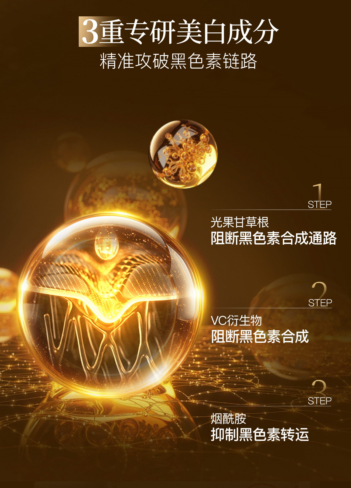

**轻薄与肤感模块。** 将质地、肤色观感和跟妆集中为独立主题，承接消费者对日常使用的顾虑。

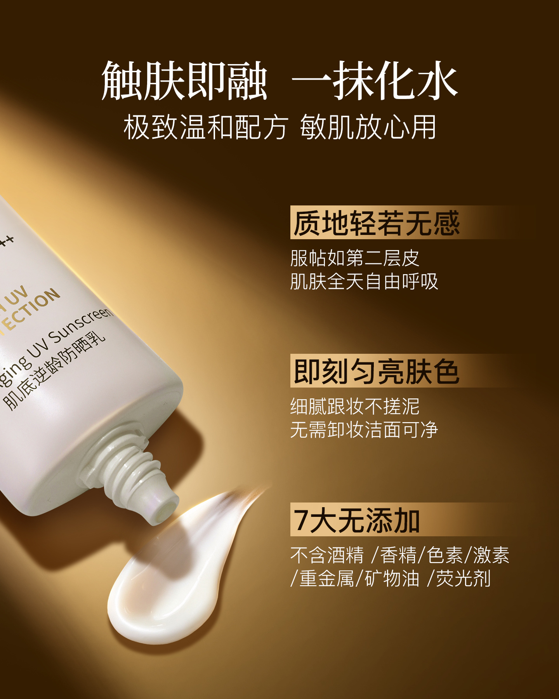

[查看完整详情长图](../../portfolio-content/sunscreen/assets/detail/sunscreen-detail-full.jpg)

### 四条视频：同一价值主线，不同的信息推进方式

四条脚本均由我负责。以下结构根据现有成片整理，保留各自文件入口。

#### 李颖合作：让疑问推动人物态度变化

先以价格与宣传质疑建立冲突，再经由亲试、推开、上脸、上妆和户外场景推进体验。体验段之后继续追问原理，再承接资料、成分与推荐。信息随着人物的问题逐步出现。

[观看李颖合作视频](../../portfolio-content/sunscreen/assets/videos/sunscreen-liying.mp4)

#### 达人体验：先让肤感被看见

通过挤出、推开、成膜、上脸和上妆的连续动作，分别承接质地与底妆兼容等信息；随后用转场进入防护和护理价值，最后收束到当时的活动邀请。

[观看达人体验视频（录屏4）](../../portfolio-content/sunscreen/assets/videos/sunscreen-influencer-04.mp4)

#### 向海岚合作：让产品连接人物的选择观

从人物经历和生活选择进入精简护肤，再通过质地、上脸、街头、通勤与妆前场景解释选择理由，结尾回到不将就的生活态度。产品段与人物主题形成首尾呼应。

[观看向海岚合作视频](../../portfolio-content/sunscreen/assets/videos/sunscreen-xianghailan.mp4)

#### 达人讲述：围绕高价问题逐层解释

先给出防晒选购标准，再提出四位数价格疑问，接资料、肤感演示与技术表达。技术段之后主动承接疑问，转向成分说明，让较多产品信息形成连续讲述。

[观看达人讲述视频（录屏3）](../../portfolio-content/sunscreen/assets/videos/sunscreen-influencer-03.mp4)

逐段结构：[李颖](../../portfolio-content/sunscreen/docs/video-01-structure.md) · [达人体验](../../portfolio-content/sunscreen/docs/video-04-structure.md) · [向海岚](../../portfolio-content/sunscreen/docs/video-02-structure.md) · [达人讲述](../../portfolio-content/sunscreen/docs/video-03-structure.md)

### 项目结果与我的贡献

**防晒上新半个月，私域 GMV 120万+。** 这是团队及渠道共同完成的项目整体成绩，现有材料没有单条内容或个人销售归因数据。

这组作品展示的是如何同时组织价值解释与使用顾虑：在长文中连续展开，在海报和朋友圈中选择单次重点，在话术中按问题调用，在视频中安排人物与动作。

图文、资料与视频中的功效、数值、人物评价和活动信息按历史作品保留，未由本轮内容整理转为独立验证的产品结论或当前销售承诺。

继续查看：[童颜面膜的升级沟通](mask.md) · [其他项目](../home.md#代表项目) · [查看简历](../../portfolio-resume.pdf)

## 编辑依据与呈现说明

依据[原版完整案例](../../baseline/pages/projects/sun.md)、[项目稿](../../portfolio-content/sunscreen/project.md)、[选材与成片入口](../../portfolio-content/sunscreen/selected-materials.md)及[话术分析](../../portfolio-content/sunscreen/docs/private-sales-analysis.md)。恢复r2遗漏的四组海报、其他朋友圈作品、价格问答及四条视频；原版已有的职责与主线继续继承。

线稿身份见[原件说明](../../portfolio-content/skincare-wireframes/sunscreen/README.md)：2026年10月29日本人补充提供的四页简版线稿与四张成品，不写成已核实的当年原始稿。四组对照全部保留，网站阶段可沿用两组主展示、两组补充展开。

话术节选可回查原Word第37—39段，这里是段落编号，不是页码；材料为历史原稿，区别于精华油／面膜的后期重建。厚重、假白等归类依据本人确认与既有分析，不新增伪装成原稿的独立QA。

公众号沿用31页及2026年5月28日发布信息，打印日期不作发布时间。“半支精华”是历史价值表达，不作为配方比例。视频结构依据既有逐段分析，不声称本轮重新逐帧观看全部原片，不补造统一发布排期或单条成交效果。

原图、视频、CV与正式站未修改。各类作品均在正文有入口，取舍与覆盖见[通用版r3对照](../reviews/general-r3-vs-baseline.md)。
