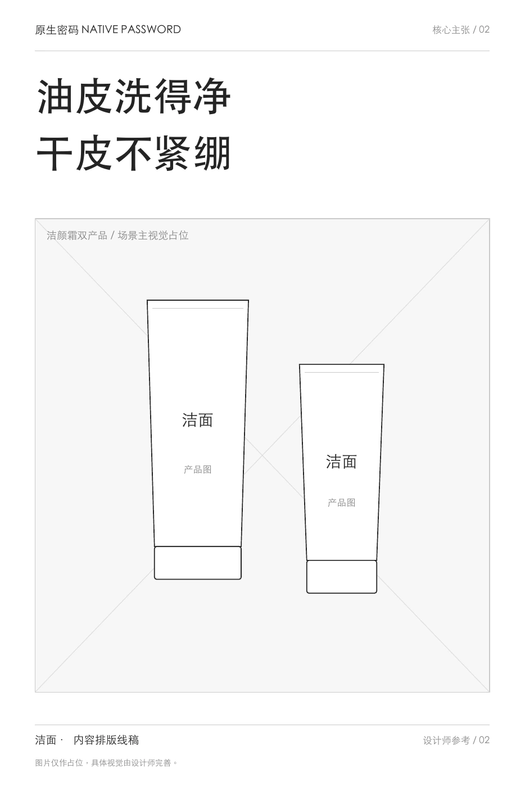
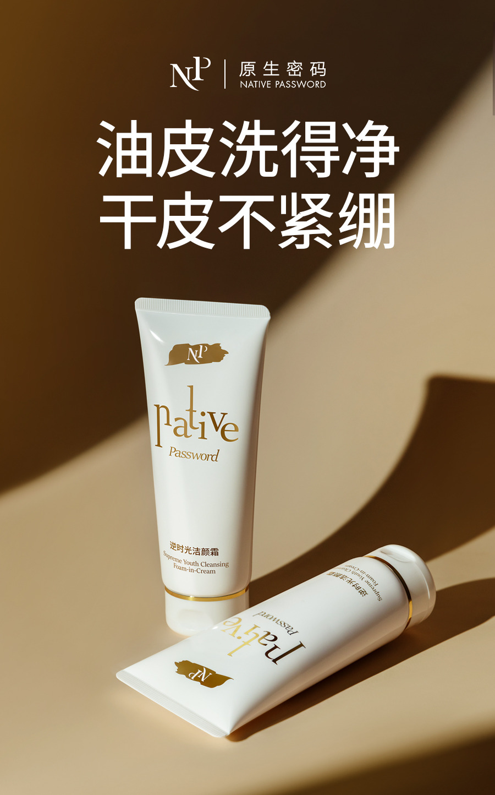
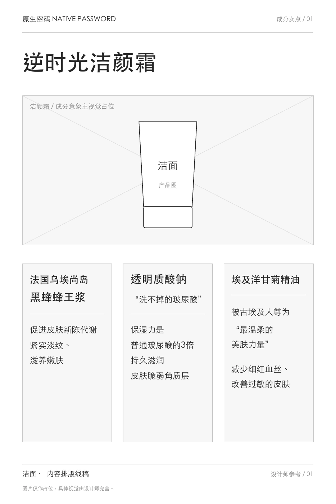
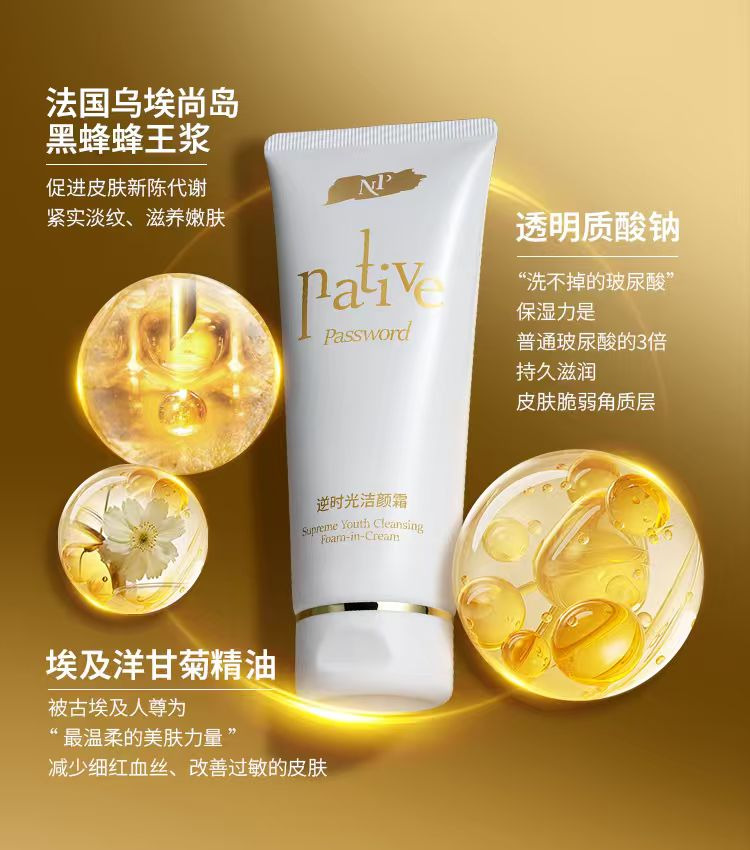
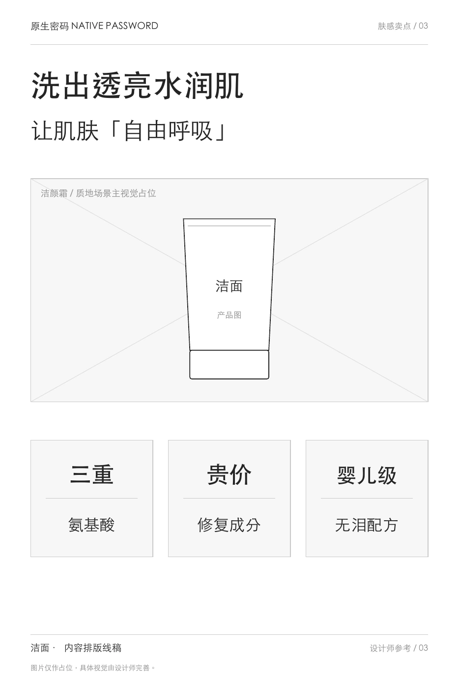
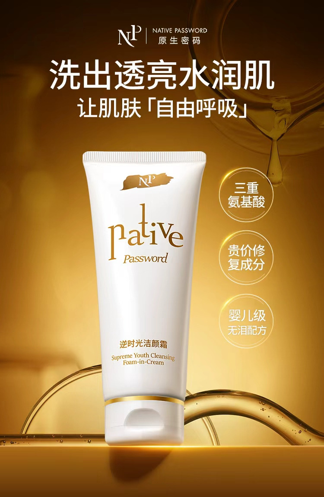
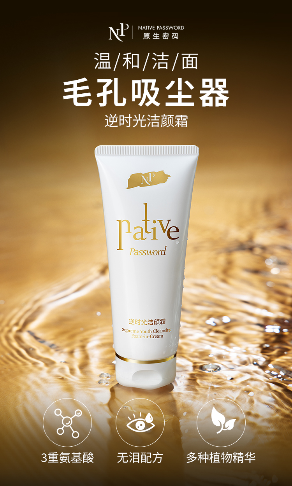

# 逆时光洁颜霜：内容 r4 提案

2026-11-02。基于[内容r3](../../projects/cleanser.md)及原版，保留精简案例定位和完整证据；未替换网页输入。

## 网页正文

### 逆时光洁颜霜｜一句话回应两种使用顾虑

洗不净和洗后紧绷，是这款洁面内容需要同时回应的两类顾虑。我把产品资料整理成短主张，再通过海报和上新文章分别展开。

**我的工作：独立完成卖点提炼、整体内容策划与文案。** 配方、研发与测试来自产品资料；摄影和视觉设计未计入个人已确认职责。

**项目整体结果：洁面上新 GMV 80万+，由项目及渠道共同完成；统计时长尚未补充。**

### 先把两类顾虑，写进一句短话

**历史原作：“油皮洗得净，干皮不紧绷”。**

“洗得净”回答清洁是否足够，“不紧绷”回答洗后感受。两个相互呼应的分句，把容易分散在资料里的关注点放到同一主张中，读者先知道这款产品想回应什么。

主海报围绕这句话安排标题与产品，不再把其他成分说明都挤进首个画面。下面是本人补充提供的简版内容排版线稿及历史成品，视觉由设计师完成。

[查看主海报原件](../../../portfolio-content/cleanser/assets/posters/cleanser-main.jpg)

### 短句留下重点，长文继续解释

2024年7月11日的上新文章，以“可以睁眼洗”的历史传播表达建立温和性记忆，再解释配方、洗卸与清洁信息、使用感受和首发选择。

海报给出简短理由，长文则需要继续回答“温和是否也能洗干净”。正文通过设问和转场展开资料，图片分别说明一个主题，再承接购买与互动信息。

[查看上新文章30页全文](../../../portfolio-content/cleanser/assets/wechat/cleanser-launch-article.pdf)

### 项目结果与我的贡献

**洁面上新 GMV 80万+。** 这是项目整体成果，没有单篇文章、某张海报或个人内容的销售归因；现有确认未限定为一个月。

这一案呈现的是选择主张与压缩表达：先用两句短话建立重点，再为成分、肤感和长文安排不同的信息量。

### 完整作品与补充阅读

以下两组对照与清洁感海报继续保留，不必逐张读完也能理解主线。

#### 成分分组：把名称和说明逐组对应

将较多成分资料分成三个信息组，名称与说明相邻，产品画面独立安排。这组侧重信息归属，与主海报集中一个主张的任务不同。

#### 肤感表达：总标题之后，保留三个短标签

先给整体肤感表达，再以三个短标签承接配方相关信息。线稿确定标题、产品与分项说明的关系，设计师通过字号和位置完成视觉层级。

#### 清洁感海报与完整线稿

“毛孔吸尘器”是这张历史海报使用的清洁感比喻，与主海报的两类顾虑、肤感图的水润主题分别展开同一产品。

[查看三页简版线稿 PDF](../../../portfolio-content/skincare-wireframes/cleanser/cleanser-content-wireframes.pdf)

图文中的配方、功效与体验按历史作品保留。“睁眼洗”等是历史传播表达，不作为当前使用建议或本轮核验的测试结论。

继续查看：[防晒的价值与顾虑回应](sun.md) · [其他项目](works.md) · [查看简历](../../../portfolio-resume.pdf)

## 编辑依据与呈现说明

沿用[原版](../../../baseline/pages/projects/cleanser.md)、[本人确认与素材索引](../../../portfolio-content/cleanser/洁面作品集内容.md)及[线稿来源](../../../portfolio-content/skincare-wireframes/cleanser/README.md)。三组线稿／成品、清洁感海报、主海报原件与完整长文均有具名位置。主叙述集中短文案选择，补充区保留成分与肤感的不同信息任务。

简版线稿于2026年10月29日补充提供，不标为已核实的当年原始稿。未重解析完整卖点Excel，未新增测试、调研或归因。数字沿用“上新80万+”，不采用CV的一个月限定。内容自审和作品覆盖另见本批review。
