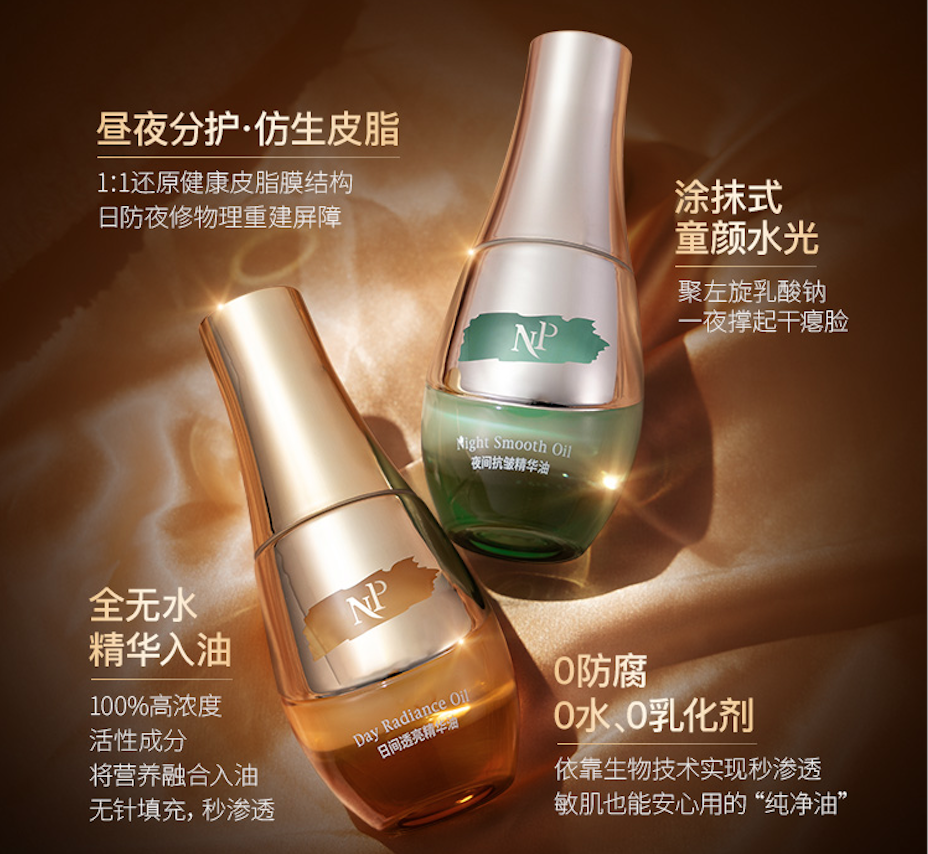

# 首页：内容 r4 提案

2026-11-02。依据[内容r3](../../home.md)、原版与现有CV整理。独立内容提案，未替换网页输入。

## 网页正文

### 我是孙岩萍

产品内容策划 · 新媒体运营

**把产品价值，写成选择理由。**

我为护肤品梳理卖点、撰写长文和视频脚本，也在酷狗音乐策划内容与粉丝活动、统筹多平台运营。以下作品呈现具体的表达取舍与协作分工。

[看代表项目](#代表项目) · [查看简历](../../../portfolio-resume.pdf)

### 代表项目

#### 日夜精华油｜把共同特点，写进日夜场景

两瓶产品怎样既有共同记忆点，又有各自的介绍重点？从“表补油，里补精华”的历史主张，到日夜海报、上新长文与四种视频讲述，展示一条内容主线怎样展开。

我的工作：卖点与文案、内容结构、视频脚本。

[查看精华油案例](oil.md)

#### 酷狗音乐｜让粉丝兴趣有具体的参与入口

发糖机怎样交代参与理由、入口和奖励？音效内容和晚安电台又怎样持续组织？这组作品呈现活动策划、内容统筹与资源协作。

我的工作：内容与活动策划、资源沟通、团队管理及统筹审核。

[查看酷狗案例](kugou.md)

### 更多项目，展开不同的内容问题

#### 高客单防晒｜解释价格，也回应肤感顾虑

用历史话术承接价格疑问，再将护理价值与厚重、搓泥等使用问题分别讲清。重点看问答、海报对照与人物脚本。

[查看防晒案例](sun.md)

#### 童颜面膜｜让升级有理由，让讲述有承接

在旧品认知上解释新版差异，再把较多资料写进人物故事与直播讲解。重点看升级表达、故事转场和讲解记录。

[查看面膜案例](mask.md)

#### 逆时光洁颜霜｜一句话回应两种使用顾虑

“油皮洗得净，干皮不紧绷”的历史短句，怎样进入主海报与上新长文？这一案集中展示主张选择与文字层级。

[查看洁面案例](cleanser.md) · [浏览全部作品](works.md)

### 我的经历

最近一段工作聚焦护肤品新品内容；此前在酷狗音乐负责官方新媒体运营，更早从事品牌本地化内容及韩语学习相关的新媒体编辑工作。

[了解工作经历与协作范围](about.md)

### 联系我

关于内容策划或新媒体运营岗位，欢迎联系。

[邮件联系](mailto:beibiduo@163.com) · [查看简历](../../../portfolio-resume.pdf)

## 编辑依据与呈现说明

沿用[通用定位](../../brief.md)，不新增岗位要求或工作年限。主标题恢复原版已有的“把产品价值，写成选择理由”，副标题和酷狗入口补足新媒体运营方向。没有把原版已有表达算作本轮新能力。

首页负责选择入口，不在这里重复五个案例全部数据与职责。两案重点、三案互补，详细个人分工与团队成果范围在对应案例开篇可见。首页图像为现有作品，酷狗为既有组合预览；不让封面暗示所有素材均由候选人独立视觉制作。保留r3简历、五案、关于及联系入口；新增目录仅复用本批案例，未增加筛选功能。
