# 酷狗音乐：内容 r4 试点提案

2026-11-02。输入为[内容r3](../../projects/kugou.md)与固定原版，全文供单独评审；尚未替换网页输入。各活动及平台数据分别说明，不合成一个整体成果。

## 网页正文

### 酷狗音乐｜让粉丝兴趣有具体的参与入口

在官方新媒体工作中，我独立负责微博内容与活动，管理两位专员，统筹其他平台的内容及脚本审核。工作的重点是组织参与理由、入口与内容，并协调产品和运营资源落地。

**我的工作：内容与活动策划、资源沟通、团队管理及统筹审核。** 技术开发与产品实现由相关团队负责；其他平台的制作、剪辑按团队分工完成。

### 发糖机：把艺人节点写成可执行的参与内容

账号已有品牌积累、增粉趋缓后，内容还需要承接客户端拉新与促活。我根据微博可合作资源提出跳转合作思路，与产品经理、APP运营沟通，将站外音乐兴趣连接到站内内容。

围绕粉丝的签到、打榜与互动习惯，我策划“胖汪发糖机”H5，组织主题、福利、规则及传播内容，并协调产品与设计落地，后续形成月度固定活动。

#### 一个期次：入口和奖励各自说清

2022年11月23日，时代少年团“三时有声”周年企划的发布微博给出网页链接与客户端搜索口令。微博交代参与理由与入口，活动长图继续解释主题和奖励。

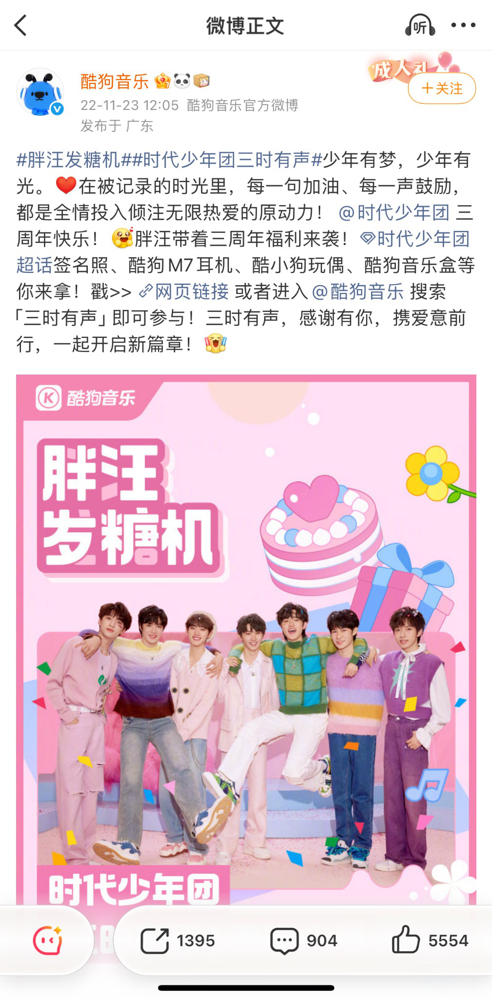

该期将第66、666、1123、6666名参与者与相应福利配对，指定参与序号对应奖励；这不是所有发糖机的统一机制。

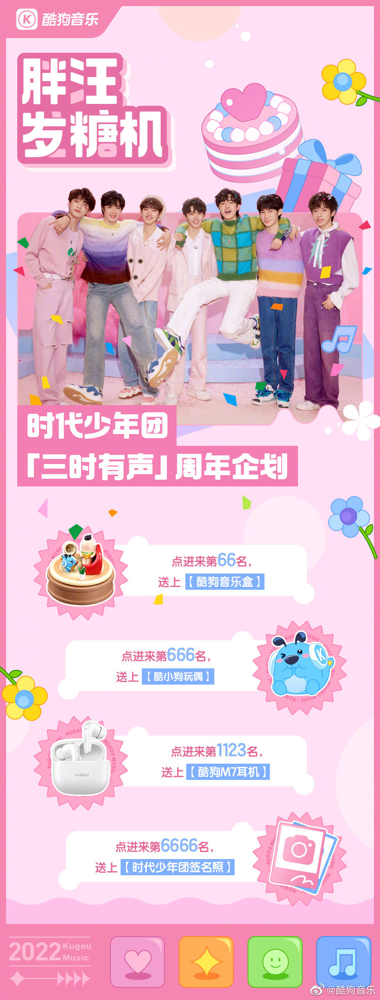

在迭代中，围绕参与门槛、福利和主题开展A/B内容测试。现有资料保留本人工作回顾，未提供逐轮分组及结果明细。

**历史阶段记录：累计参与8万人次，拉新及促活2.2万人次。** 具体统计周期尚待补充，不归为上述单期成绩，也不与其他引流数字相加。

### 音效内容：让功能进入具体的音乐体验

抖音的音效内容中，我负责选题、统筹与脚本审核，专员制作剪辑。选取热门或熟悉的现场Live，让功能与实际听歌场景相连；小红书的征集内容则延伸到用户表达，公众号进一步承担功能说明、设置与收听引导。

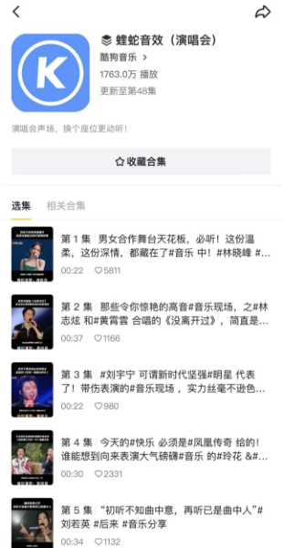

**合集截图显示1763万播放、更新至48集。** 这是截图时点的累计记录，不能等同于功能新增用户；本案保留的是静态截图，没有提供可播放原片。

不同平台的具体作品与各自指标在下方保留，可继续比较同一功能怎样进入现场内容、用户投稿和长文说明。

### 晚安电台：把一个场景持续做成栏目

围绕睡前陪伴，将艺人声音、歌词分享、延伸祝愿与晚安收尾组织为3分钟内音频。我负责整体策划、主题内容和站外推广；版权团队沟通艺人录制，电台团队配合站内推广。

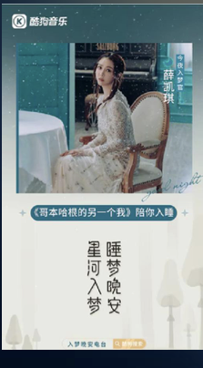

历史方案安排每周二、周四22:30更新，具体稿件随艺人与歌曲调整。栏目体现的是持续组织内容与跨团队资源协作，不作为当前在播排期。

**历史总结：上线26期、站内播放84万。** 统计周期尚待确认，不与其他平台数字合并。

### 我的贡献与工作范围

微博从新歌、品牌节点、明星生日到热点和活动内容，由我独立策划并推进。其他平台通过方向、选题和脚本／内容审核组织团队工作，管理两位专员承担相关制作与剪辑。

发糖机体现参与机制与资源沟通，音效内容体现渠道改写与审核，电台体现栏目组织及持续协作。活动参与、话题浏览、合集播放、阅读和互动分别看待，不能合计为个人创造的一个总成绩。

### 完整作品与补充阅读

以下继续保留不同平台的独特作品；它们不是同一期活动的统一排期或同一统计范围。

#### 小红书票根：给参与一个明确动作

我策划鹿晗直播票根活动，将预约直播、保存截图、带话题发布笔记和抽奖组织成参与路径，以签名照与周边提供动力。

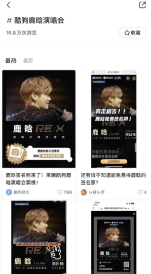

截图累计浏览16.8万次，仅按截图时点记录，不等同于去重参与人数或新增预约量。

#### 小红书音效征集：从官号延伸到用户内容

围绕歌曲宣发、音乐场景和用户表达组织音效征集。日常内容以统筹审核为主，具体制作按团队分工完成。

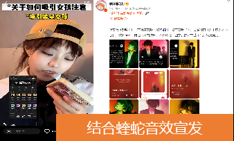

#### 抖音代表片段：现场内容与音效结合

《极乐净土》是现场Live与蝰蛇音效结合的代表截图，体现选材与功能表达；统筹、选题及审核由我负责，剪辑由专员完成。

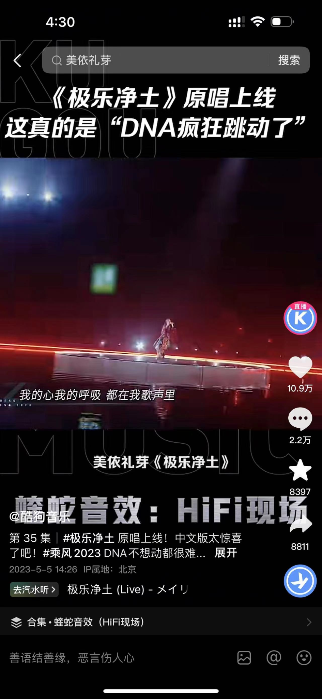

#### 公众号：音乐话题之后，接功能与收听

我负责官号运营与定位调整，将纯音乐内容转为“音乐内容＋产品功能”。下列两图来自同一篇文章：先从人物与音乐话题进入，后段补充功能、设置及收听引导；单篇撰写、排版与审核分工按作品核实。

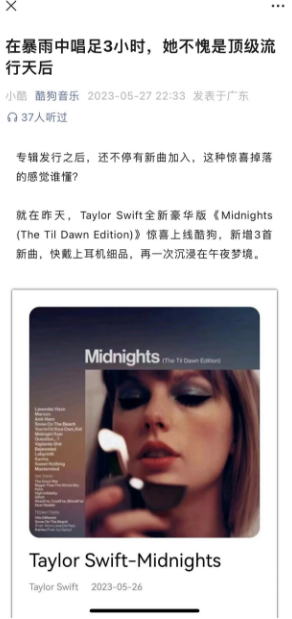
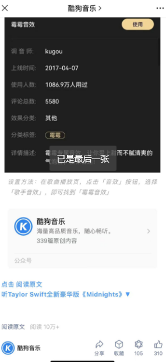

文章截图阅读10万+，是历史阅读表现，不据此认定相同数量的功能新增用户。

#### 视频号：从0到1组织新歌与热点Live

我负责统筹审核，专员制作剪辑。截图前排两条内容的爱心标识旁显示10万+，按互动量记录，不改写为播放量。

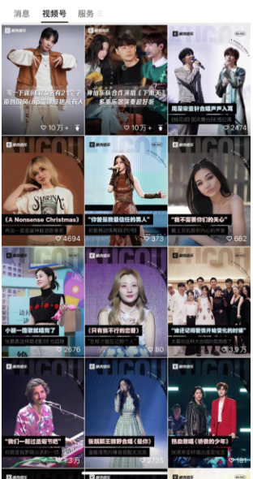

#### 电台更多作品：另一位艺人与两个传播位置

以下于文文海报、官博推广与站内节目页，与上方薛凯琪海报共同呈现栏目内容及站内外协作，不归入同一平台指标。

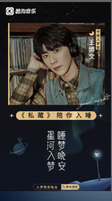
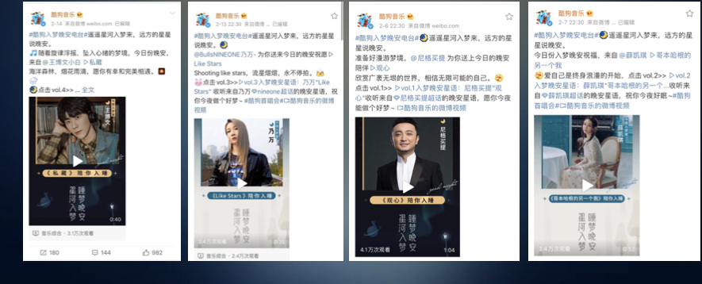
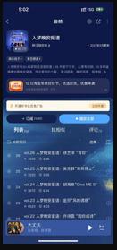

继续查看：[日夜精华油的产品内容策划](oil.md) · [其他代表项目](../../home.md#代表项目) · [查看简历](../../../portfolio-resume.pdf)

## 编辑依据与呈现说明

沿用内容r3、[项目稿](../../../portfolio-content/kugou/project.md)、[本人记录](../../../portfolio-content/kugou/酷狗作品集内容.md)及[素材索引](../../../portfolio-content/kugou/asset-index.md)。未解决的200万+／256万人次与21万定义仍留在共同核对记录，不带回正文。

把等权的平台顺序改为发糖机、功能内容、持续栏目三项主要任务；小红书票根、音效UGC、抖音片段、公众号、视频号及电台其他作品均有文字与原图去向。全部14幅原有图像入口保留；统计范围、团队制作、同篇公众号及静态截图身份也继续保留。

没有补造实验结果、技术实现、跨平台归因或用户转化率。内容提案不认定历史活动仍在线；页面中的路径说明仅依据既有公开入口和规则。逐项评审见[内容review](../../reviews/general-r4-pilot-review.md)。
