# 日夜精华油：内容 r4 试点提案

2026-11-02。输入为[内容r3](../../projects/oil.md)与固定原版，全文供单独评审；尚未替换网页输入。主叙述与补充阅读共同构成本案完整提案，原件不改写。

## 网页正文

### 日夜精华油｜把共同特点，写进日夜场景

两瓶精华油既要有共同的记忆点，也要让人看懂日用、夜用各自的角色。我负责把产品资料写成主张、图文和不同讲述方式。

**我的工作：卖点与文案、内容结构、四条视频脚本。** 既定产品方案由相关团队确定；视觉设计、包装、拍摄剪辑及商务由协作团队负责。

**项目整体结果：产品／套组上市两周，私域 GMV 460万+，由团队及渠道共同完成。**

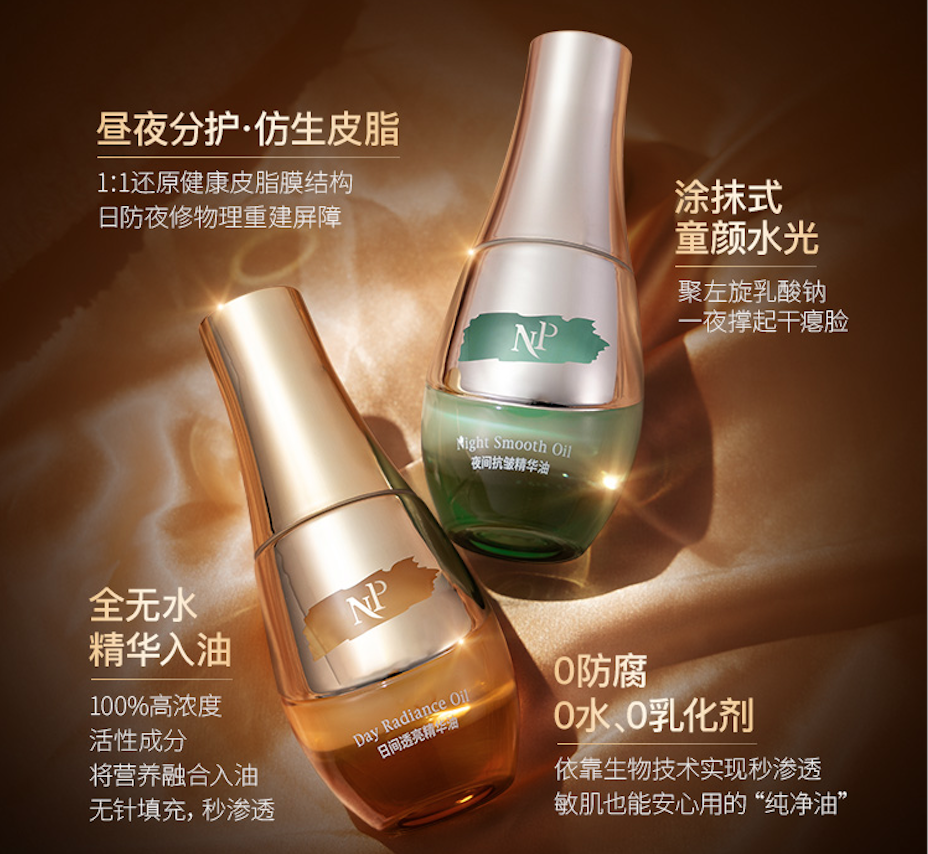

### 先把共同特点，写成一句能记住的话

**原作主张：“表补油，里补精华”。**

我将精华与油相的产品特点压缩成一句对称短句，让标题、短图文和口播有共同的表达。具体说明再回到产品信息，继续解释这句话指向哪些特点。

介绍从干燥、紧绷、上妆卡粉等护理困扰进入，以“保护层”的类比解释皮脂膜，再转到产品。先给理解入口，后面的成分与日夜区别才有共同背景。

### 让日夜各有角色，也保留系列感

海报文案和内容层级由我负责，设计师完成视觉制作。以下使用本人补充提供的简版内容排版线稿，与历史成品对照。

#### 日间透亮：把重点放在日间护理与妆前

以“智能抗氧盾”“祛黄提亮”“妆前打底”三组历史标签选择说明，围绕日间场景展开。线稿先明确主张与卖点的优先级，成品再通过字号、位置和产品画面完成视觉表达。

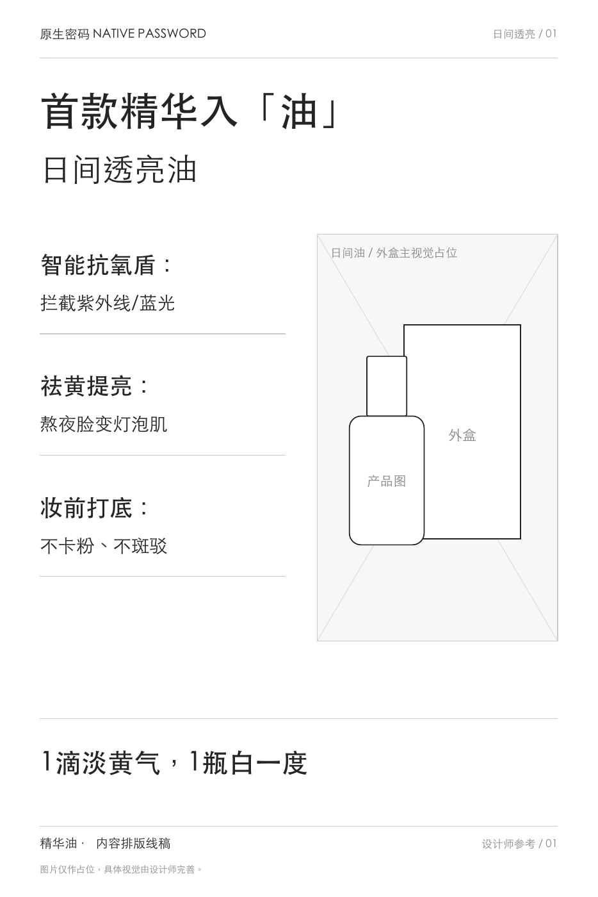
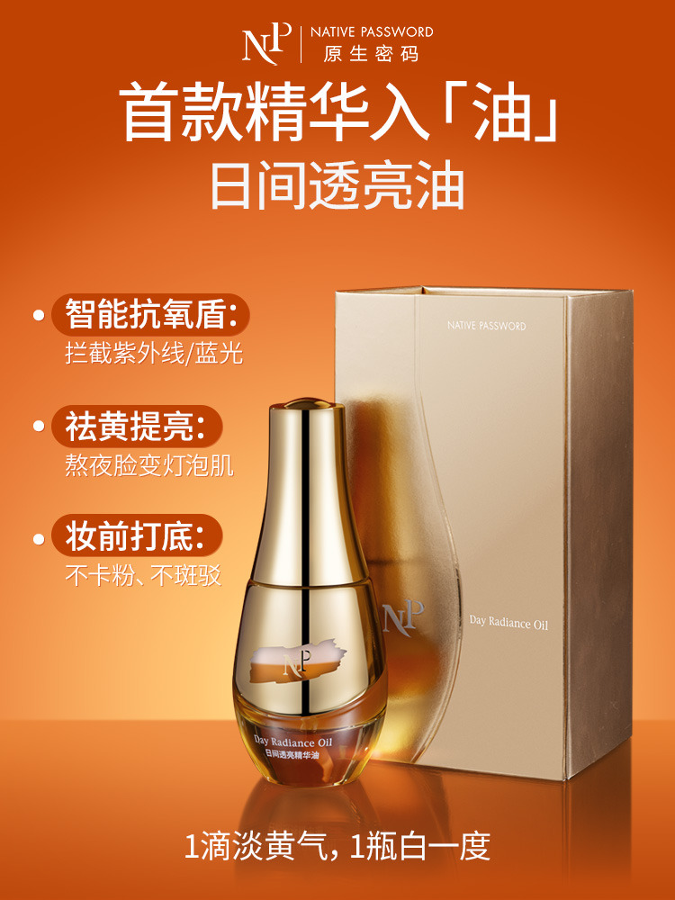

#### 夜间修护：同一骨架，换成夜间的讲述重点

沿用标题、三组卖点与收尾的系列结构，把重点转为“深层修复”“喂饱胶原”“抚平纹理”等历史表达。两款因此既能相互比较，又有各自的内容主题。

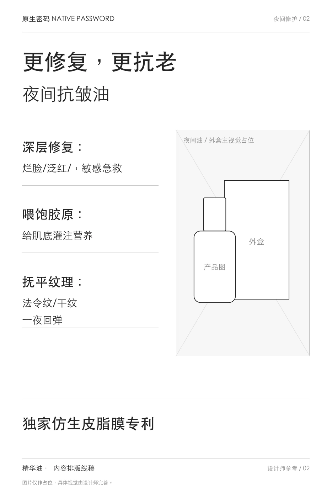
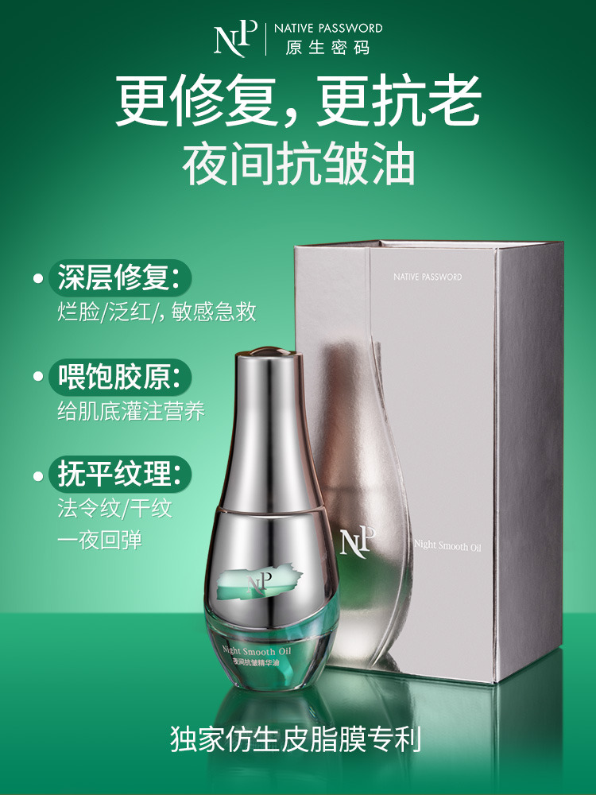

[查看三页简版线稿 PDF](../../../portfolio-content/skincare-wireframes/essence-oil/oil-content-wireframes.pdf)

### 一篇长文，接住后续理解

2025年12月26日的上新文章，由我独立完成标题、正文、图内文案与版式规划，设计师制作配图。人物与护理问题带出皮脂膜，随后解释精华入油、日夜区别、使用方式及首发选择。

**短句负责记忆，正文与图片负责把它讲明白。** 原文第14页将产品形象、结构与比例放在同一主题里，承接“精华入油”的表达。完整文章还将两款放进早晚场景，并把三种不同使用方式分别归组，便于按需要查阅。

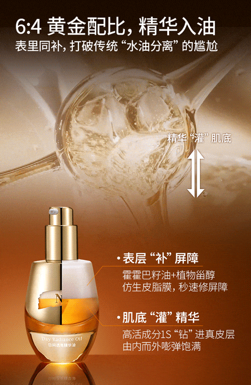

[查看公众号25页全文](../../../portfolio-content/essence-oil/assets/wechat/oil-launch-article.pdf)

### 同一方向，写成四种讲述

四条脚本均由我撰写。品牌科普与刘晓庆合作推广脚本独立完成；达人合作中结合账号风格与发布要求沟通调整。拍摄、剪辑及商务由相关团队或合作方完成。

#### 品牌科普：先建立品类理解

从冬季干燥与清洁习惯的疑问进入，用生活类比解释皮脂膜，再转到油脂护理、原料与使用画面。它先回应“为什么关注”，再介绍产品。

[观看品牌科普成片](../../../portfolio-content/essence-oil/assets/videos/oil-sebum-education.mp4)

#### 刘晓庆合作推广：让卖点进入人物关注点

从熟龄护理话题进入，将皮脂膜、精华入油和日夜区别串进人物口吻，后段补充使用、价值判断与推荐。产品信息随着人物讲述推进，并与使用画面对应。

[观看刘晓庆合作推广成片](../../../portfolio-content/essence-oil/assets/videos/oil-liuxiaoqing.mp4)

另外两条分别用连续答疑和动作演示组织信息，成片及各自处理方式在下方完整作品中保留。

**以下结构说明依据现有成片整理，历史逐字原稿未留存；文件为压缩查阅版。**

[查看四条视频的逐段分析](../../../portfolio-content/essence-oil/docs/video-analysis.md)

### 项目结果与我的贡献

**产品／套组上市两周，私域 GMV 460万+。** 这是团队及渠道的项目整体成绩，没有单篇文章、单条视频或个人内容的销售归因数据。

我的贡献是选择共同表达、区分日夜角色，再根据长文、短图文、人物口播与问答的任务改写内容。图文视觉、产品方案与视频制作按上述分工完成。

### 完整作品与补充阅读

以下保留主叙述之外的图文、两条成片及重建示例，可按关注点继续查阅。

#### 资料信息海报：五组标签与数字各有归属

线稿把五组资料与数值配对，并安排人物、双瓶产品与信息区域；成品通过位置与字号强化对应。图中的数字及标题保留历史作品表达。

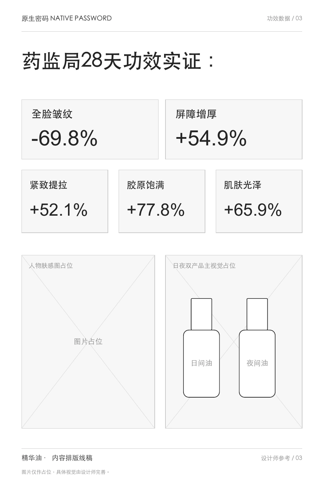
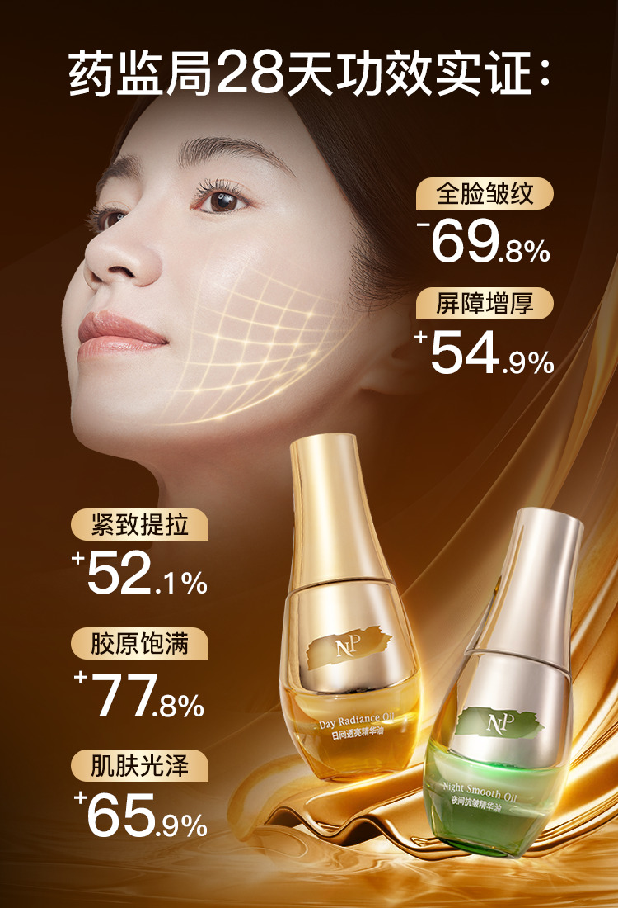

#### 公众号更多片段：从比较到具体使用

第16页将两款并列到早晚场景，便于按相同结构比较；第20页为三种不同使用方式分别安排方法、示意与说明，并非连续三步。

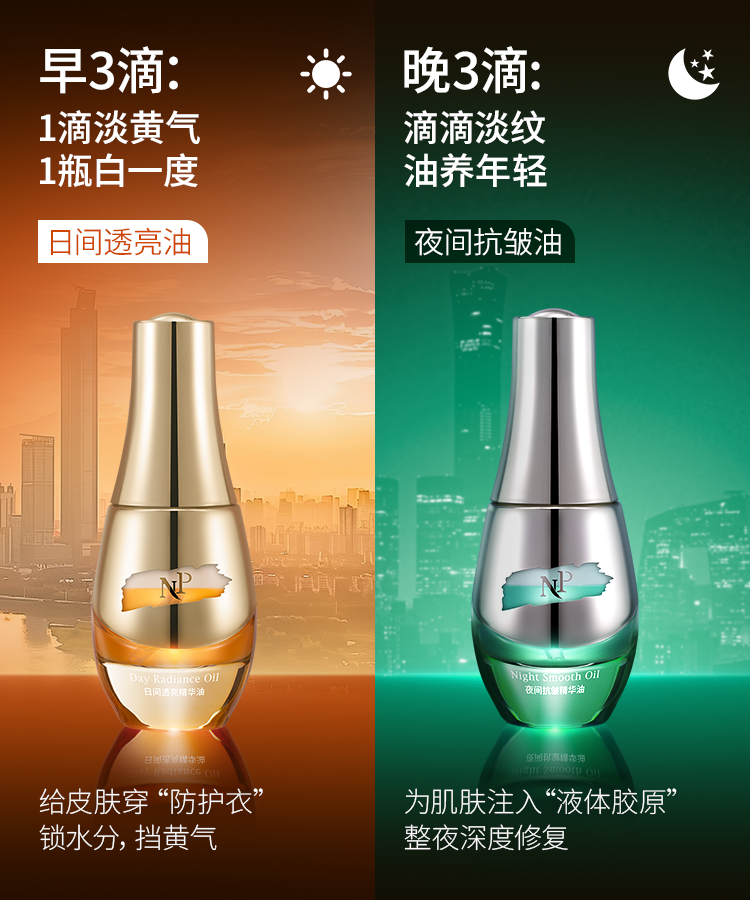
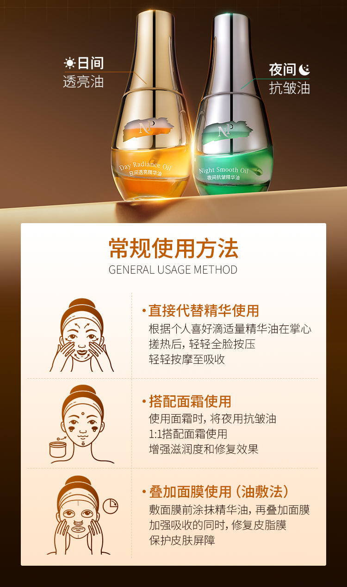

#### 朋友圈三张作品：一次解释一个理由

我负责配文、图内文案及信息顺序，设计师完成视觉。前两张从护理困扰进入皮脂膜概念，第三张围绕精华入油组织产品与补充信息；短内容各有单次沟通重点。

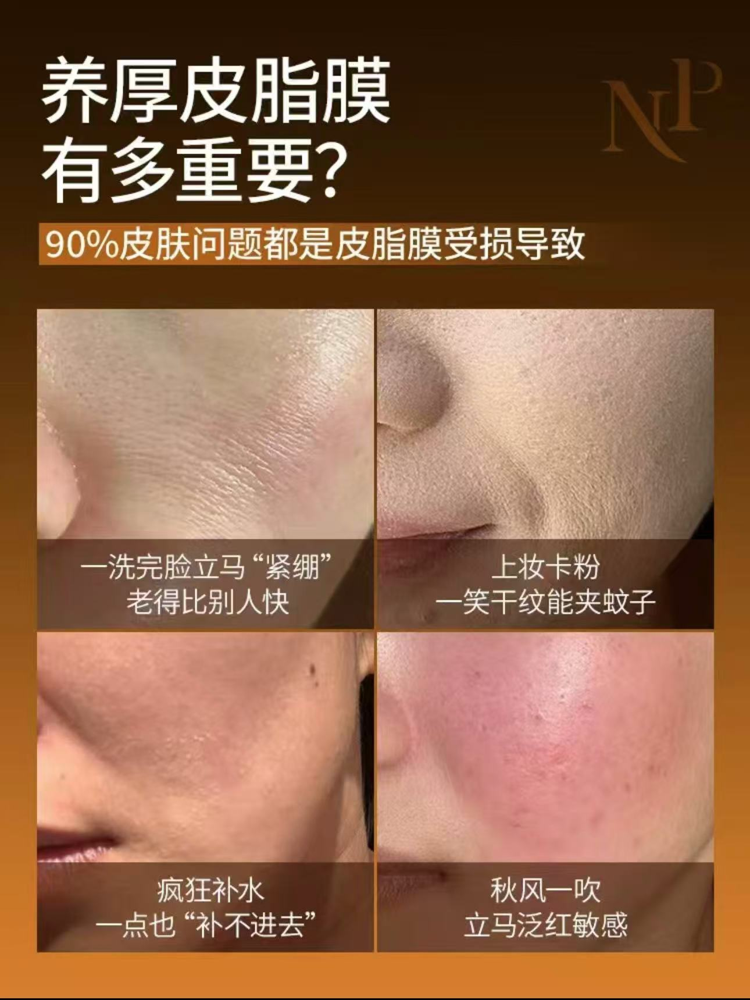
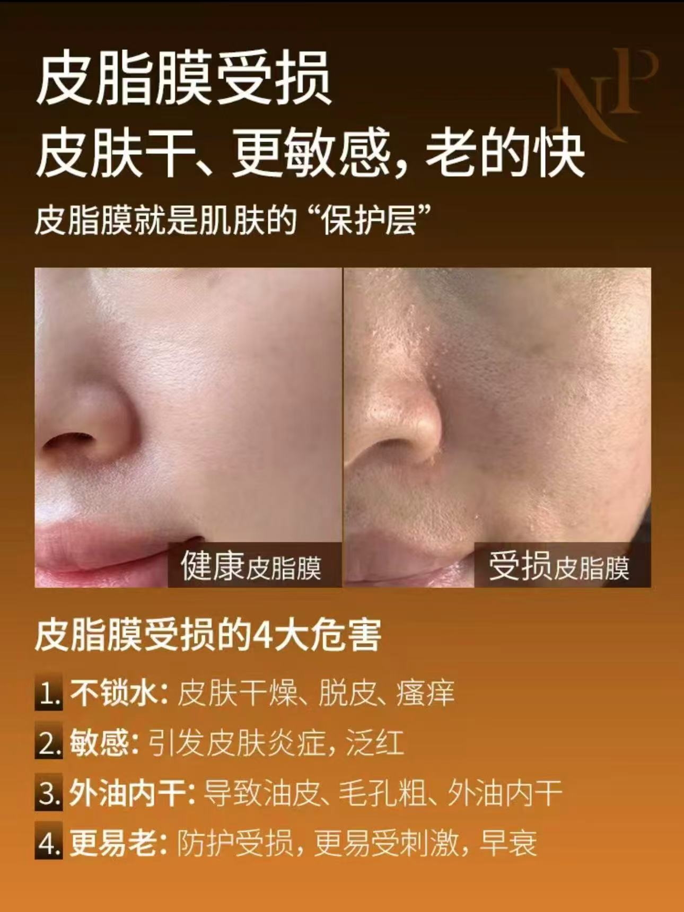
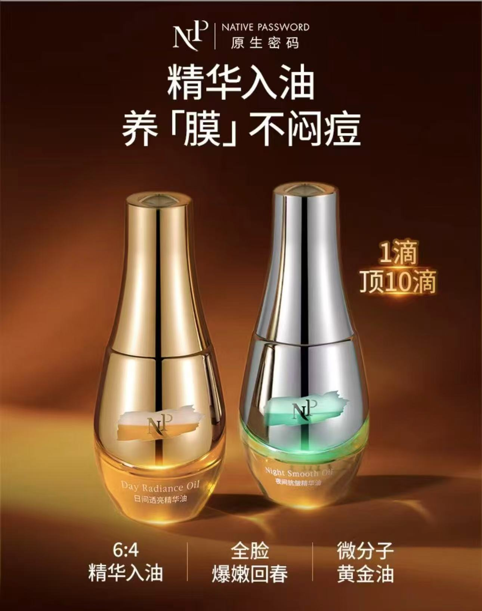

#### 达人答疑与使用演示：两种不同的推进方式

答疑片以疑问、回应和反问逐层带出概念、产品及早晚场景；演示片以三个方法段落组织场景、步骤与动作，便于口播和产品、手部混合、上脸画面对应。

[观看达人问题答疑成片](../../../portfolio-content/essence-oil/assets/videos/oil-influencer-qa.mp4) · [观看达人使用场景成片](../../../portfolio-content/essence-oil/assets/videos/oil-tutorial.mp4)

#### 销售沟通：后期重建示例

原项目中，我也负责销售客服话术。**以下示例为后期重建，非当年话术原稿或真实客户对话。**

> 为什么精华油要分日用和夜用？
>
> 先了解客户的早晚护理习惯，再选择相关卖点、解释两款区别，并连接具体使用说明。

[查看销售沟通后期重建全文](../../../portfolio-content/essence-oil/docs/private-sales-reconstructed.md)

图文及成片按历史作品查看；人物、功效、比例和技术说法未因本次整理成为独立验证的产品结论。“表、里”为原作传播表达，不作为此次验证的皮肤分层作用机制。

继续查看：[酷狗音乐的活动与运营](kugou.md) · [其他代表项目](../../home.md#代表项目) · [查看简历](../../../portfolio-resume.pdf)

## 编辑依据与呈现说明

来源沿用内容r3、[项目稿](../../../portfolio-content/essence-oil/project.md)、公众号及视频分析。简版线稿身份仍以[原件说明](../../../portfolio-content/skincare-wireframes/essence-oil/README.md)为准，不称已核实的历史原始底稿。没有新增本人确认、用户调研、发布时间或销售归因。

主叙述保留任务、角色、核心表达、日夜两组对照、长文说明、两种重点讲述及结果；完整作品区保留另外七幅图、两条成片和重建示例。共13幅原图、四条视频、两份作品PDF及两份补充文稿的原有入口均应可查。补充区不是素材墓地，设计需清楚写出类型与数量，关键身份保持可见。

开篇与结果段重复核心数字用于支持直接进入章节；其他重复的泛化总结已合并。三种使用方式、四种讲述区别及朋友圈任务均有文字解释，未只留文件链接。逐项评审见[内容review](../../reviews/general-r4-pilot-review.md)。
