# 高客单防晒：内容 r4 提案

2026-11-02。依据[内容r3](../../projects/sun.md)与原版，独立整理价值解释及使用顾虑；未替换网页输入。

## 网页正文

### 高客单防晒｜解释价格，也回应肤感顾虑

高客单定位已经确定，内容既要解释护理价值，也要回应加入精华护理后会不会厚重、假白、搓泥。我将这两类问题分别展开，再写进图文、话术和人物视频。

**我的工作：卖点与内容策划、文案、海报内容线稿及四条视频脚本。** 定价与产品方案由团队确定；视觉设计、拍摄剪辑和商务由相关团队完成。

**项目整体结果：防晒上新半个月，私域 GMV 120万+，由团队及渠道共同完成。**

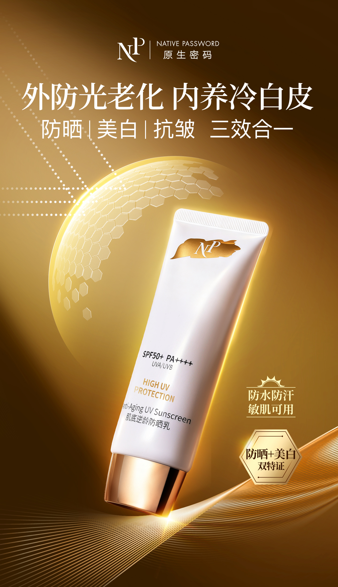

### 价格疑问，需要换一个解释入口

**历史话术原稿节选：**

> 问：价格怎么这么贵？外面一瓶防晒才一两百块。
>
> 姐，明白您的顾虑。但咱们这款真的不是普通的防晒，而是“防晒型的抗老美白精华”。

先承接顾虑，再把比较维度转到护理组合，随后展开资料。话术用于一对一、群内介绍及销售培训，其中也有帮助销售理解回应方向的内部提示；这里引用原稿，不是实际客户聊天记录。

[查看历史话术原文件](../../../portfolio-content/sunscreen/assets/sales/private-sales-source.docx) · [查看全文文字](../../../portfolio-content/sunscreen/assets/sales/private-sales-text.txt)

### 价值与肤感，分别留出说明空间

**历史主张：“1支防晒半支精华，外防光老化，内养冷白皮”。** 这句话建立当时的护理价值参照；“半支精华”是传播表达，不是配方比例。

护理信息越丰富，越需要接住使用负担的疑问。我将价值说明与轻薄、贴肤、跟妆分开组织，让“为什么关注”和“用起来怎样”都有明确内容。

#### 养肤价值：把每组资料与各自描述配对

总标题之下安排透亮、细腻、嘭弹、滑嫩四组信息。原图中的数值保留“使用4周、受试者自评体验”的条件，不在案例中单独放大成未经说明的结果。文案与内容线稿由我负责，视觉由设计师完成。

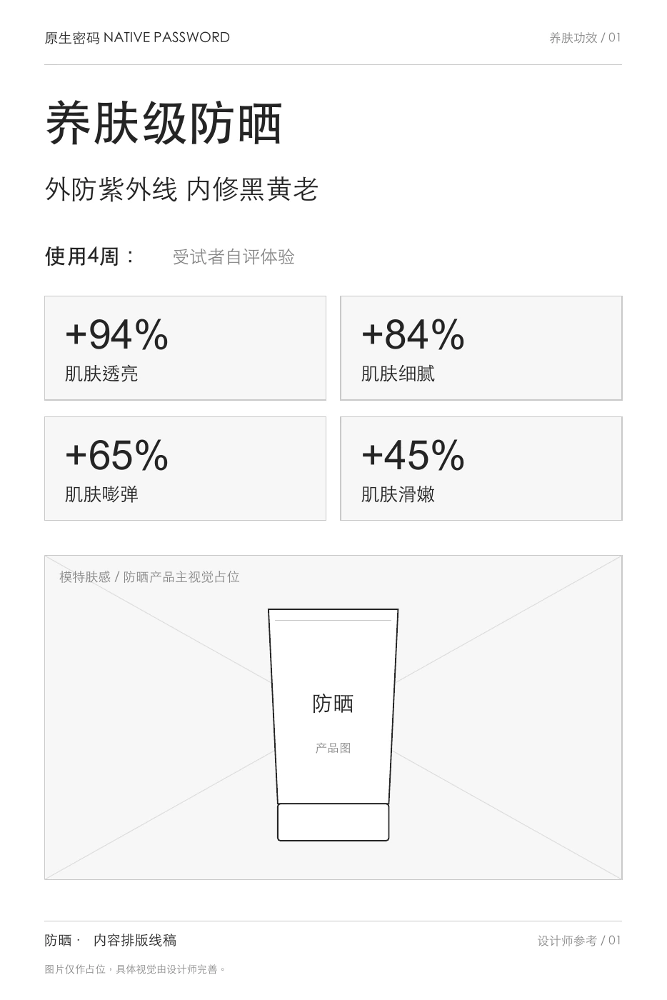
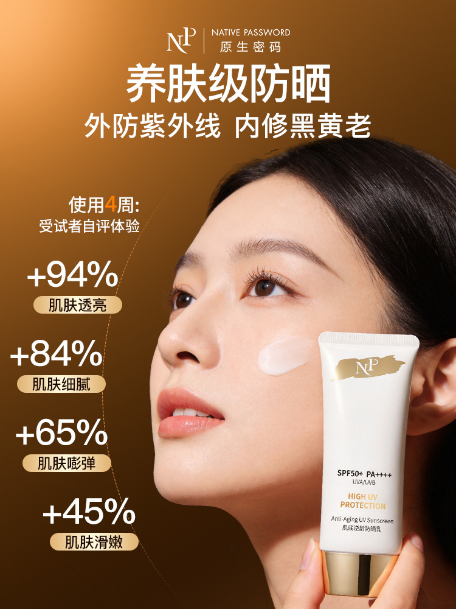

#### 肤感回应：让读者按顾虑找到说明

用“透”“贴”“敏肌友好”三个历史标签组织对应解释，将产品、质地与文字联系起来。它没有重复价值海报的全部资料，而是给使用问题一个独立位置。

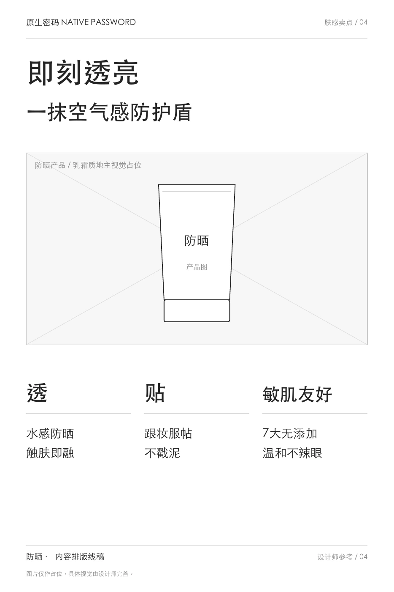
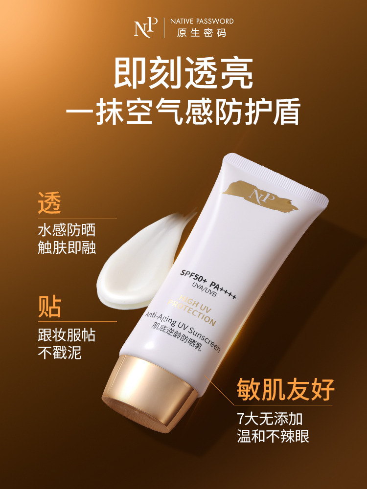

### 长文把问题接起来，视频让问题推动讲述

我负责上新长文的内容与文案。2026年5月28日的文章先建立组合定位，再讲护理资料、成膜与肤感，后段接人物反馈和首发套组。第19页主动列出厚重、搓泥等问题，再转入使用体验，避免只有价值介绍、没有顾虑回应。

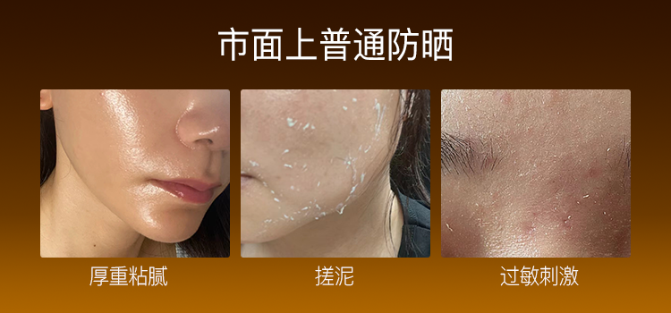

[查看公众号31页全文](../../../portfolio-content/sunscreen/assets/wechat/sunscreen-launch-article.pdf)

四条脚本均由我负责。以下说明依据现有成片整理，拍摄、剪辑及商务按团队分工完成；逐字历史脚本未在本轮补造。

#### 李颖合作：让疑问推动人物态度变化

从价格与宣传质疑建立冲突，经由亲试、推开、上脸、上妆与户外场景推进体验，再追问原理、承接资料及推荐。产品信息随着人物的问题逐步出现。

[观看李颖合作视频](../../../portfolio-content/sunscreen/assets/videos/sunscreen-liying.mp4) · [查看逐段分析](../../../portfolio-content/sunscreen/docs/video-01-structure.md)

#### 向海岚合作：把选择理由放进人物主题

从人物经历和生活选择进入精简护肤，再用质地、通勤与妆前场景解释产品，结尾回到不将就的生活态度。它以选择观串联内容，与疑问推动的讲述方式不同。

[观看向海岚合作视频](../../../portfolio-content/sunscreen/assets/videos/sunscreen-xianghailan.mp4) · [查看逐段分析](../../../portfolio-content/sunscreen/docs/video-02-structure.md)

### 项目结果与我的贡献

**防晒上新半个月，私域 GMV 120万+。** 这是项目及渠道的整体成绩，没有单条内容或个人销售归因。

我的贡献是同时组织价值解释与使用顾虑：话术按问题选择回应，图文给两类信息独立空间，人物视频再安排不同的推进方式。

### 完整作品与补充阅读

以下保留另外两组海报、朋友圈、详情页与两条达人视频，便于继续查看不同信息任务。

#### 预热与反馈：两组补充海报

预热稿先交代新品状态与高端联想，保留后续可以展开的线索；反馈稿则将场景、产品及两组历史体验表达分区，各自配图与署名。图中评价按历史作品保留，未在本轮独立核验。

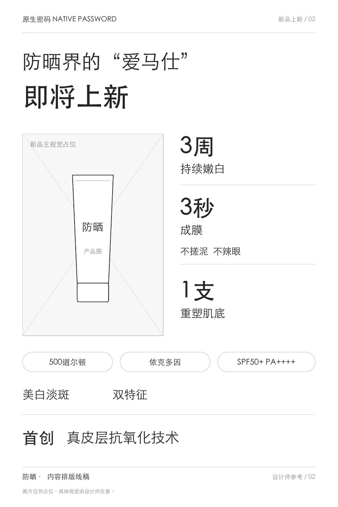
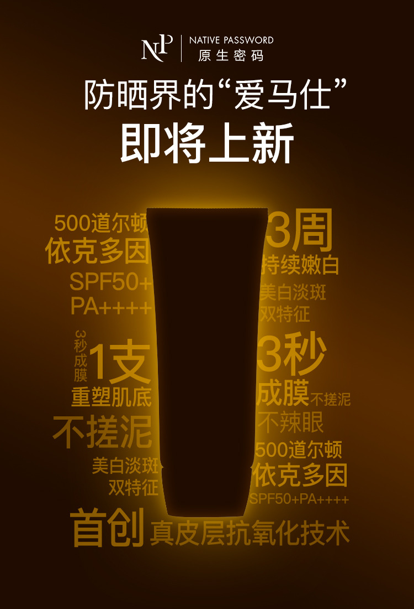

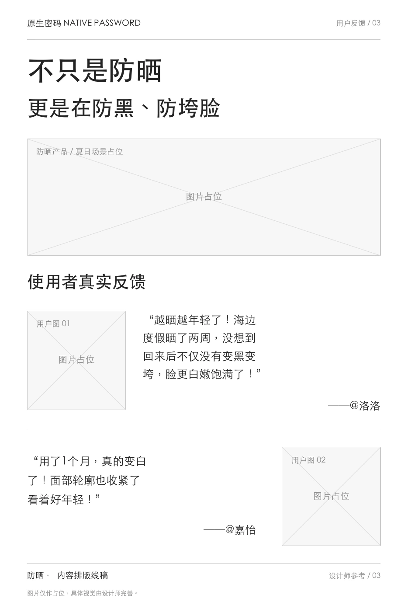
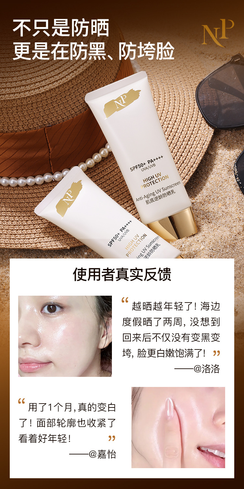

[查看四页简版线稿 PDF](../../../portfolio-content/skincare-wireframes/sunscreen/sunscreen-content-wireframes.pdf)

#### 公众号价值图与朋友圈三个主题

公众号第5页将防护与护理放在同一主题中，给后续成分解释建立参照。朋友圈分别集中精华价值、肤质搭配和资料说明；我负责配文、图内文案及顺序，设计师制作图片。

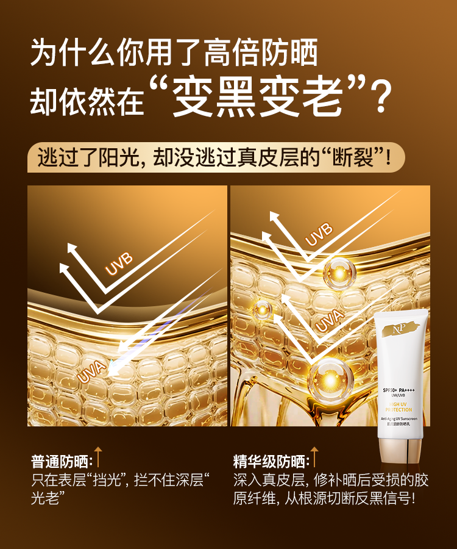

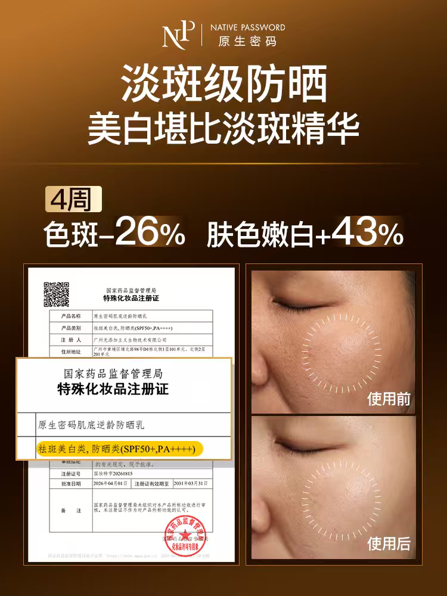
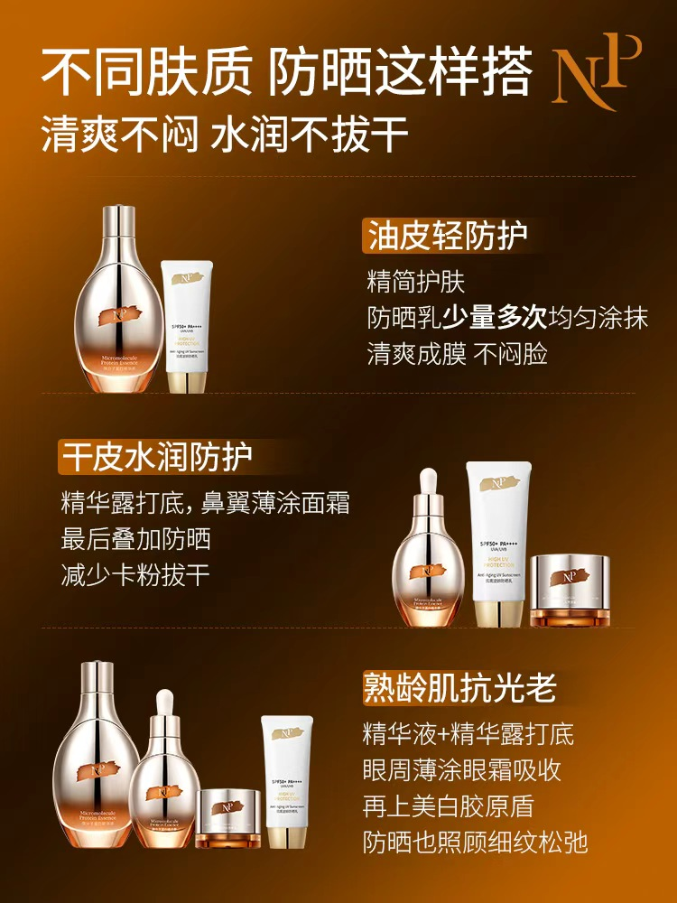
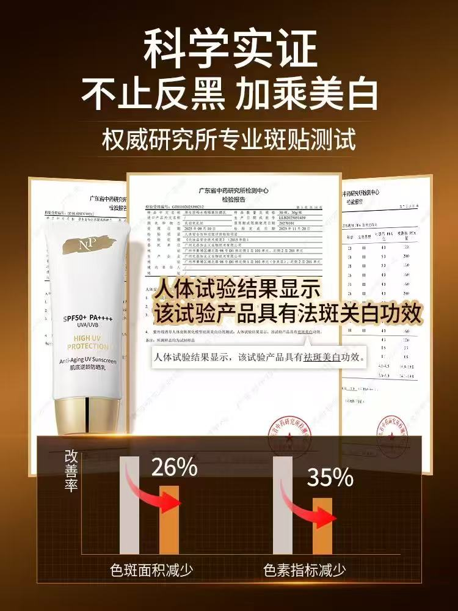

[查看三组原始配文与图片分析](../../../portfolio-content/sunscreen/docs/moments-analysis.md)

#### 详情页：支持自主阅读与查阅

我负责整页文案与内容结构。首屏之后分别组织防护、美白、抗皱滋养、使用感及商品资料。以下两幅分别呈现成分分组与轻薄、肤感，完整长图保留上下文。

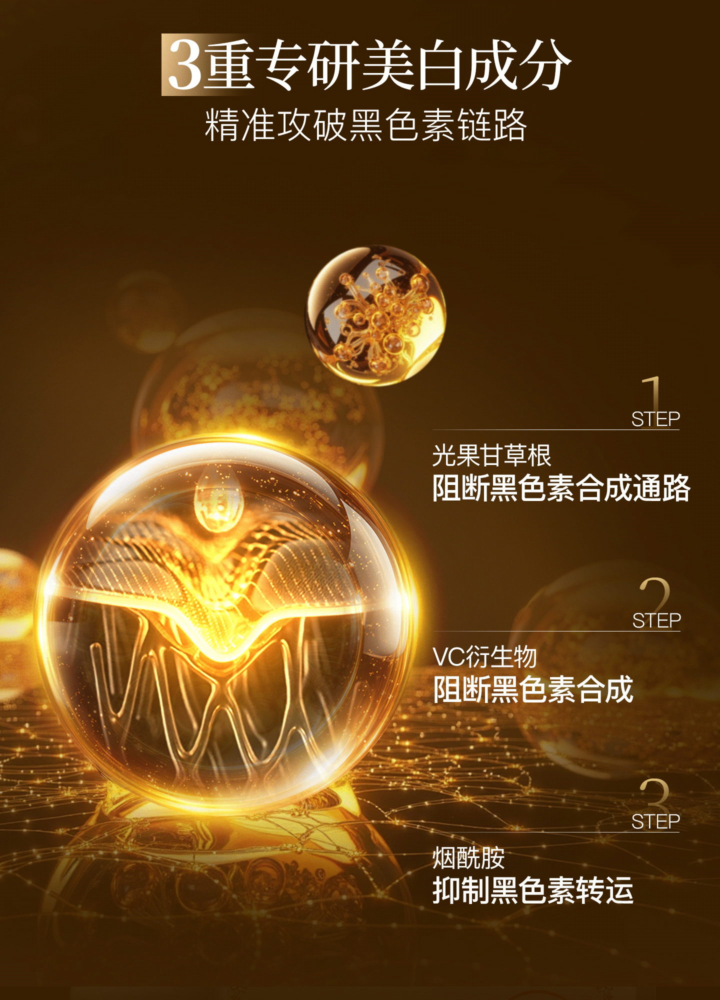
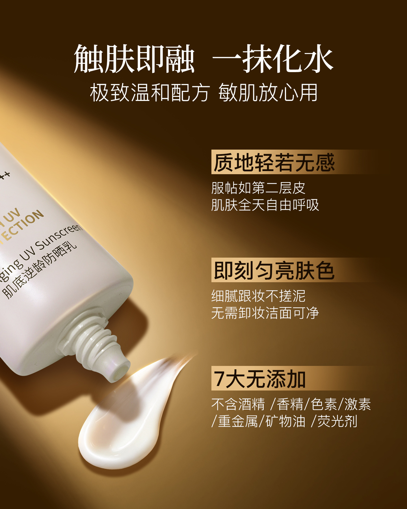

[查看完整详情长图](../../../portfolio-content/sunscreen/assets/detail/sunscreen-detail-full.jpg)

#### 达人体验与讲述：动作和解释各有顺序

体验片通过挤出、推开、成膜、上脸和上妆承接肤感，再转入防护与护理价值；讲述片先给选购标准、提出高价疑问，再接资料与演示，技术段之后继续承接疑问并解释成分。

[观看达人体验视频（录屏4）](../../../portfolio-content/sunscreen/assets/videos/sunscreen-influencer-04.mp4) · [查看体验片分析](../../../portfolio-content/sunscreen/docs/video-04-structure.md)

[观看达人讲述视频（录屏3）](../../../portfolio-content/sunscreen/assets/videos/sunscreen-influencer-03.mp4) · [查看讲述片分析](../../../portfolio-content/sunscreen/docs/video-03-structure.md)

历史作品中的功效、技术、数值、人物评价及活动信息未由本轮整理转为独立验证的产品结论或当前销售承诺。

继续查看：[童颜面膜的升级沟通](mask.md) · [其他项目](works.md) · [查看简历](../../../portfolio-resume.pdf)

## 编辑依据与呈现说明

沿用[原版](../../../baseline/pages/projects/sun.md)、[项目稿](../../../portfolio-content/sunscreen/project.md)、[选材记录](../../../portfolio-content/sunscreen/selected-materials.md)及[话术分析](../../../portfolio-content/sunscreen/docs/private-sales-analysis.md)。历史问答可回查Word第37—39段，不写成PDF页码；未新造独立问答或真实客户对话。

主叙述保留首屏、两组海报、使用顾虑长文片段、价格原稿及两种人物脚本；补充区保留其余十幅原图、详情长图与两条成片。r3全部作品资源和四条逐段分析的入口均有位置。简版线稿身份见[来源说明](../../../portfolio-content/skincare-wireframes/sunscreen/README.md)，不称已核实的当年原始稿。

将按渠道依次介绍改为“价格—价值与肤感—长文与人物讲述”，减少只复述版面的段落，保留独特作品解释。没有新增测试、访谈、定价决策、统一排期或销售归因；内容与设计分别review。
