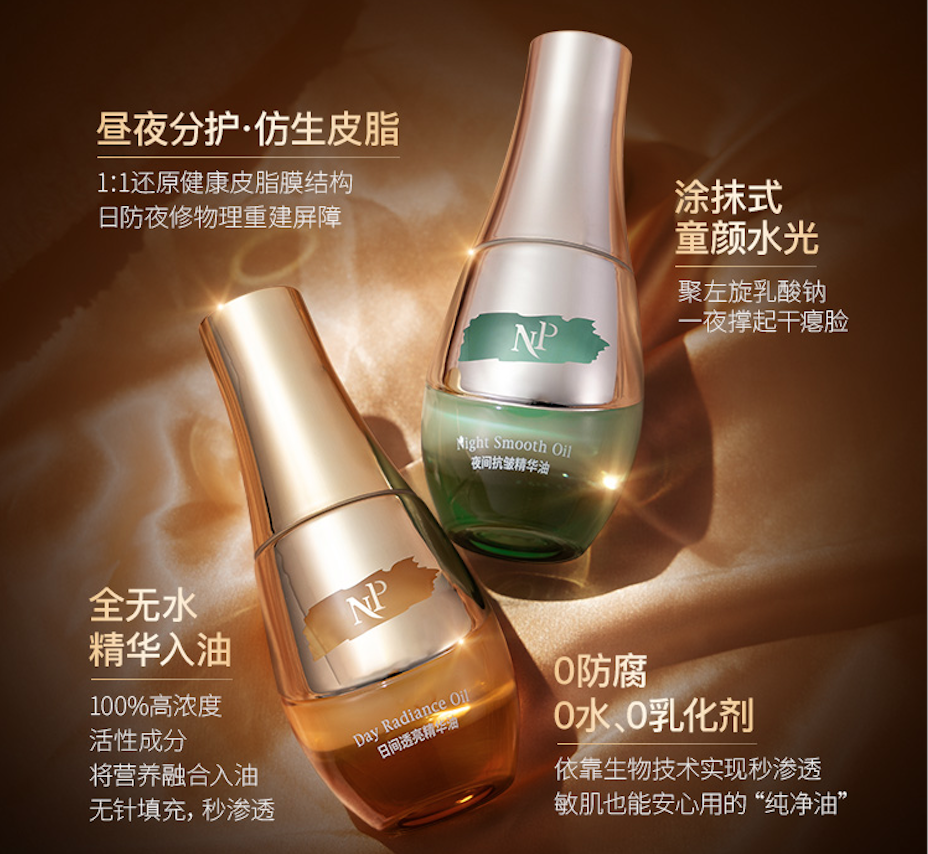
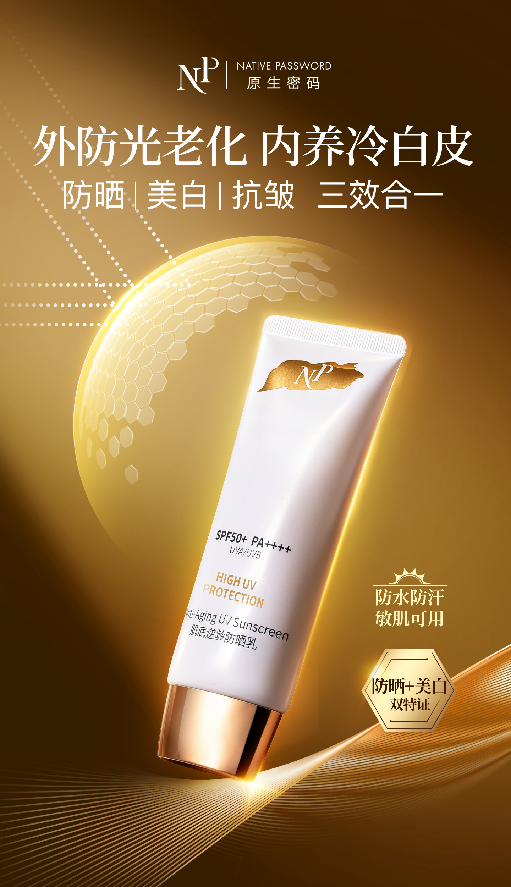
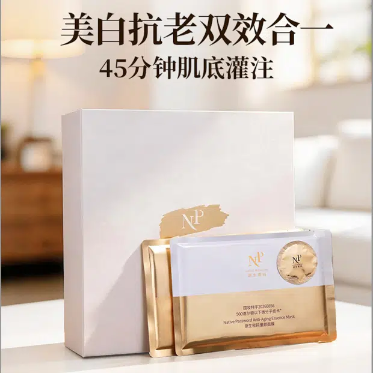
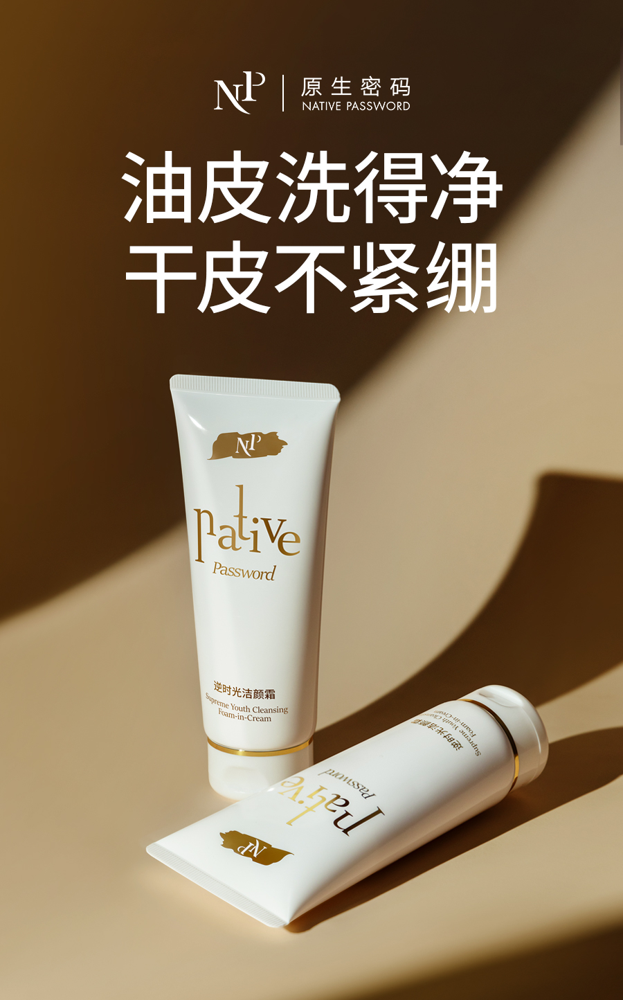

# 作品目录：内容 r4 提案

2026-11-02。复用本批五案的标题、摘要及职责，不建立另一份独立事实来源。

## 网页正文

### 作品与案例

从产品主张、短文案到活动与栏目，查看不同内容问题的处理方式。

#### 日夜精华油｜把共同特点，写进日夜场景

两瓶产品的共同主张、日夜差异，以及长文与不同视频讲述。

我的工作：卖点与文案、内容结构、视频脚本。

[查看完整案例](oil.md)

#### 酷狗音乐｜让粉丝兴趣有具体的参与入口

发糖机的参与内容、音效表达与晚安电台，呈现活动及持续运营。

我的工作：内容与活动策划、资源沟通、团队管理及统筹审核。

[查看完整案例](kugou.md)

#### 高客单防晒｜解释价格，也回应肤感顾虑

从历史价格问答到价值与肤感海报，再到人物视频的不同推进方式。

我的工作：卖点与内容策划、文案、海报内容线稿及视频脚本。

[查看完整案例](sun.md)

#### 童颜面膜｜让升级有理由，让讲述有承接

承接旧品认知，解释新版差异，再将内容放进人物故事与直播讲解。

我的工作：卖点与多渠道内容策划、文案及视频脚本；参与直播话术讨论并制定产品讲解内容。

[查看完整案例](mask.md)

#### 逆时光洁颜霜｜一句话回应两种使用顾虑

以清洁与洗后感受为主张，查看短文案、海报层级及完整长文。

我的工作：独立完成卖点提炼、整体内容策划与文案。

[查看完整案例](cleanser.md)

### 继续了解

[了解我的经历](about.md) · [查看简历](../../../portfolio-resume.pdf) · [邮件联系](mailto:beibiduo@163.com)

## 编辑依据与呈现说明

这是现有五个案例的紧凑入口，供从案例返回后继续选择。顺序与首页重点一致，不增加标签筛选、搜索、额外成绩或新项目。封面均为已有作品或既有组合预览，完整制作分工在案例中说明；目录不作为候选人独立视觉设计作品的证明。
