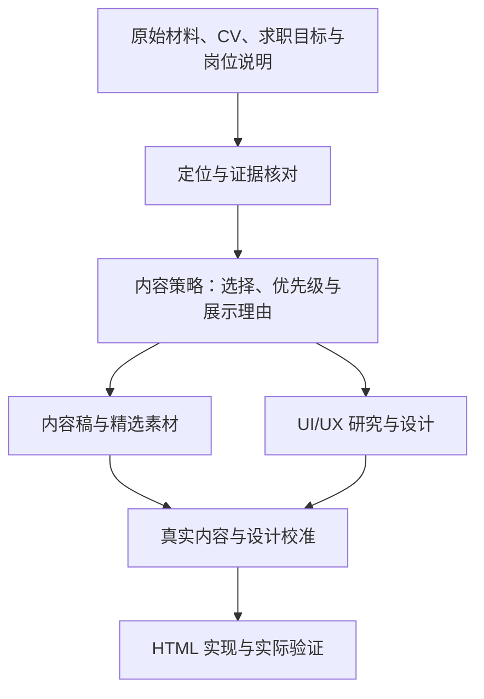

# 作品集制作 Pipeline

更新日期：2026-11-01。本文件是写作者、设计者和开发 agent 共用的制作方法，实际阶段与已完成成果见 [PROJECT](PROJECT.md)。

## 首要目标与内容质量

首要目标是让目标岗位的读者，通过真实、相关、清楚且有作品支持的内容，准确理解候选人的能力、个人贡献与适配程度，形成合理预期。内容包括定位、案例叙述、作品、图注与成果说明。pipeline、UI/UX 和代码都服务于这个目标，改进优先级按它对读者判断的作用确定。

| 内容是否合适 | 判断问题 |
| --- | --- |
| 与目标相关 | 这项内容回答了目标岗位读者的哪个问题，为什么值得优先展示？ |
| 真实且有依据 | 能力、职责和数字有何来源，个人贡献与团队成果是否清楚？ |
| 具体且有作品支持 | 能否看到实际问题、候选人的判断与行动，以及对应交付和结果？ |
| 主次清楚、容易理解 | 读者能否找到重点，正文、图注与作品是否相互解释，详略是否适当？ |
| 与本人经历相称 | 表达强度是否符合证据，候选人能否在面试中解释这些工作和判断？ |

内容稿能让读者说清“适合什么、具体做了什么、凭什么这样说”，核心主张有依据，重要待定项已标明，即可用于下一步校准。继续修改时指出具体改善哪项判断；当本次目标已满足、尚无新的明确问题时，结束本轮修改，把后续调整留给实际反馈。不另外设置评分表或审批步骤。

## 从什么推导到什么

围绕候选人的真实求职目标，以经历和作品能够支持的事实为基础，决定要证明哪些能力，再选择案例、叙事、优先级和展示形式，最后实现并验证网站。重要取舍要能说明“服务什么读者判断、依据什么材料”，不能只留下页面改动。

原始材料、网页内容稿、UI/UX 方案、HTML 是四类产物；上图是它们之间的制作关系。内容和 UI/UX 可以分别推进、相互修订，HTML/CSS/JS 及代码原型统一放在最后。按照当前任务范围推进，不因某一阶段已有产物就自动跨到后续阶段。

## 每一环怎样工作

| 环节 | 方法与取舍 | 留下什么成果 |
| --- | --- | --- |
| 1 定位与证据 | 确认 CV 版本、候选人意愿、主投方向及实际岗位说明；明确谁来看、需要判断什么、希望下一步做什么。对照已有作品核实能支持哪些能力 | 简短定位、能力与案例证据对应、待确认事实 |
| 2 内容策略 | 按岗位相关性、个人贡献清晰度、证据质量与能力覆盖选择案例；确定主次、阅读路径、详略和展示形式，说明采用与舍弃的理由 | 一页策略底稿，作为内容和 UI/UX 的共同输入 |
| 3A 内容研究与制作 | 针对明确缺口补研究，复用已有项目稿；把经历整理成读者能理解的判断、行动与作品证据，写正文、图注和按钮文字，选取素材并保留来源 | 页面内容稿、精选素材与说明 |
| 3B UI/UX 研究与设计 | 根据同一策略研究相关作品集；比较导航、信息层级、中文阅读、长图与手机呈现，用真实代表内容做非代码草图或设计稿 | 参考及借鉴理由、页面结构与视觉方案 |
| 4 内容与设计校准 | 用一个代表案例检查文案长度、证据位置、图文关系和浏览路径；通过轻量试读检验读者能否理解定位、个人贡献与作品证据 | 相互匹配的内容稿与设计方案；修订直接回原稿，无需另写审批文档 |
| 5 HTML 实现与验证 | 将内容稿和设计方案接入现有 HTML/CSS/JS；检查内容一致性、资源引用、桌面与手机阅读及实际交互，再按正常 PR 流程交付 | 可运行的网站改动、验证结果及实际交付状态 |

这些是任务依据，不是逐环签字的审批程序。允许一个代表案例先走通再扩展，不要求全站文案或全部历史资料先达到完整状态。

## 内容策略怎样推导

- CV 提供履历和能力主张，求职意愿与岗位说明提供选择视角，原始作品及本人确认提供事实依据。目标指导选材，证据也可能要求收窄主张或调整定位。CV 需要核对；来源冲突保留待确认项，不自动采用更大的数字或更强的职责表述。
- 先把“想证明的能力 → 适合的案例 → 个人做出的判断与行动 → 可展示的作品／成果及来源”连起来，再决定案例顺序。材料不足时补事实、换案例或收窄主张，不用润色代替证据。
- 每个主要模块先回答一个读者问题，例如“为什么适合这个岗位”“这件事具体由谁完成”“作品如何体现这项能力”。与这些问题无关的材料可以留在资料库。
- 优先级由相关性、证据和代表性共同决定；案例不必一样长，也不必展示全部素材。相似能力已有充分证据时，新增案例应有明确补充价值。
- 展示形式与证据相配：需要说明策划判断的地方用简洁分析配原作品；需要看细节的地方选取清楚片段并提供完整原稿入口；重要信息准备可读文字与图注。具体布局由 UI/UX 线验证。

例如，偏产品内容的目标可能更需要卖点判断与内容落地证据，偏运营的目标可能更需要活动机制和用户行为证据。这是选择方法的示例，不预先替本项目决定目标岗位或案例排名。岗位改变时先调整策略与受影响模块，事实口径保持一致。

## 不同展示版本与同版迭代

针对不同岗位或面试可以选择不同内容重点，原始事实与素材共用；同一展示版本的后续修改由 Git 提交记录，重要投递或评审节点固定下来。旧版可查阅、比较和恢复，不用“最终版／最终修改版”等文件副本替代版本记录。具体文件位置、保留方式与原站基线统一见 [版本记录](VERSIONS.md)。

## 研究和文件保持轻量

研究围绕具体问题进行，简要记录来源、结论和它影响的内容／设计决定。同行参考要说明适用性；求职与自由职业获客、中文长文与英文短文的需求可能不同。研究到足以支持当前取舍即可，未解决问题明确保留。

| 资料或产物 | 位置与写法 |
| --- | --- |
| 原始材料与已有整理 | 沿用 `portfolio-content/`、其素材目录及仓库其他原件；现有 CV 为 `portfolio-resume.pdf`，是否最新需在实际任务中核对。原件、历史项目稿和后期分析分别识别，不批量搬动 |
| 共同策略底稿 | 按需建立 `content/brief.md`，写目标读者与方向、希望形成的判断／行动、能力与案例证据、取舍理由及待确认项；控制在一页左右 |
| 网页内容稿 | 按需建立 `content/home.md`、`content/about.md`、`content/projects/案例.md`；每页写模块顺序、标题正文、图注与链接文字、素材路径和来源。结构草稿与最终视觉排版分开 |
| UI/UX 成果 | 按需建立 `design/`，保存参考比较、设计理由与草图／设计稿。工具根据实际需要选择，不强制增加一套设计工具 |
| 网站实现 | 沿用现有 `index.html`、JS、CSS 与资源目录。内容稿作为本轮表达依据，代码内容与之同步；迁移前的既有页面仍按现有方式维护 |

本文件维护方法，[PROJECT](PROJECT.md) 维护当前阶段，[AGENTS](../AGENTS.md) 是 agent 入口，[COLLABORATION](COLLABORATION.md) 维护正常 GitHub 协作。只在真正开展相应任务时建立产物文件，不预建空目录或重复复制全部材料。

## 页面被指出有问题时，怎样回到对应环节

先把“这里不对”转成具体问题：读者看不懂什么、缺什么证据、哪里难读或哪个操作失败。以下是排查入口，不预设问题一定来自上游。

| 观察到的问题 | 优先检查 |
| --- | --- |
| 看不出候选人适合什么岗位，或重点与岗位不符 | 定位和内容策略 |
| 案例很多但重复，最有说服力的作品被埋没 | 案例选择、优先级与证据分配 |
| 个人贡献不清，数字或经历前后冲突 | 原材料、CV 与事实口径 |
| 内容太长、顺序难懂，图文没有解释关系 | 内容稿、叙事和信息结构 |
| 内容清楚但难扫读，手机长图细节难辨 | 素材呈现、UI/UX 版式，并检查实际实现是否还原设计 |
| 设计明确但浏览器显示错误、交互失效或加载异常 | HTML/CSS/JS、资源与实际运行环境 |

在原因对应的最小范围修改，并同步受影响的下游内容、设计或代码。不要求每个排版问题都重做定位，也不在纯视觉或技术问题上无限追溯。HTML 虽是最终实现产物，其可读性、交互与加载仍会影响展示效果，必须实际验证。

## 后续怎样使用

写作者或 agent 接手时先读本方法和当前项目状态，再按收到的任务范围工作。事实缺口只在确实影响判断时请本人确认，日常修改通过正常分支和 PR 共享；重要取舍留在策略稿、页面稿或设计说明中即可。

用代表案例检验这套方法；只有出现实际重复问题时再补充流程，避免方法维护本身占用过多制作时间。

## 已核查的参考入口

- [Catherine A. Ross：YSL／No7](https://www.catherinearosscopywriter.com/work/portfolio/beauty)：任务、创意表达与脚本／作品的组织方式。
- [The Beauty Copywriter](https://www.thebeautycopywriter.co.uk/)：行业定位与精选案例入口；自由职业获客场景需结合本项目求职用途判断。
- [W3C 图片指南](https://www.w3.org/WAI/tutorials/images/)：图片说明、图片中文字与复杂图像的替代文本要求。

上述是已有参考入口，具体内容策略和视觉方案需结合目标、材料及当前任务判断，不因某个案例可参考就视为方案已经确定。
