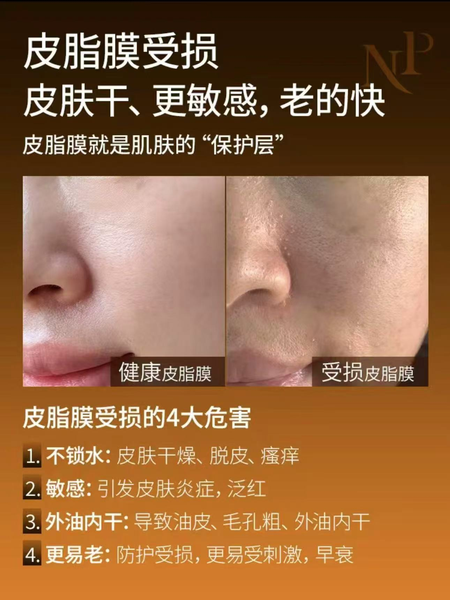
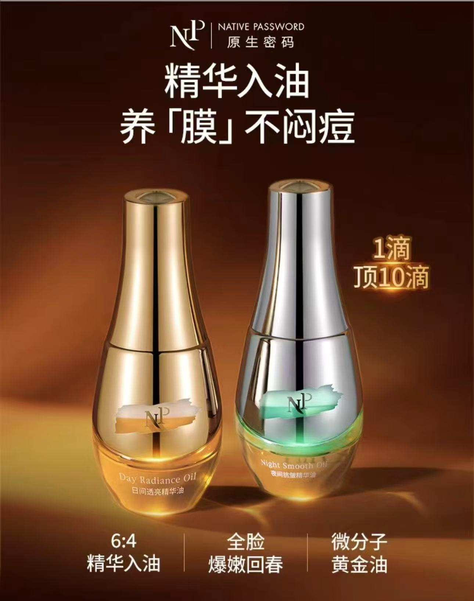

# 日夜精华油｜新品卖点提炼与私域内容策划

更新时间：2026-10-27  
内容状态：已补充25页公众号全文；本案例按完整主案例呈现，清晰视频后续可替换。  
项目角色：产品内容策划／文案  
推广渠道：私域；现有作品包括公众号、朋友圈及视频号内容

## 项目概述

围绕原生密码日夜精华油的私域上市，我负责从零梳理产品卖点，将“皮脂膜修护”“精华入油”及日夜护理场景组织成统一的内容表达，并延展为公众号、销售朋友圈图文、销售客服话术及明星／达人视频脚本，为新品介绍与销售沟通提供内容支持。

**项目结果：日夜精华油产品／套组上市两周，私域GMV达到460万＋。** 该结果由团队与私域渠道共同完成，不单独归因于个人内容或某条作品。

## 1. 项目背景与我的职责

品牌已确定日用、夜用两瓶的产品方案，需要进一步明确消费者为什么关注这款油、怎样理解产品特点，以及两款产品如何放进早晚护理场景。

我的工作从产品信息出发：参与成分与卖点讨论，筛选适合对外解释的信息，完成卖点提炼及不同形式的内容撰写。

| 由我负责 | 团队协作 |
| --- | --- |
| 产品卖点梳理，参与成分与沟通重点讨论 | 配方研发、产品规格、定价和包装设计由相关团队负责 |
| 公众号标题、正文、配图文案与版式规划 | 设计师根据内容方案制作图片 |
| 朋友圈配文、图片文案及信息顺序策划 | 设计师负责视觉设计与排版 |
| 销售客服话术，达人卖点提纲、完整脚本及初稿修改 | 视频拍摄、剪辑及明星商务不计入已确认的个人贡献 |
| 刘晓庆精华油推广、品牌皮脂膜科普脚本独立撰写 | 达人合作中结合账号风格及平台发布要求沟通调整表达 |

## 2. 内容策略：把产品资料转化为消费者能理解的理由

### 从“皮脂膜”建立理解入口

围绕产品修护抗老的沟通方向，将“皮脂膜护理”作为内容切入点。从干燥、紧绷、上妆卡粉等容易识别的护理困扰进入，用“保护层”的类比帮助读者理解概念，再连接精华油的滋养与修护表达。

这一处理让成分信息有了具体的讲述顺序：先解释关注什么，再介绍产品如何围绕这一方向展开。

### 用“表补油，里补精华”概括产品特点

结合精华与油相的产品信息，提炼“表补油，里补精华”的记忆表达，将较复杂的资料压缩为适合标题、朋友圈短文及视频口播反复使用的一句话。

这是一句产品沟通表达；具体介绍落回油脂滋养与精华护理结合的特点，不将“表、里”写成已经证实的皮肤分层作用机制。

### 将日夜双瓶写成使用场景

在既定日夜产品方案下，分别梳理日间透亮护理与夜间修护、抗皱护理的沟通重点，让消费者从“有两瓶”进一步理解两款产品在早晚护理中的不同角色。

个人贡献在于两款产品的卖点表达与场景解释，产品规格及日夜方案由产品团队确定。

## 3. 公众号：让核心概念形成一篇完整的新品介绍

我独立完成文章标题、正文、配图文案及版式规划，设计师据此制作图片。现已补齐25页全文，文章发布日期为2025年12月26日，以PDF所载信息为准。

文章先以人物与护理困扰建立阅读入口，再将“皮脂膜”作为贯穿全篇的解释线索，依次组织概念、资料、精华入油结构和日夜区别。后部通过使用方式、套组和互动承接购买与反馈，让内容从为什么关注推进到怎样理解和选择。

| 阅读阶段 | 原文位置 | 内容组织与展示重点 |
| --- | --- | --- |
| 人物与需求 | PDF第1-6页 | 从人物外观与护理叙事进入，再用干燥、泛红、卡粉等具体问题连接核心概念 |
| 皮脂膜概念与资料 | 第7-12页 | 给专业概念安排统一解释入口，结合图内信息与分节标题展开 |
| 精华入油与产品结构 | 第13-14页 | 用产品结构、配比和分层信息展开产品特点，体现正文和配图的分工 |
| 日夜双瓶 | 第15-17页 | 从共同主线转到两款各自的沟通重点，组织早晚护理场景 |
| 体验与使用方式 | 第18-20页 | 通过效果诉求及使用图文，让产品信息进入具体护理动作；具体原图见全文 |
| 首发与互动 | 第21-24页 | 按方案组织正装、赠品、选择与互动信息，承接前文的产品理解 |

主展示选择产品结构、日夜差异和使用图文，配合正文节选，让读者看到如何把产品资料写成有顺序的长图文，而非只展示一张封面。

- [公众号25页全文](essence-oil/assets/wechat/oil-launch-article.pdf)
- [原文链接](https://mp.weixin.qq.com/s/lY5_fSiM1Bk8Cobkfq_2ug)
- [全文结构与图文分析](essence-oil/docs/wechat-analysis.md)
- [精选素材与展示顺序](essence-oil/selected-materials.md)

原文中的人物经历、技术与效果表达作为历史作品保留，分析关注内容组织，不将其改写成此次已核实的产品结论。

## 4. 朋友圈：将核心卖点拆成两类图文

朋友圈内容供销售进行产品介绍与种草沟通。我负责配套文字、图片上的文案及信息呈现顺序，设计师负责视觉设计与排版。

### 概念与需求：为什么关注皮脂膜

从日常护理困扰进入，用两张配图分别呈现问题场景与概念解释，让较专业的皮脂膜话题形成容易进入的阅读路径，为产品修护方向建立理解基础。

### 产品特点：为什么做“精华＋油”

以设问引出产品结构，通过短句提炼沟通重点；图片以“精华入油”为主标题，结合日夜双瓶及配比信息形成层次，让朋友圈配文与图内信息围绕同一卖点展开。

两组图文分别展示专业概念解释和产品特点提炼。此处按内容任务归类，不代表当时的真实发布顺序。当前已确认的朋友圈图文均纳入展示；首发活动的信息组织见公众号原文，不要求额外补充促销朋友圈。

## 5. 视频脚本：同一卖点，适配不同讲述方式

围绕皮脂膜护理与精华入油主线，将产品信息转化为品牌科普、人物推广、问题答疑和使用场景四种表达。

| 视频作品 | 脚本处理 | 体现的内容能力 |
| --- | --- | --- |
| [皮脂膜品牌科普](essence-oil/assets/videos/oil-sebum-education.mp4) | 从冬季干燥与清洁习惯的疑问进入，用生活类比解释皮脂膜，再引向油脂护理和原料信息 | 专业概念的通俗转化 |
| [刘晓庆精华油推广](essence-oil/assets/videos/oil-liuxiaoqing.mp4) | 从熟龄护理话题进入，将核心概念、精华入油及日夜产品区别融入人物讲述 | 人物口吻与产品信息的衔接 |
| [达人问题答疑](essence-oil/assets/videos/oil-influencer-qa.mp4) | 用疑问、回应及反问展开，逐步带入皮脂膜、产品与日夜场景 | 对话式脚本组织 |
| [达人使用场景](essence-oil/assets/videos/oil-tutorial.mp4) | 用三个方法段落组织使用场景、步骤与动作画面 | 将产品信息转化为演示内容 |

四条脚本均由我撰写，其中刘晓庆推广与品牌科普脚本独立完成。达人合作中，根据账号风格和平台发布要求沟通调整讲述方式与措辞。

逐段内容及分析见[四类视频脚本拆解](essence-oil/docs/video-analysis.md)。现有成片用于说明脚本内容，不据此认定四条属于同一发布排期，也不将拍摄、剪辑或商务职责计入个人贡献。

## 6. 销售沟通：把卖点转化为可解释的问题

原项目中负责销售客服话术，将产品信息组织为概念解释、日夜区别、肤感顾虑和使用方式等沟通内容，让销售介绍有明确的信息顺序。

历史原稿未保留。附录为依据现有资料重建的展示稿，以“皮脂膜是什么？”“为什么分日夜？”等问题呈现内容方法，不作为当年交付原稿或真实客户对话。

## 7. 项目结果与内容复盘

日夜精华油产品／套组上市两周，私域GMV达到460万＋。我在其中完成卖点梳理及公众号、朋友圈、销售沟通和视频脚本内容，为团队的新品传播与销售介绍提供支持。

这段工作的代表性在于：从产品资料中提炼出可持续展开的沟通主线，再根据长文、短图文、人物口播和客户问答的不同阅读／讲述方式调整信息层次，形成相互对应、适合各自使用场景的内容。

作品集按内容任务组织现有作品，能展示卖点提炼、图文策划和脚本适配能力。现阶段没有单条内容的销售归因数据，整体销售结果按团队与渠道成果呈现。

## 材料说明

图片与视频为历史作品展示，历史素材中的倍数、比例、功效及科普说法不作为本项目分析已经核实的科学结论。正文中的策略与复盘依据现有素材及已确认分工整理，不是历史策划案的逐字还原。

公开视频为已去除通知和外围界面的压缩预览版，画质较低。后续将由干净、清晰的成片或重新录屏替换；原始视频及更清晰处理副本仍保留在本地。25页公众号PDF保留全文、页序与文字版式，仅压缩内嵌图片供网页查阅；原始PDF保留本地。

---

[销售沟通重建稿与组织思路](essence-oil/docs/private-sales-reconstructed.md) · [完整查阅稿](essence-oil/精华油作品集内容.md) · [开发说明](essence-oil/developer-handoff.md)
