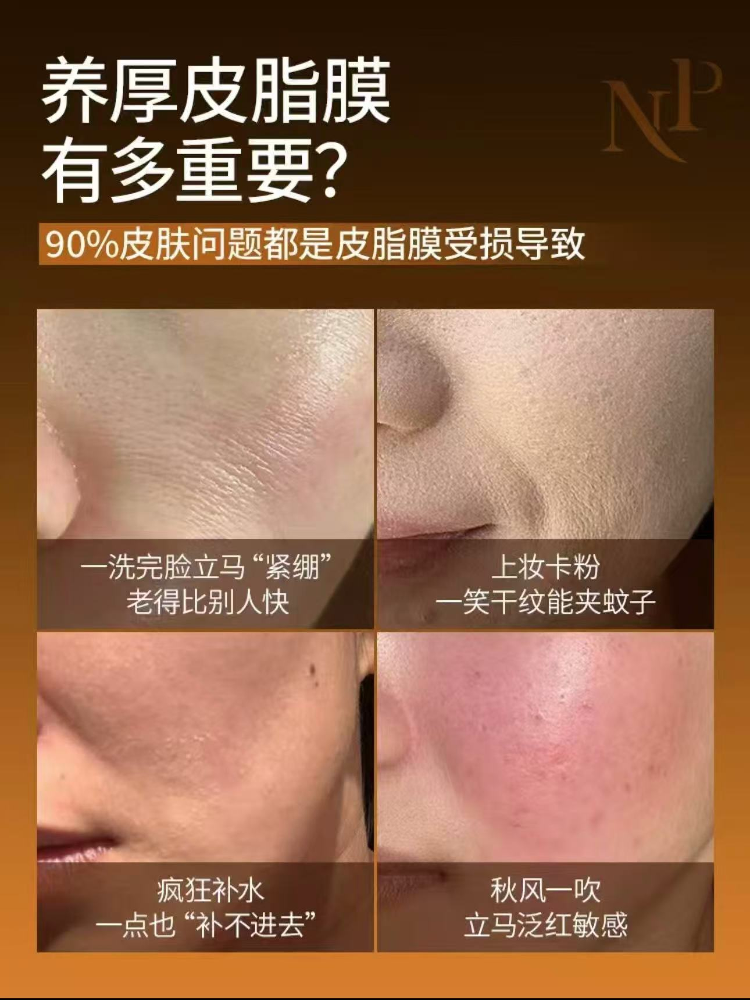

# 日夜精华油｜私域新品内容项目

更新时间：2026-10-14

**项目背景**

品牌推出日用、夜用两款精华油，通过私域渠道开展新品推广与销售。在产品规格及配方方案由相关团队确定的基础上，我负责从零梳理卖点，并完成公众号、私域种草、销售客服话术及达人脚本等内容。

**核心内容思路**

围绕产品“修护抗老”的沟通方向，将研发与配方信息整理为三个相互衔接的表达层次：

以“皮脂膜修护”建立产品理解入口，将油脂相关信息与消费者的滋养、修护需求连接；结合精华与油相的产品特点，提炼“表补油，里补精华”的记忆表达；再通过日间、夜间的不同使用场景，展开两款产品的沟通重点。

**代表性内容落地：新品公众号推文**

将文章组织为“需求切入—核心概念—产品特点—日夜区别—使用方法—首发活动”的阅读路径，从产品认知逐步承接到私域销售沟通。

其中，产品结构与日夜场景的介绍，承担解释卖点和使用方式的任务；活动部分根据既定销售方案组织信息。

**个人贡献**

负责产品卖点梳理及内容撰写，参与成分与卖点讨论，并将核心表达延展至私域种草内容、销售客服话术及达人种草脚本。独立完成公众号标题、正文、配图文案及版式规划，再交由设计同事制作成图。产品定价、规格、配方研发及包装设计由其他团队负责。

**项目结果**

日夜精华油产品及套组上市两周，私域 GMV 达到460万＋。

在项目中，我完成新品卖点梳理，并将核心表达延展至公众号、私域种草图文、销售客服话术及达人脚本，为新品上市传播和销售沟通提供内容支持。

销售数据为团队及私域渠道共同完成的项目结果，不单独归因于个人内容工作。

## 私域朋友圈图文

### 皮脂膜概念与护理需求

从干燥、卡粉、泛红等日常护理困扰切入，用“保鲜膜／保护层”的类比解释皮脂膜概念。通过问题场景与概念说明两张配图逐步展开内容，为后续介绍精华油的滋养、修护方向建立理解基础。

### 精华入油产品特点

以“为什么做精华＋油”的设问切入，将产品结构整理为简短的朋友圈介绍。配图以“精华入油”为主标题，结合日夜双瓶与配比信息承接文案，形成围绕同一卖点的图文表达，供销售用于产品沟通。

图片为历史内容成品，具体图内文案、排版与设计执行分工仍在整理。图中倍数、比例及效果表述仅作为历史作品展示，不作为本项目分析已验证的科学结论或传播效果数据。

## 视频脚本作品

本人负责以下四条视频脚本，其中刘晓庆推广和品牌科普脚本独立完成。原逐字脚本未保留，结构说明依据成片画面和字幕整理。拍摄与剪辑分工不归入已确认的个人贡献。

| 作品 | 内容任务 | 视频 |
| --- | --- | --- |
| 皮脂膜品牌科普 | 从季节现象解释概念，再引向油脂护理与原料 | [观看](oil-sebum-education.mp4) |
| 刘晓庆明星推广 | 将核心卖点写进第一人称人物讲述 | [观看](oil-liuxiaoqing.mp4) |
| 达人问题答疑 | 从护肤疑问进入产品与日夜区别 | [观看](oil-influencer-qa.mp4) |
| 达人使用场景 | 用三个方法段落组织使用内容 | [观看](oil-tutorial.mp4) |

逐段结构及分析见[视频脚本分析](video-analysis.md)。视频为已发布内容的录屏整理版，移除了通知、聊天及播放器外围界面，结尾重播部分已截去。保留内容中的字幕和资料不代表已经独立核验其中所有功效、专利和科普说法。

## 材料说明与整理状态

销售话术为基于原项目资料重建的展示稿，不作为历史原稿或实际客户对话记录。朋友圈创作说明及视频结构是作品集整理说明。促销／活动朋友圈案例待补充，图片执行分工待确认。后续仅在确定事实和素材范围后更新本稿。

## 销售沟通内容｜重建展示稿

基于原项目资料重建的展示稿

**一、了解客户需求**

您好，您现在更想改善干燥、肤色暗沉，还是细纹方面的困扰？目前有没有使用精华油的习惯？

如果客户表示干燥：

您平时是洗完脸容易紧绷，还是用了护肤品后仍然觉得不够滋润？我先了解一下您的日常护理，再给您介绍这套产品。

**二、简洁介绍产品**

这套日夜精华油结合了精华与油相护理，产品沟通重点是修护与抗老。

我们用“表补油，里补精华”来帮助理解：既关注油脂带来的滋养，也结合精华护理。它分为日间、夜间两款，日间侧重透亮护理，夜间侧重修护与抗皱护理。

**三、解释核心卖点**

**客户：皮脂膜是什么？**

可以把皮脂膜理解为皮肤表面的一层“保护膜”，主要由皮脂、汗液等共同形成，帮助保持皮肤滋润、减少水分流失。

这套精华油的油相设计参考了皮脂中的脂质组成，所以我们从皮脂膜护理的角度，介绍它的滋养与修护特点。

客户：“表补油，里补精华”是什么意思？

这是概括产品特点的一句表达。产品结合了精华与油相，油相承担滋养护理，精华部分提供配套护理。

这里的“表、里”是帮助记忆的说法，具体功效以产品确认的资料为准。

**四、解释日夜两款的区别**

客户：为什么要分早晚两瓶？

两款有共同的滋养、修护沟通主线，同时各有侧重：

日间透亮精华油侧重透亮与抗氧化护理；夜间抗皱精华油侧重修护与抗皱护理。分成两款，方便围绕早晚护理场景使用。

客户：必须两款一起用吗？

这套产品是按日夜搭配的方案推出的。您可以先告诉我现在使用的护肤品，我再根据品牌确认的使用说明，帮您了解怎样安排护理步骤。

**五、回应常见顾虑**

客户：精华油会不会很油？

这款结合了精华与油相，并非单一植物油。实际肤感会受到用量、肤质及搭配产品的影响。

如果您担心厚重，可以先了解质地或体验装，按照产品说明使用，观察是否适合自己。

客户：油性肌肤能用吗？

油性肌肤也需要结合具体状态判断。您目前主要是出油，还是同时伴有干燥、紧绷？

我会先核对品牌确认的适用肤质与使用说明，再给您建议。如果正在出现明显不适，建议先处理当前皮肤问题。

客户：用了多久能看到效果？

不同肤质和护理习惯，体验会有差异。可以先关注滋润度、肤感以及与现有护理的搭配情况。

抗皱等效果应以品牌的产品功效评价资料为依据，我们不会保证每个人在固定时间内出现相同变化。

客户：可以替代医美吗？

它是日常护肤产品。您可以根据自己的护理需求选择，我们主要介绍它在滋养、修护及抗皱护理方面的产品特点。

**六、介绍使用方式**

使用前按产品说明摇匀，让精华与油相混合，再按照规定用量和护理步骤使用。

如果您正在使用其他功效型产品，可以把产品名称告诉我，我先核对搭配说明，避免一次调整过多护理步骤。

**七、承接购买**

您刚才更关注的是________，这套产品可以重点从________这个方向了解。

如果您愿意，我可以把产品介绍、使用说明和当前活动信息一起发给您，您看清规格、价格和赠品后再决定。对肤感有顾虑，也可以先了解是否有体验装。

**八、使用后回访**

您好，想了解一下您最近使用日夜精华油的感受：质地是否习惯？日常护理后滋润度如何？有没有出现不适？

如果您愿意，也可以告诉我每次用量和搭配的产品，我帮您核对一下使用步骤。

## 三、销售话术策划思路｜从产品卖点到客户沟通

**沟通目标**

围绕日夜精华油的“修护抗老”方向，将研发资料中的产品信息转化为销售客服便于讲解的内容，帮助客户理解产品特点、日夜区别与使用方式。

**1. 先解释概念，再介绍产品**

“皮脂膜”是核心卖点中的理解门槛。如果直接讲成分和技术，客户可能难以理解这些信息与自己的护理需求有什么关系。

因此，从“皮脂膜是什么？”切入，用“皮肤表面的保护膜”帮助理解，再连接滋润、减少水分流失等作用，最后引出产品的油相设计与滋养、修护方向。

形成“概念解释—护理需求—产品特点”的讲解顺序。

**2. 用一句记忆表达概括产品特点**

将精华与油相结合的特点，提炼为“表补油，里补精华”，让销售能够简洁介绍，也方便客户记住。

在进一步解释时，落回“油脂滋养与精华护理结合”的产品特点，避免将传播语言延伸为未经证实的分层渗透机制。

**3. 把日夜双瓶转化为使用场景**

基于既定的日用、夜用产品方案，分别梳理日间透亮护理与夜间修护、抗皱护理的沟通重点。

让客户不仅知道有两款产品，还能理解它们在日常护理中的不同角色。个人贡献集中在两款产品的内容表达与场景解释。

**4. 围绕购买顾虑组织问答**

本次重建稿选取精华油沟通中可能遇到的问题，例如“会不会油腻”“两款有什么区别”“多久能看到效果”，分别回应肤感、使用安排与效果预期。

回答先提供客户需要的信息，再根据肤质、用量和现有护理情况补充说明，最后承接产品资料、体验或活动信息。

**代表性问答与内容任务**

| 客户问题 | 话术承担的任务 |
| --- | --- |
| 皮脂膜是什么？ | 降低专业概念的理解门槛 |
| “表补油，里补精华”是什么意思？ | 解释核心记忆点 |
| 为什么分日间、夜间两款？ | 说明产品区别与使用场景 |
| 精华油会不会很油？ | 回应质地与肤感顾虑 |
| 多久能看到效果？ | 说明效果差异，合理管理预期 |

**个人贡献与材料说明**

原项目中负责销售客服话术撰写，将产品卖点延展至客户沟通场景。因历史话术原稿未保留，本页为基于原项目资料重建的展示稿；问答及策划说明用于呈现内容方法，不作为当年原稿或实际客户反馈记录。
