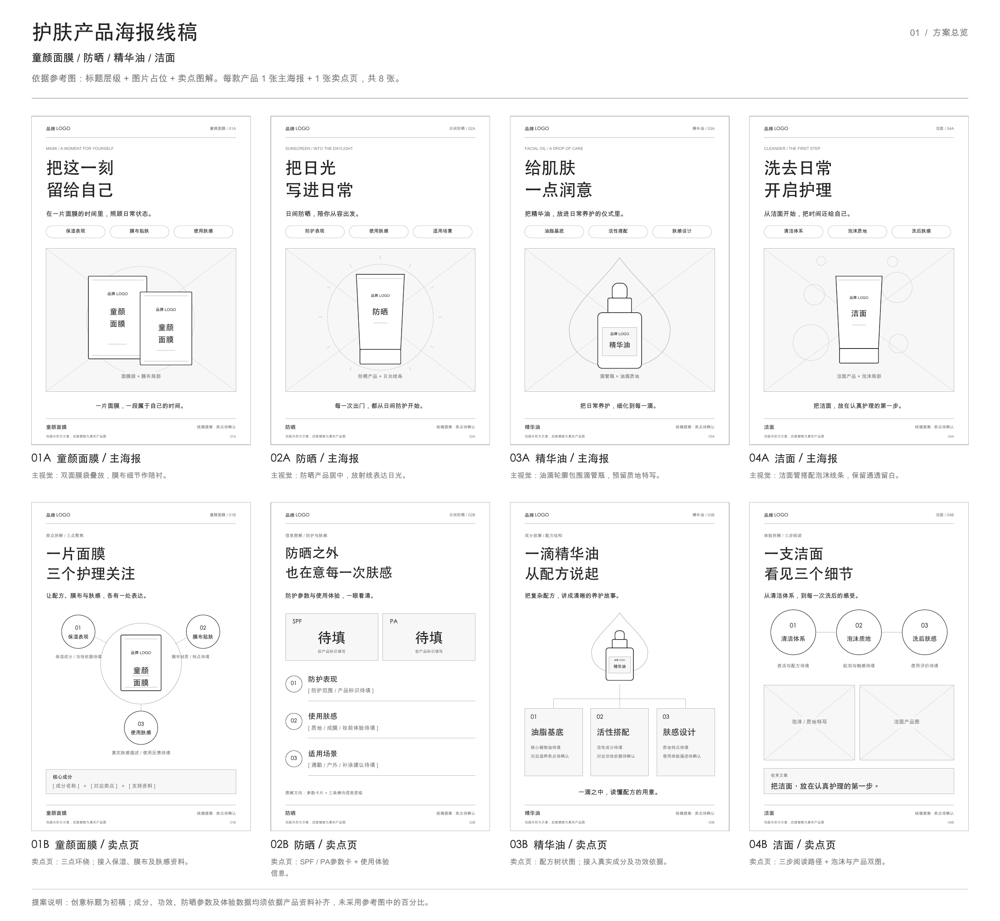

# 护肤四品类海报线稿

童颜面膜、防晒、精华油、洁面：每款 1 张主海报 + 1 张卖点页，共 8 张单页线稿，另附 1 张整组总览。

当前素材为创意线稿提案；产品轮廓与待填文案用于版式展示，后续展示页可据正式资料补充。

## 整组总览

## 素材索引

| 内容 | PNG 预览 | SVG 源文件 |
| --- | --- | --- |
| 00_整组线稿总览 | [PNG](png/00_整组线稿总览.png) | [SVG](svg/00_整组线稿总览.svg) |
| 01A_童颜面膜_主海报 | [PNG](png/01A_童颜面膜_主海报.png) | [SVG](svg/01A_童颜面膜_主海报.svg) |
| 01B_童颜面膜_卖点页 | [PNG](png/01B_童颜面膜_卖点页.png) | [SVG](svg/01B_童颜面膜_卖点页.svg) |
| 02A_防晒_主海报 | [PNG](png/02A_防晒_主海报.png) | [SVG](svg/02A_防晒_主海报.svg) |
| 02B_防晒_卖点页 | [PNG](png/02B_防晒_卖点页.png) | [SVG](svg/02B_防晒_卖点页.svg) |
| 03A_精华油_主海报 | [PNG](png/03A_精华油_主海报.png) | [SVG](svg/03A_精华油_主海报.svg) |
| 03B_精华油_卖点页 | [PNG](png/03B_精华油_卖点页.png) | [SVG](svg/03B_精华油_卖点页.svg) |
| 04A_洁面_主海报 | [PNG](png/04A_洁面_主海报.png) | [SVG](svg/04A_洁面_主海报.svg) |
| 04B_洁面_卖点页 | [PNG](png/04B_洁面_卖点页.png) | [SVG](svg/04B_洁面_卖点页.svg) |

## 后续展示页接入

- `png/`：原始分辨率预览图，可直接用于页面图片。
- `svg/`：矢量线稿源文件，保留文字、轮廓和占位框。
- `asset-manifest.json`：素材路径、原始文件名、尺寸与 Git blob SHA。

此目录作为作品集独立展示页的素材包。
