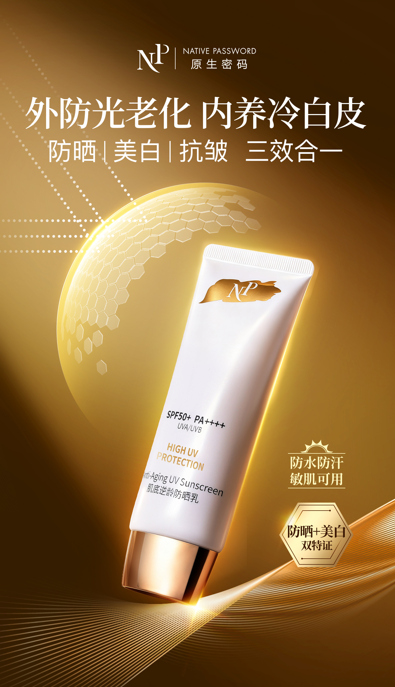
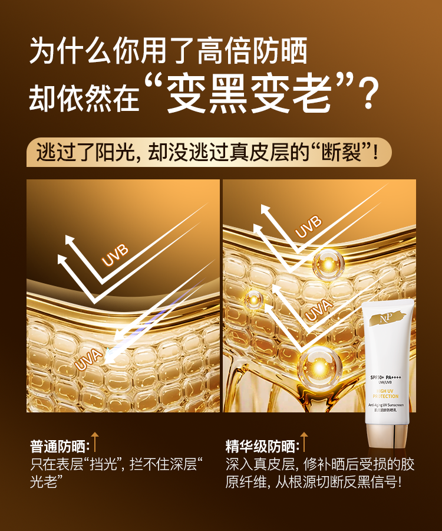
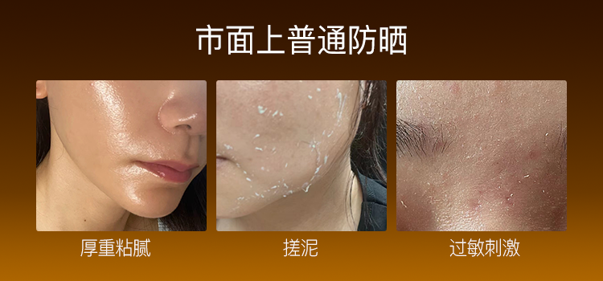
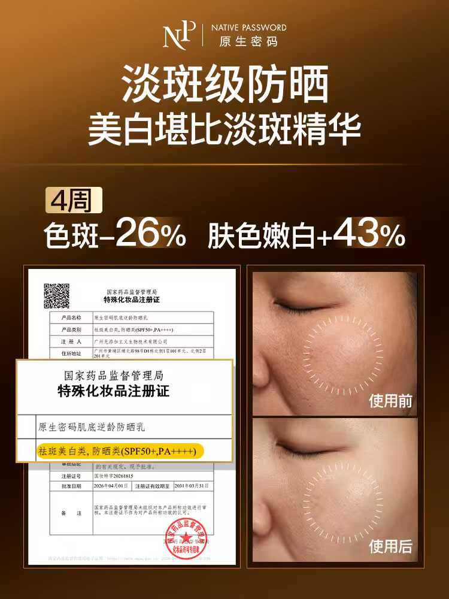
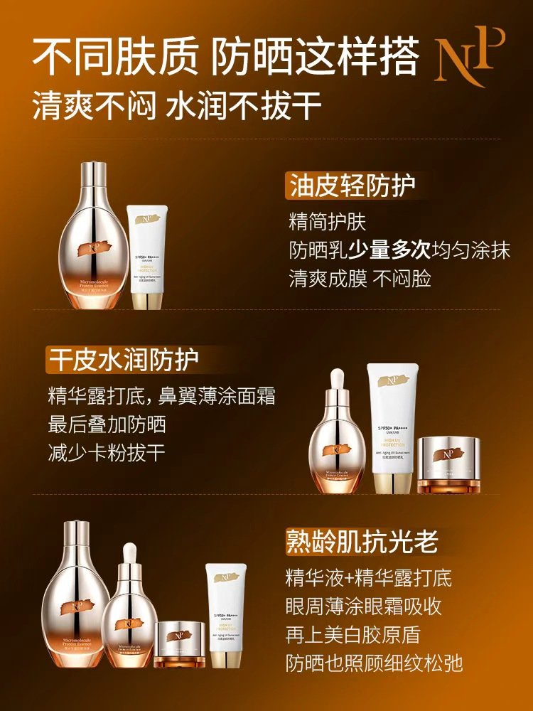

# 高客单抗老防晒｜从0到1建立购买理由与多渠道内容

如何让用户理解一支高价防晒的护理价值与轻薄体验。

产品：原生密码肌底逆龄防晒乳  
我的角色：产品卖点与内容策划／文案  
内容范围：公众号、朋友圈、私域销售话术、电商详情页、明星及达人视频脚本

## 项目概述

品牌计划推出高客单的高端抗老防晒。我从0到1完成产品卖点与内容策划，核心任务是建立差异化购买理由，回答用户最关心的两个问题：为什么值得这个价格，以及增加精华护理后，上脸体验是否仍然轻薄、自然。

我以防晒与美白抗老精华护理的结合建立价值主线，再用轻薄肤感、上脸观感和夏日使用场景回应顾虑。围绕这套主线，完成公众号上新文章、朋友圈图文、销售话术、完整详情页及四条明星／达人视频脚本，让不同形式的内容各自承担解释、种草、演示和销售沟通的任务。

**项目结果：防晒上新半个月，私域GMV 120万＋。**

以上沿用简历已披露口径，为参与内容策划项目的整体销售成绩，由团队与渠道共同完成。

*原详情页首屏：用总主张、三效合一和产品形象建立新品识别。本人负责内容策划与文案。*

## 1. 项目难点：护理价值需要讲清，肤感顾虑也要回应

高客单定位在项目开始时已经确定。内容需要让消费者理解，产品的价值如何从防晒延伸到美白、抗老和滋养，并将这些信息组织成容易理解、便于销售复述的理由。

护理价值越丰富，也越容易引出新的使用疑问。客户在意的不只有价格，还会问：加入精华会不会很厚重？上脸会不会假白？是否容易搓泥、影响后续底妆？

因此，我把内容任务组织为三个连续的问题：

| 用户的问题 | 我的策划处理 | 主要承接内容 |
| --- | --- | --- |
| 为什么贵，和其他防晒有什么区别？ | 用防晒与美白抗老精华护理的组合建立价值参照，再分主题解释成分与技术信息 | 核心卖点、公众号、价格话术、视频 |
| 加入精华，会不会厚重、闷或搓泥？ | 将轻薄肤感独立写成购买理由，安排质地、推开、成膜与上妆的表达 | 公众号肤感段、详情页、视频演示 |
| 上脸是否自然，怎样放进日常护理？ | 区分即时观感与护理诉求，连接不同肤质、夏日外出及妆前使用场景 | 朋友圈搭配图文、话术、使用场景视频 |

## 2. 我的职责与代表交付

我独立完成产品卖点与内容体系的建立，并将其延展到五类内容触点。

| 工作 | 代表交付 | 体现的策划动作 |
| --- | --- | --- |
| 卖点与沟通主线 | 防晒与精华护理的组合表达，护理价值与轻薄体验的主次安排 | 提炼购买理由，建立卖点层次与记忆表达 |
| 公众号 | 一篇完整上新长文 | 组织需求、产品价值、资料、使用体验和首发购买信息 |
| 朋友圈 | 三组原始图文 | 将资料说明、精华价值与肤质搭配拆为单主题内容 |
| 私域销售话术 | 产品介绍、需求介绍与异议回应资料 | 支持一对一沟通、群内上新和销售培训 |
| 电商详情页 | 一版完整长图的文案与内容结构 | 安排首屏利益、分模块解释、使用体验和商品查阅信息 |
| 视频脚本 | 两条明星合作、两条达人视频 | 将同一卖点转为人物口吻、疑问、故事和使用动作 |

本案例的个人贡献为产品卖点、文案、内容结构及视频脚本策划。

## 3. 核心策略：用精华护理解释价值，用轻薄体验承接选择

### 用一句话建立产品记忆

> 1支防晒半支精华，外防光老化，内养冷白皮。

这是当时的核心传播表达。它将消费者熟悉的防晒步骤与精华护理联系起来，为美白、抗老、抗氧及滋养等信息建立共同的讲述主线。

我的策划动作，是先确定消费者需要记住的购买理由，再安排技术与成分各自如何解释它。“半支精华”用于建立品类和价值联想，展开内容时分别落到具体的护理方向。

### 把轻薄体验放进高端价值

我将厚重、搓泥与假白列为需要回应的使用顾虑，让肤感拥有独立的内容篇幅。水感质地、成膜、自然光泽和底妆兼容等信息，分别通过图片、口语化话术和动作演示展开。

炎热夏日、海边是策划中强调的使用场景；现有成片则可以核对到户外、街头、通勤与上妆等画面。场景让用户能够想象产品怎样进入自己的日常护理，也让价值解释从成分介绍延伸到使用体验。

### 为不同触点安排不同的内容任务

| 触点 | 内容任务 | 组织方法 |
| --- | --- | --- |
| 公众号 | 完整解释新品为什么值得关注 | 串联需求、护理价值、肤感与购买选择 |
| 朋友圈 | 一次讲清一个理由 | 用配文点题，图片集中展开价值、资料或搭配 |
| 私域话术 | 回应客户的具体疑问 | 根据价格、护理关注点和肤感顾虑选择信息 |
| 详情页 | 支持自主阅读与查阅 | 用分区标题组织产品利益、资料和商品信息 |
| 视频 | 让价值在人物和动作中被理解 | 用疑问、态度变化、使用演示与生活场景推进 |

## 4. 代表作品：从价值解释到实际使用

### 公众号：把护理价值和肤感顾虑组织成完整阅读路径

上新文章先亮出防晒、美白与抗老的组合定位，再从消费者对晒老、肤色变化的关注进入，分别展开护理成分、美白、成膜与肤感。价值解释之后，再接资料、人物反馈与首发套组信息。

我将正文用于设问、转折和段落衔接，配图则集中呈现对照、成分分组、使用困扰与购买选项。作品集精选“防护与护理对照”和“厚重搓泥顾虑”两个片段，展示文章如何先建立附加价值，再主动接住使用疑问。

*分别节选自原文PDF第5页和第19页；图内文字保留历史原作。*

[查看公众号全文](assets/wechat/sunscreen-launch-article.pdf)

### 朋友圈：把价值与用法拆成容易记住的单主题图文

三组朋友圈分别围绕美白检测信息、淡斑精华价值和不同肤质搭配展开。我用配文给出观看入口，图片集中解释一个主题，形成适合销售日常介绍和种草沟通的内容。

主展示选择“淡斑精华价值”和“按肤质搭配”两组：前者将产品连接到精华护理的价值参照，后者把产品带回具体护理步骤。两组分别说明为什么关注、如何理解使用安排。

[查看第一组资料说明及三组原文](docs/moments-analysis.md)

### 私域话术：把购买理由变成销售可以调用的回应

话术用于销售一对一发给客户、群内上新介绍和销售培训。我围绕实际问题组织介绍重点，让销售能够从客户的关注点进入，再选择护理价值、肤感或活动信息继续说明。

原稿中的两个代表切口：

> Q：价格怎么这么贵？外面一瓶防晒才一两百块。
>
> 姐，明白您的顾虑。但咱们这款真的不是普通的防晒，而是“防晒型的抗老美白精华”。

> 姐姐，夏天马上到了，是不是总觉得涂防晒又厚又闷，还容易泛白、和后续粉底搓泥？

第一处先接住价格顾虑，再用护理价值调整比较维度；第二处从可识别的使用问题进入，承接后面的质地、肤色观感和跟妆说明。这部分展示的是将产品资料转为客户听得懂、销售便于讲述的内容。

*以上节选自现有话术第37—39段及第29段，保留原有口语表达。*

[查看话术资料](assets/sales/private-sales-source.docx)

### 详情页：把购买理由组织成可自主查阅的信息结构

我负责完整详情页的产品文案与内容结构，以总主张和三效合一建立首屏认知，再分别展开防护、美白、抗皱滋养与使用感，后部补充检测、反馈和商品信息。

展示精选“美白成分分组”和“轻薄与肤感”两个模块：前者体现将复杂资料拆成主标题、步骤与成分说明，后者体现将质地、肤色观感和跟妆顾虑集中成独立主题。它们共同承接护理价值与日常体验两组购买理由。

[查看美白成分分组](assets/detail/detail-04.png) · [查看轻薄与肤感模块](assets/detail/detail-05.png) · [查看完整详情页](assets/detail/sunscreen-detail-full.jpg)

### 视频脚本：让购买理由进入人物的疑问与使用动作

四条视频共用高客单抗老防晒的价值主线，分别通过价格疑问、人物故事、资料讲述与使用体验组织内容。主展示选择两条具有不同内容入口的作品。

**李颖合作视频：从价格质疑到体验改观。**

以高价与宣传质疑建立冲突，人物先替观众提出疑问，再进入亲试、推开、上脸、上妆和户外场景。体验之后继续问原理，再连接技术、成分与推荐，让信息随着人物的问题逐步出现。

这条重点展示把购买顾虑写成情节、安排态度转折，以及让抽象卖点对应具体动作与场景的能力。

[查看李颖录屏](assets/videos/sunscreen-liying.mp4) · [查看逐段结构](docs/video-01-structure.md)

**达人录屏4：先呈现肤感，再展开防护与护理。**

从抗老需求和闺蜜试用进入，用挤出、推开、成膜、上脸和粉扑上妆依次承接不同的使用疑问。再以“你以为这就完了”切换到功能信息，补充防护与护理价值，最后连接活动邀请。

这条重点展示约72秒内的信息取舍、动作安排与转场设计，让轻薄和底妆兼容有可以观察的内容。

[查看达人录屏4](assets/videos/sunscreen-influencer-04.mp4) · [查看逐段结构](docs/video-04-structure.md)

| 更多视频案例 | 内容组织与展示重点 |
| --- | --- |
| [向海岚合作视频](assets/videos/sunscreen-xianghailan.mp4) | 从留下适合自己的选择观进入精简护肤，再通过外出、通勤和妆前打底回到不将就的生活态度，展示主题衔接与首尾呼应 |
| [达人录屏3](assets/videos/sunscreen-influencer-03.mp4) | 从选购标准与四位数价格疑问展开，在技术讲述后主动接住观众疑问，再转向成分，展示价值说明与信息切换 |

## 5. 项目成果与个人贡献

**项目整体表现：防晒上新半个月，私域GMV 120万＋。**

我的交付是从0到1建立产品的卖点与内容体系，围绕高客单定位形成护理价值和轻薄体验两组购买理由，并将它们落实到上新长文、单主题图文、销售回应、商品长页面和人物视频中。

这组作品体现了三个方面的能力：围绕既定商业定位提炼差异化价值；把成分、技术与使用体验组织为消费者能理解的表达；根据不同触点安排信息层次、人物口吻和使用场景，为新品传播与销售沟通提供内容支持。

项目GMV为团队及渠道共同完成的整体成绩。个人贡献以卖点策划与实际内容交付呈现。

---

素材与数据说明：成果沿用现有简历已披露口径。图内及视频中的技术、功效、价格和活动表达保留历史原作，案例说明聚焦内容策划方法。代表节选均可回查已归档来源。本文为作品集内容审阅稿；全量分析与素材入口见[防晒作品集内容](防晒作品集内容.md)。
