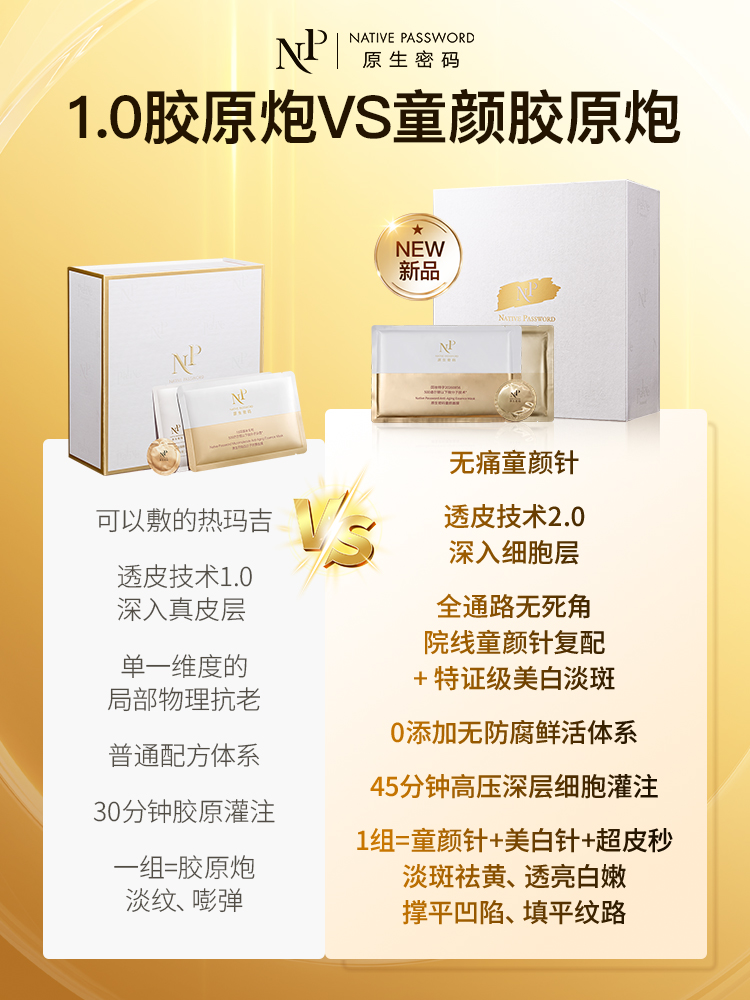
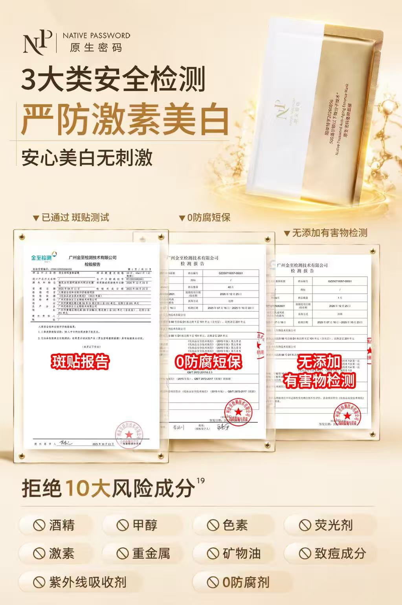
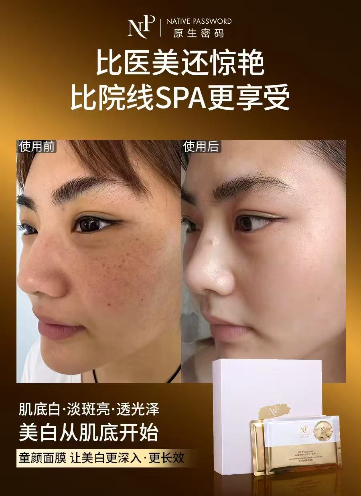

# 童颜面膜｜王牌产品升级卖点与多渠道内容策划

更新日期：2026-10-27。此稿为作品集内容与开发参考，依据项目本人确认的背景、职责、思路及现有作品整理。

## 项目概览

童颜面膜是在品牌镇店王牌胶原炮面膜基础上升级配料、增加美白淡斑方向的产品。开品最初回应抖音直播间对美白淡斑相关表达与资质的需求，产品开发后，按新品上市流程开展内容策划。

胶原炮已有成熟的用户教育和认知。我的任务是在承接旧品信任的基础上，为童颜面膜建立新的购买理由，并将这些理由转化为适合不同渠道的内容，支持用户理解升级价值、考虑选择新版。

## 我的职责

- 制定产品卖点，规划私域种草内容与销售话术。
- 独立完成公众号上新文章的标题、结构、正文、图内文案与文字排版方案。
- 负责朋友圈配文、图内文案及信息顺序。
- 完成一条明星合作推广和两条达人视频的完整脚本，并与达人沟通形成成片。
- 参与直播间话术讨论并制定讲解话术，非完整主播稿。
- 负责淘宝／天猫详情页的整页文案、内容结构与信息顺序。

公众号、朋友圈、详情页中的视觉设计制作由设计师完成。项目职责不包含已确认范围之外的拍摄、剪辑、商务、投放或直播运营。

## 项目难点：成熟旧品认知之上，建立升级购买理由

旧胶原炮的认知越成熟，童颜面膜越需要讲清自己的新增价值。内容既要解释继承关系，也要让用户有理由关注新版，理解从原有抗皱紧致护理到更多护理方向与体验的变化。

因此，我以新品上市的范围组织内容，同时将同价升级与老客选择作为卖点收束。这里描述的是当时的策划目标，不将其直接写成已实现的用户迁移结果。

## 六个卖点策划方向

以下记录当时的表达思路与策划动作；传播概念作为历史内容呈现。

| 方向 | 策划处理 | 内容作用 |
| --- | --- | --- |
| 科技价值 | 围绕重组胶原蛋白肽，以“万元童颜针”同源成分等概念组织科技卖点 | 建立新版的价值参照和科技印象 |
| 抗氧化教育 | 提炼“先停龄再抗老”，以漏水水桶一边漏水、一边加水的比喻解释护理思路 | 将成分资料转成容易记忆、便于讲述的观点 |
| 健康白 | 将美白淡斑、皮脂膜护理与品牌无添加、0防腐剂价值结合 | 回应用户追求美白效果时对刺激的顾虑，连接品牌认知与新增方向 |
| 居家护理体验 | 将45分钟敷膜组织为居家院线护理的体验叙事 | 为更长的使用时间赋予体验价值 |
| 透皮升级 | 延续旧品透皮技术认知，用进一步升级的技术故事解释新品差异 | 承接旧品认知并展开新版价值 |
| 同价升级 | 以一代胶原炮价格获得更多护理价值作为选择理由 | 将新增价值收束到老客对新版的考虑 |

“先停龄再抗老”及水桶比喻尤其适合展示卖点提炼能力：从配方信息中选择一个可传播的观点，再转成用户听得懂、销售讲得出的表达。

## 各渠道的内容分工

| 渠道 | 核心任务 | 内容组织方式 |
| --- | --- | --- |
| 公众号 | 建立完整新品认知 | 用长图文串联需求、产品特点、成分、护理组合与使用体验 |
| 朋友圈 | 拆解购买理由、分主题种草 | 升级差异、安心美白、效果诉求分别展开；配文提出观点，图片补充信息 |
| 明星／达人视频 | 通过人物与场景建立代入感 | 从片场状态、情绪困扰、夫妻日常等入口展开，找到自然的产品转场 |
| 直播间话术 | 降低理解门槛，支持实时购买判断 | 用新旧对比、生活化比喻、演示安排及互动提问组织讲解 |
| 商城详情页 | 集中呈现购买所需信息 | 按需求、升级、技术、组件、成分、资料与用法形成自主阅读结构 |
| 私域销售沟通 | 按个人关注点回应疑问 | 根据肤色、细纹、使用方式等关注点选择卖点、资料和使用说明 |

不同渠道可以使用同一核心卖点，展开方式随信息承载量及互动场景调整。这是内容分工，不将素材接收顺序写成真实排期，也不假定已建立可追踪的跨渠道转化路径。

## 代表作品一：公众号上新长文

我独立完成整篇内容，包含标题、全文结构、正文、图内文案及文字排版方案，设计师做图。

文章从护肤风险话题引入，连接无防腐工艺与新品特点，再展开双膜、45分钟护理、抗氧、美白、胶原护理和面霜，最后承接首发套组。它体现的是完整新品介绍与图文信息组织能力。

- [公众号全文PDF（网页查阅版）](assets/wechat/mask-launch-article.pdf)
- [原文章链接](https://mp.weixin.qq.com/s/br1rnY7m4sV6_7hGVMGlEw)
- [公众号详细分析](docs/wechat-analysis.md)

| 代表配图 | 展示重点 |
| --- | --- |
| [双膜结构](assets/wechat/01-dual-mask-structure.png) | 组件拆分、使用顺序与图内层次 |
| [美白成分与特证信息](assets/wechat/02-whitening-ingredients.png) | 成分与护理利益的分组说明 |
| [胶原护理成分](assets/wechat/03-collagen-ingredients.png) | 多组成分的信息归类 |
| [面霜护理收尾](assets/wechat/04-cream-step.png) | 将面霜纳入组合护理体验 |
| [首发套组](assets/wechat/05-launch-bundle.png) | 可选的销售承接内容 |

## 代表作品二：三组朋友圈图文

我的职责为配文、图内文案与信息顺序，设计师负责做图。以下保留实际原文和对应图片；展示编号不代表历史发布顺序。

### 1. 新旧升级差异

> 抗老不是越猛越好，  
> 关键是精准到达肌肤需要的位置✨  
> 透皮科技2.0升级  
> 开启细胞级抗老时代！  
> 更紧更嫩更白！

配文聚焦一个技术角度，海报通过新旧并列补充差异维度。两部分有主次，避免短文重复整张海报。

### 2. 安心美白与使用顾虑

> 美白可以很猛，  
> 但安全必须更稳✨  
> 3大类安全检测通过  
> 0防腐、0刺激、0风险成分  
> 这才是安心美白的底气！

以美白与使用顾虑的关系为切口，配图将报告和配方信息组织为同一主题，连接品牌的无添加价值。

### 3. 效果诉求与直观呈现

> 不用挨针流血，拉起断崖式垮脸！🔥  
> 45分钟无防腐细胞级灌注  
> 定点填充凹陷、洗净脏黄  
> 敷出豪门贵妇原生的净、透、亮！✨

用体验和外观利益形成鲜明记忆，配图提供直观观察对象。配文与图片的具体侧重点不同，分析关注其表达和组织方式。

[三组原文与详细分析](docs/moments-analysis.md)。

## 代表作品三：一条明星合作与两条达人视频

三条完整脚本均由我撰写。根据人物与表达方式，分别组织职业故事、个人使用体验和夫妻日常叙事，并在达人合作中沟通形成成片。

| 视频 | 叙事结构 | 素材 |
| --- | --- | --- |
| 骆达华合作推广 | 角色反差与片场状态 → 情绪“消耗” → 护理转场 → 居家使用与产品资料 → 首尾回扣 | [视频](assets/videos/mask-luodahua-preview.mp4) · [原链接](https://weixin.qq.com/sph/ABf1djMlJ) |
| 达人个人体验与双膜演示 | 情绪与外观困扰 → 护理安排 → 个人故事 → 产品资料 → 白膜25分钟与金膜20分钟演示 | [视频](assets/videos/mask-influencer-tutorial-preview.mp4) |
| 夫妻日常与产品查证 | 妻子研究面膜 → 调侃和怀疑 → 查看资料 → 逐步认可 → 新版美白方向与自我护理 | [视频](assets/videos/mask-influencer-story-preview.mp4) |

第二、三条原平台链接尚未提供，不影响查看本仓库视频。公开副本保留原时间轴，并处理个人通知及外围录屏界面；关键帧由该副本导出。

[视频展示稿](docs/video-case.md) · [逐段拆解](docs/video-analysis.md)

## 代表作品四：直播间产品讲解话术

我参与话术讨论并制定产品讲解内容。现有素材是主播实际表达的文字记录截图，不是我的完整历史交付稿。

作品重点在升级与产品讲解：从皱纹、松垮及肤色问题带出新版需求；用葡萄与葡萄干帮助观众形成饱满和干瘪的直觉；用头发丝等熟悉事物承接抽象数字；安排猪皮对照演示与观察提示，让观众跟上讲解。之后再接护理步骤、产品资料与下单说明。

- [升级讲解截图](assets/live/product-01.png)
- [葡萄比喻截图](assets/live/product-02.png)
- [演示及尺度解释截图](assets/live/product-03.png)
- [完整11张截图与分析](docs/live-analysis.md)
- [后期整理的SOP图](assets/live/sop-with-order-guidance.png) · [可编辑PPTX](assets/live/sop-with-order-guidance.pptx)

SOP是根据截图后期整理的结构示意，不能称为当年原始方案。价格与套组按历史直播情境理解。

## 代表作品五：淘宝／天猫详情页

我负责整页文案、内容结构与信息顺序，设计师负责视觉制作。页面将需求引入、新旧对比、技术及组件、成分分组、支持材料和使用方法组织为连续阅读，方便用户自主了解和比较。

- [第一张完整长图](assets/detail/detail-01.jpg)
- [第二张完整长图](assets/detail/detail-02.jpg)
- [详情页案例说明](docs/detail-case.md)
- [内容结构分析](docs/detail-analysis.md)

作品集中优先节选新旧对比、护理组件和成分分组，分别呈现差异解释、体验组织和复杂资料转译的能力。

## 私域沟通示例

历史上我负责销售话术制定。由于原稿未保留，本资料包另收录[基于产品资料重建的沟通示例](docs/private-sales-reconstructed.md)，用于说明需求了解、卖点选择、顾虑回应及使用指导的组织方法。展示该示例时保留“后期重建”标识。

## 项目成果

**童颜面膜上新GMV 100万+。**

2026年10月27日由项目本人确认，使用“上新”口径，不沿用旧网页的“首月”限定。该数字为项目及渠道共同完成的整体销售结果，不归因于单条内容或个人工作。

## 交付与能力总结

现有交付素材覆盖公众号、朋友圈、明星／达人视频、直播话术和商城详情页，并保留私域沟通重建示例。通过同一产品在不同场景的表达，体现卖点提炼、生活化解释、故事脚本、长图文结构及销售沟通内容策划。

当前没有已确认的单条内容成交归因或老客迁移比例，项目结果以可核对的作品与职责呈现。后续如有新增数据，可补充来源和适用范围。

## 开发入口

- [README与素材目录](README.md)
- [开发交接说明](developer-handoff.md)
- [结构化内容](content.json)
- [素材文件与校验清单](asset-manifest.json)

材料类型：历史原作、成片分析、后期整理说明、后期重建示例分别标注。平台规范审阅不在本资料包内。
